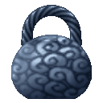

<!-- Generated by tools/build_pack_reference.py. Edit the pack sources and regenerate. -->

# Ton Ton no Mi

{ .entry-page-icon }

[Fruits](index.md) · [Missing Missing no Mi](../../reference/content/inomissing.md)

<!-- fruit inomissing:ton_ton_no_mi -->

| Stat | Value |
| --- | --- |
| Type | Paramecia |
| Tier | 2 |
| Fruit damage scaling | 1.00× at 10,000 Doriki → 2× at 50,000 Doriki |
| Abilities | 7 (7 active, 0 passive) |
| Fruit boxes | [Iron Box](../fruit-boxes.md) |

See [damage calculations](../combat-stats.md#damage-from-doriki).

!!! note "Reading the stats"
    Listed base damage is for the named part of the move. Pack and Doriki multipliers are shown separately. Times assume 20 ticks per second.

<!-- move inomissing:float -->

## Float

{ .entry-move-icon loading=lazy } *Active*

The user removes their weight and floats into the air, from where a Vise can be used. Using it again lets the user down and they take no fall damage when they land.

| Stat | Value |
| --- | --- |
| Min cooldown | 2 s (40 ticks) |
| Conditional cooldown | 20 s (400 ticks) |
| Pack multiplier when dealing damage | 1.3× |

<!-- move inomissing:vise -->

## Vise

*Active*

While in the air, the user becomes many tonnes heavy and falls straight down on the enemies below. The higher the fall the more damage it deals, landing on nobody hurts the user. The heavier the weight, the more damage in a bigger area, but the longer the cooldown. The two heaviest leave a crater.

| Stat | Value |
| --- | --- |
| Miss damage | 2 HP |
| Pack multiplier when dealing damage | 1.3× |

<!-- move inomissing:heavy_body -->

## Heavy Body

{ .entry-move-icon loading=lazy } *Active*

Makes the user very heavy, they take no knockback and less damage but moves slowly and can barely jump. Landing on enemies damages them. Floating turns it off.

| Stat | Value |
| --- | --- |
| Cooldown | 2 s (40 ticks) |
| Pack multiplier when dealing damage | 1.3× |

<!-- move inomissing:senton_knuckle -->

## Senton Knuckle

{ .entry-move-icon loading=lazy } *Active*

While on the ground, the user becomes 1000 tonnes heavy right when their punch lands, dealing heavy damage to the enemies in front of them and sending them flying.

| Stat | Value |
| --- | --- |
| Base damage | 22 HP |
| Cooldown | 10 s (200 ticks) |
| Pack multiplier when dealing damage | 1.3× |

<!-- move inomissing:hyakuton_stomp -->

## Hyakuton Stomp

{ .entry-move-icon loading=lazy } *Active*

While on the ground, the user becomes 100 tonnes heavy and stomps, creating a shockwave that damages all nearby enemies standing on the ground, launching them into the air and slowing them.

| Stat | Value |
| --- | --- |
| Base damage | 14 HP |
| Cooldown | 12 s (240 ticks) |
| Pack multiplier when dealing damage | 1.3× |

<!-- move inomissing:manton_tackle -->

## Manton Tackle

{ .entry-move-icon loading=lazy } *Active*

The user dashes forward with all their weight, damaging all enemies in their path and pushing them aside.

| Stat | Value |
| --- | --- |
| Base damage | 20 HP |
| Cooldown | 15 s (300 ticks) |
| Pack multiplier when dealing damage | 1.3× |

<!-- move inomissing:senton_press -->

## Senton Press

{ .entry-move-icon loading=lazy } *Active*

The user grabs the enemy in front of them, becomes 1000 tonnes heavy and falls on it, dealing heavy damage and pinning it to the ground for a few seconds.

| Stat | Value |
| --- | --- |
| Base damage | 26 HP |
| Cooldown | 20 s (400 ticks) |
| Pack multiplier when dealing damage | 1.3× |

