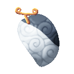
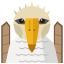
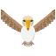
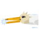
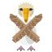

<!-- Generated by tools/build_pack_reference.py. Edit the pack sources and regenerate. -->

# Tori Tori no Mi, Model: Albatross

{ .entry-page-icon }

[Fruits](index.md) · [Missing Missing no Mi](../../reference/content/inomissing.md)

<!-- fruit inomissing:tori_tori_no_mi_model_albatross -->

| Stat | Value |
| --- | --- |
| Type | Zoan |
| Tier | 1 |
| Fruit damage scaling | 1.00× at 10,000 Doriki → 2.25× at 50,000 Doriki |
| Abilities | 6 (4 active, 2 passive) |
| Fruit boxes | [Wooden Box](../fruit-boxes.md) |

See [damage calculations](../combat-stats.md#damage-from-doriki).

!!! note "Reading the stats"
    Listed base damage is for the named part of the move. Pack and Doriki multipliers are shown separately. Times assume 20 ticks per second.

<!-- move inomissing:albatross_assault_point -->

## Albatross Assault Point

{ .entry-move-icon loading=lazy } *Active · Transformation*

Transforms the user into an albatross hybrid, which can fly for a very long time and still use weapons

| Stat | Value |
| --- | --- |
| Pack multiplier when dealing damage | 1.5× |

**Stats while transformed**

| Stat | Value |
| --- | --- |
| Movement speed | +15% of base |
| Maximum health | +15% |
| Punch damage | +3 HP |
| Armor | +4 |
| Step height | +0.5 blocks |
| Jump | +1.3 |
| Toughness | +2 |

<!-- move inomissing:albatross_fly_point -->

## Albatross Fly Point

{ .entry-move-icon loading=lazy } *Active · Transformation*

Transforms the user into a great albatross, which flies for a very long time, faster over water and in the rain, and can carry another player on its back

| Stat | Value |
| --- | --- |
| Pack multiplier when dealing damage | 1.5× |

**Stats while transformed**

| Stat | Value |
| --- | --- |
| Movement speed | +15% of base |
| Maximum health | +10% |
| Punch damage | +2 HP |
| Armor | +2 |
| Step height | +1 blocks |
| Jump | +1 |
| Toughness | +1 |

<!-- move inomissing:albatross_flight -->

## Albatross Flight

*Passive*

| Stat | Value |
| --- | --- |
| Pack multiplier when dealing damage | 1.5× |

<!-- move inomissing:albatross_rideable -->

## Albatross Rideable

*Passive*

Allows another player to ride on the albatross's back.

| Stat | Value |
| --- | --- |
| Pack multiplier when dealing damage | 1.5× |

<!-- move inomissing:albatross_beak_strike -->

## Beak Strike

{ .entry-move-icon loading=lazy } *Active*

The user throws themselves at the target and strikes it with their long beak, pushing it back

| Stat | Value |
| --- | --- |
| Base damage | 14 HP |
| Cooldown | 8 s (160 ticks) |
| Pack multiplier when dealing damage | 1.5× |

<!-- move inomissing:albatross_wing_wall -->

## Wing Wall

{ .entry-move-icon loading=lazy } *Active*

As a hybrid the user crosses their long wings in front of them. While it is held the hits from the front are much weaker and projectiles from the front are stopped. The user can't attack while guarding

| Stat | Value |
| --- | --- |
| Cooldown | 12 s (240 ticks) |
| Pack multiplier when dealing damage | 1.5× |

