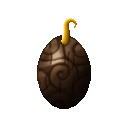
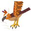
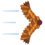
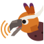

<!-- Generated by tools/build_pack_reference.py. Edit the pack sources and regenerate. -->

# Tori Tori no Mi, Model: Eagle

{ .entry-page-icon }

[Fruits](index.md) · [Missing Missing no Mi](../../reference/content/inomissing.md)

<!-- fruit inomissing:tori_tori_no_mi_model_eagle -->

| Stat | Value |
| --- | --- |
| Type | Zoan |
| Tier | 2 |
| Fruit damage scaling | 1.00× at 10,000 Doriki → 2× at 50,000 Doriki |
| Abilities | 7 (6 active, 1 passive) |
| Fruit boxes | [Iron Box](../fruit-boxes.md) |

See [damage calculations](../combat-stats.md#damage-from-doriki).

!!! note "Reading the stats"
    Listed base damage is for the named part of the move. Pack and Doriki multipliers are shown separately. Times assume 20 ticks per second.

<!-- move inomissing:eagle_assault_point -->

## Eagle Assault Point

{ .entry-move-icon loading=lazy } *Active · Transformation*

Transforms the user into an eagle hybrid, heavy and tough, which can fly and still use weapons.

| Stat | Value |
| --- | --- |
| Pack multiplier when dealing damage | 2.1× |

**Stats while transformed**

| Stat | Value |
| --- | --- |
| Movement speed | +10% of base |
| Maximum health | +30% |
| Punch damage | +8 HP |
| Armor | +7 |
| Step height | +0.5 blocks |
| Jump | +1.3 |
| Toughness | +3 |

<!-- move inomissing:eagle_fly_point -->

## Eagle Fly Point

{ .entry-move-icon loading=lazy } *Active · Transformation*

Transforms the user into a great eagle, which flies and can carry off its prey in its talons

| Stat | Value |
| --- | --- |
| Pack multiplier when dealing damage | 2.1× |

**Stats while transformed**

| Stat | Value |
| --- | --- |
| Movement speed | +25% of base |
| Maximum health | +20% |
| Punch damage | +7 HP |
| Armor | +4 |
| Step height | +1 blocks |
| Jump | +1 |
| Toughness | +2 |

<!-- move inomissing:eagle_flight -->

## Eagle Flight

*Passive*

| Stat | Value |
| --- | --- |
| Pack multiplier when dealing damage | 2.1× |

<!-- move inomissing:talon_strike -->

## Talon Strike

{ .entry-move-icon loading=lazy } *Active*

While in the air, the user dives at the target and strikes it with their talons with all their weight, pushing it back and slowing it

| Stat | Value |
| --- | --- |
| Base damage | 18 HP |
| Cooldown | 10 s (200 ticks) |
| Pack multiplier when dealing damage | 2.1× |

<!-- move inomissing:carry_off -->

## Carry Off

{ .entry-move-icon loading=lazy } *Active*

While in the eagle form, the user grabs the enemy under them with their talons and carries it off. Use the ability again to drop it.

| Stat | Value |
| --- | --- |
| Cooldown | 12 s (240 ticks) |
| Pack multiplier when dealing damage | 2.1× |

<!-- move inomissing:wing_gust -->

## Wing Gust

{ .entry-move-icon loading=lazy } *Active*

The user beats their great wings, throwing far back all enemies in front of them, projectiles are also sent back

| Stat | Value |
| --- | --- |
| Base damage | 5 HP |
| Cooldown | 12 s (240 ticks) |
| Pack multiplier when dealing damage | 2.1× |

<!-- move inomissing:screech -->

## Screech

{ .entry-move-icon loading=lazy } *Active*

The user lets out a piercing cry that shakes all enemies around them, slowing and weakening them for a moment

| Stat | Value |
| --- | --- |
| Cooldown | 20 s (400 ticks) |
| Pack multiplier when dealing damage | 2.1× |

