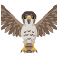
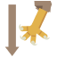
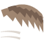
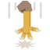
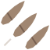

<!-- Generated by tools/build_pack_reference.py. Edit the pack sources and regenerate. -->

# Tori Tori no Mi, Model: Falcon

{ .entry-page-icon }

[Fruits](index.md) · [Missing Missing no Mi](../../reference/content/inomissing.md)

<!-- fruit inomissing:tori_tori_no_mi_model_falcon -->

| Stat | Value |
| --- | --- |
| Type | Zoan |
| Tier | 2 |
| Fruit damage scaling | 1.00× at 10,000 Doriki → 2× at 50,000 Doriki |
| Abilities | 11 (9 active, 2 passive) |
| Fruit boxes | [Iron Box](../fruit-boxes.md) |

See [damage calculations](../combat-stats.md#damage-from-doriki).

!!! note "Reading the stats"
    Listed base damage is for the named part of the move. Pack and Doriki multipliers are shown separately. Times assume 20 ticks per second.

<!-- move inomissing:falcon_assault_point -->

## Falcon Assault Point

{ .entry-move-icon loading=lazy } *Active · Transformation*

Transforms the user into a falcon hybrid, which can fly and still use weapons.

| Stat | Value |
| --- | --- |
| Pack multiplier when dealing damage | 1.7× |

**Stats while transformed**

| Stat | Value |
| --- | --- |
| Movement speed | +20% of base |
| Maximum health | +20% |
| Punch damage | +6 HP |
| Armor | +5 |
| Step height | +0.5 blocks |
| Jump | +1.5 |
| Toughness | +2 |

<!-- move inomissing:falcon_fly_point -->

## Falcon Fly Point

{ .entry-move-icon loading=lazy } *Active · Transformation*

Transforms the user into a big falcon, which flies fast and can carry another player.

| Stat | Value |
| --- | --- |
| Pack multiplier when dealing damage | 1.7× |

**Stats while transformed**

| Stat | Value |
| --- | --- |
| Movement speed | +40% of base |
| Maximum health | +10% |
| Punch damage | +5 HP |
| Armor | +2 |
| Step height | +1 blocks |
| Jump | +1 |
| Toughness | +1 |

<!-- move inomissing:falcon_flight -->

## Falcon Flight

*Passive*

| Stat | Value |
| --- | --- |
| Pack multiplier when dealing damage | 1.7× |

<!-- move inomissing:falcon_rideable -->

## Falcon Rideable

*Passive*

Allows another player to ride on the falcon's back.

| Stat | Value |
| --- | --- |
| Pack multiplier when dealing damage | 1.7× |

<!-- move inomissing:tobizume -->

## Tobizume

{ .entry-move-icon loading=lazy } *Active*

While in the air, the user dives at the target and slashes it with their talons.

| Stat | Value |
| --- | --- |
| Base damage | 12 HP |
| Cooldown | 8 s (160 ticks) |
| Pack multiplier when dealing damage | 1.7× |

<!-- move inomissing:tsukami_otoshi -->

## Tsukami Otoshi

{ .entry-move-icon loading=lazy } *Active*

While in the falcon form, the user grabs the enemy under them with their talons and carries it. Use the ability again to drop it.

| Stat | Value |
| --- | --- |
| Cooldown | 12 s (240 ticks) |
| Pack multiplier when dealing damage | 1.7× |

<!-- move inomissing:hane_arashi -->

## Hane Arashi

{ .entry-move-icon loading=lazy } *Active*

The user flaps their wings and pushes back all enemies in front of them. Projectiles are sent back too.

| Stat | Value |
| --- | --- |
| Base damage | 3 HP |
| Cooldown | 10 s (200 ticks) |
| Pack multiplier when dealing damage | 1.7× |

<!-- move inomissing:kyukoka -->

## Kyukoka

{ .entry-move-icon loading=lazy } *Active*

While in the air, the user dives straight down at very high speed, damaging all enemies around the impact and sending them flying. The higher the dive, the bigger the damage.

| Stat | Value |
| --- | --- |
| Min damage | 10 HP |
| Max damage | 20 HP |
| Cooldown | 15 s (300 ticks) |
| Pack multiplier when dealing damage | 1.7× |

<!-- move inomissing:kagizume -->

## Kagizume

{ .entry-move-icon loading=lazy } *Active*

While in the hybrid form, the user slashes the enemies in front of them a few times with their talons. The last slash sends them in the air.

| Stat | Value |
| --- | --- |
| Base damage | 4 HP |
| Cooldown | 11 s (220 ticks) |
| Pack multiplier when dealing damage | 1.7× |

<!-- move inomissing:hayabusa_no_me -->

## Hayabusa no Me

{ .entry-move-icon loading=lazy } *Active*

The user looks around with the eyes of a falcon. All living beings around them can be seen through walls for 10 seconds.

| Stat | Value |
| --- | --- |
| Cooldown | 30 s (600 ticks) |
| Pack multiplier when dealing damage | 1.7× |

<!-- move inomissing:hane_tsubute -->

## Hane Tsubute

{ .entry-move-icon loading=lazy } *Active*

The user flaps their wings and throws 4 sharp feathers where they are looking.

| Stat | Value |
| --- | --- |
| Base damage | 4 HP |
| Cooldown | 8 s (160 ticks) |
| Pack multiplier when dealing damage | 1.7× |

