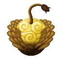
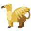
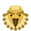
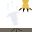
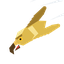
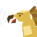
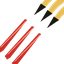

<!-- Generated by tools/build_pack_reference.py. Edit the pack sources and regenerate. -->

# Tori Tori no Mi, Model: Griffon

{ .entry-page-icon }

[Fruits](index.md) · [InoFruits](../../reference/content/inofruits.md)

<!-- fruit inofruits:tori_tori_no_mi_model_griffon -->

| Stat | Value |
| --- | --- |
| Type | Mythical Zoan |
| Tier | 3 |
| Fruit damage scaling | 1.00× at 10,000 Doriki → 1.75× at 50,000 Doriki |
| Abilities | 12 (9 active, 3 passive) |
| Fruit boxes | [Golden Box](../fruit-boxes.md) |

See [damage calculations](../combat-stats.md#damage-from-doriki).

!!! note "Reading the stats"
    Listed base damage is for the named part of the move. Pack and Doriki multipliers are shown separately. Times assume 20 ticks per second.

<!-- move inofruits:griffon_fly_point -->

## Griffon Fly Point

{ .entry-move-icon loading=lazy } *Active · Transformation*

Transforms the user into a griffon, which flies, can carry an ally on its back and focuses on mobility.

| Stat | Value |
| --- | --- |
| Pack multiplier when dealing damage | 1.6× |

**Stats while transformed**

| Stat | Value |
| --- | --- |
| Movement speed | +40% of base |
| Maximum health | +40% |
| Punch damage | +8 HP |
| Armour | +10 |
| Toughness | +4 |
| Jump | +1.2 |
| Step height | +1 blocks |

<!-- move inofruits:griffon_assault_point -->

## Griffon Assault Point

{ .entry-move-icon loading=lazy } *Active · Transformation*

Transforms the user into a griffon hybrid, which flies and focuses on strength and its talons.

| Stat | Value |
| --- | --- |
| Pack multiplier when dealing damage | 1.6× |

**Stats while transformed**

| Stat | Value |
| --- | --- |
| Movement speed | +20% of base |
| Maximum health | +30% |
| Punch damage | +12 HP |
| Armour | +8 |
| Toughness | +4 |
| Step height | +0.5 blocks |

<!-- move inofruits:talon_grab -->

## Talon Grab

{ .entry-move-icon loading=lazy } *Active*

Grabs the closest enemy in front of the user with the talons and carries it while flying for up to 4 seconds. The enemy is released if it hits the user. The grab misses if the enemy moves away or is guarding when the talons close. The user flies slower while carrying an enemy If there is no enemy in range, an ally who is crouching is carried instead for 10 seconds without taking damage, the ally can crouch again to be released.

| Stat | Value |
| --- | --- |
| Seize damage | 10 HP |
| Cooldown | 16 s (320 ticks) |
| Pack multiplier when dealing damage | 1.6× |

<!-- move inofruits:skydrop -->

## Skydrop

{ .entry-move-icon loading=lazy } *Active*

Throws down the enemy held in the talons. It takes damage when landing, the damage is higher the longer it fell, up to 12 blocks. An ally is released instead and takes no fall damage

| Stat | Value |
| --- | --- |
| Base damage | 16 HP |
| Max damage | 40 HP |
| Cooldown | 3 s (60 ticks) |
| Conditional cooldown | 0.5 s (10 ticks) |
| Pack multiplier when dealing damage | 2× |

<!-- move inofruits:diving_strike -->

## Diving Strike

{ .entry-move-icon loading=lazy } *Active*

The user dives where they are looking and crashes on everyone around the landing spot, the damage is higher the higher the dive started, up to 12 blocks.

| Stat | Value |
| --- | --- |
| Base damage | 16 HP |
| Max damage | 40 HP |
| Cooldown | 14 s (280 ticks) |
| Pack multiplier when dealing damage | 1.6× |

<!-- move inofruits:wing_gale -->

## Wing Gale

{ .entry-move-icon loading=lazy } *Active*

The user flaps their wings once, damaging and pushing back the enemies in front and sending projectiles back. While in the air it also pushes the user in the opposite direction, looking down launches the user up

| Stat | Value |
| --- | --- |
| Base damage | 12 HP |
| Cooldown | 10 s (200 ticks) |
| Pack multiplier when dealing damage | 1.6× |

<!-- move inofruits:lions_roar -->

## Lion's Roar

{ .entry-move-icon loading=lazy } *Active*

The user roars, damaging every nearby enemy and making them slow and weak for 5 seconds. The enemies hit by the roar can be seen by the user through walls for 10 seconds

| Stat | Value |
| --- | --- |
| Base damage | 10 HP |
| Cooldown | 20 s (400 ticks) |
| Pack multiplier when dealing damage | 1.6× |

<!-- move inofruits:rending_talons -->

## Rending Talons

{ .entry-move-icon loading=lazy } *Active*

Slashes the enemy in front of the user 3 times with the talons, the last slash makes it bleed.

| Stat | Value |
| --- | --- |
| Base damage | 9 HP |
| Bleed | 5 s (100 ticks) |
| Cooldown | 9 s (180 ticks) |
| Conditional cooldown | 0.5 s (10 ticks) |
| Pack multiplier when dealing damage | 1.6× |

<!-- move inofruits:hoard_guard -->

## Hoard Guard

{ .entry-move-icon loading=lazy } *Active*

Marks the chest or container the user is looking at as a hoard, up to 3 hoards. Anyone who opens or breaks one is slowed for 5 seconds and can be seen by the user through walls for a minute. Using it on a hoard again removes the mark, using it anywhere else shows where the hoards are. A fourth hoard replaces the oldest one

| Stat | Value |
| --- | --- |
| Cooldown | 3 s (60 ticks) |
| Conditional cooldown | 0.5 s (10 ticks) |
| Pack multiplier when dealing damage | 1.6× |

<!-- move inofruits:keen_eyes -->

## Keen Eyes

{ .entry-move-icon loading=lazy } *Passive*

While in either griffon form, enemies the user can see are highlighted from very far away.

| Stat | Value |
| --- | --- |
| Pack multiplier when dealing damage | 1.6× |

<!-- move inofruits:griffon_rideable -->

## Griffon Rideable

*Passive*

Allows other players to ride on the griffon's back.

| Stat | Value |
| --- | --- |
| Pack multiplier when dealing damage | 1.6× |

<!-- move inofruits:griffon_flight -->

## Griffon Flight

{ .entry-move-icon loading=lazy } *Passive*

Allows the user to fly while transformed by jumping twice.

| Stat | Value |
| --- | --- |
| Pack multiplier when dealing damage | 1.6× |

