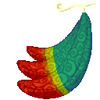
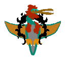
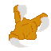
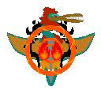

<!-- Generated by tools/build_pack_reference.py. Edit the pack sources and regenerate. -->

# Tori Tori no Mi, Model: Itsumade

{ .entry-page-icon }

[Fruits](index.md) · [Akuma no Mi](../../reference/content/akuma.md)

<!-- fruit akuma:tori_tori_no_mi_model_itsumade -->

| Stat | Value |
| --- | --- |
| Type | Mythical Zoan |
| Tier | 4 |
| Fruit damage scaling | 1.00× at 10,000 Doriki → 1.75× at 50,000 Doriki |
| Abilities | 7 (5 active, 2 passive) |
| Fruit boxes | [Noble Box](../fruit-boxes.md) |

See [damage calculations](../combat-stats.md#damage-from-doriki).

!!! note "Reading the stats"
    Listed base damage is for the named part of the move. Pack and Doriki multipliers are shown separately. Times assume 20 ticks per second.

<!-- move akuma:itsumade_fly_point -->

## Itsumade Fly Point

{ .entry-move-icon loading=lazy } *Active · Transformation*

Transforms the user into the nightmarish Itsumade

<!-- move akuma:itsumade_flight -->

## Itsumade Flight

*Passive*

<!-- move akuma:rage_beam -->

## Rage Beam

{ .entry-move-icon loading=lazy } *Active*

The user charges and launches an extremely explosive blast of flames at their opponents.

| Stat | Value |
| --- | --- |
| Cooldown | 17 s (340 ticks) |
| Base damage | 10 HP |

<!-- move akuma:talon_grab -->

## Talon Grab

{ .entry-move-icon loading=lazy } *Active*

The user snatches a target in their talons and carries them, crushing them over time.

| Stat | Value |
| --- | --- |
| Cooldown | 20 s (400 ticks) |
| Miss cooldown | 2 s (40 ticks) |
| Base damage | 4 HP |

<!-- move akuma:hurricane -->

## Hurricane

{ .entry-move-icon loading=lazy } *Active*

The user summons three massive tornadoes that hunt down and shred nearby targets.

| Stat | Value |
| --- | --- |
| Cooldown | 20 s (400 ticks) |
| Base damage | 3 HP |
| Pack multiplier when dealing damage | 0.4× |

<!-- move akuma:inferno_dive -->

## Inferno Dive

{ .entry-move-icon loading=lazy } *Active*

The user wreathes themselves in heat and flames and dives forward, exploding whatever they touch. Only emission haki can hurt the user during the dive.

| Stat | Value |
| --- | --- |
| Cooldown | 30 s (600 ticks) |
| Base damage | 30 HP |

<!-- move akuma:itsumade_night_vision -->

## Night Vision

*Passive*

Grants the user night vision.
