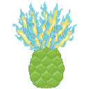

<!-- Generated by tools/build_pack_reference.py. Edit the pack sources and regenerate. -->

# Tori Tori no Mi, Model: Phoenix

{ .entry-page-icon }

[Fruits](index.md) · [Mine Mine no Mi](../../reference/content/mineminenomi.md)

<!-- fruit mineminenomi:tori_tori_no_mi_model_phoenix -->

| Stat | Value |
| --- | --- |
| Type | Mythical Zoan |
| Tier | 3 |
| Fruit damage scaling | 1.00× at 10,000 Doriki → 1.75× at 50,000 Doriki |
| Abilities | 9 (7 active, 2 passive) |
| Fruit boxes | [Golden Box](../fruit-boxes.md) |

See [damage calculations](../combat-stats.md#damage-from-doriki).

[Jump to awakening](#awakening)

!!! note "Reading the stats"
    Listed base damage is for the named part of the move. Pack and Doriki multipliers are shown separately. Times assume 20 ticks per second.

<!-- move mineminenomi:phoenix_assault_point -->

## Phoenix Assault Point

{ .entry-move-icon loading=lazy } *Active · Transformation*

Transforms the user into a half-phoenix hybrid, which focuses on speed and healing.

| Stat | Value |
| --- | --- |
| Pack multiplier when dealing damage | 2.85× |

<!-- move mineminenomi:phoenix_fly_point -->

## Phoenix Fly Point

{ .entry-move-icon loading=lazy } *Active · Transformation*

Transforms the user into a phoenix, which focuses on speed and healing.

| Stat | Value |
| --- | --- |
| Pack multiplier when dealing damage | 2.85× |

<!-- move mineminenomi:phoenix_goen -->

## Phoenix Goen

{ .entry-move-icon loading=lazy } *Active*

Launches high speed blue flames while midair.

| Stat | Value |
| --- | --- |
| Cooldown | 8 s (160 ticks) |
| Pack multiplier when dealing damage | 2.85× |

<!-- move mineminenomi:saisei_no_hono -->

## Saisei No Hono

{ .entry-move-icon loading=lazy } *Active*

Uses the blue flames to heal the target by hitting them. Using it while crouching will heal friendly entities around the user including the user themselves at the expense of a longer cooldown based on the number of healed entities.

| Stat | Value |
| --- | --- |
| Cooldown | 15 s (300 ticks) |
| Pack multiplier when dealing damage | 2.85× |

<!-- move mineminenomi:fujiazami -->

## Fujiazami

{ .entry-move-icon loading=lazy } *Active*

While midair, the user forms a protective swirl of fire in front of them capable of blocking most attacks.

| Stat | Value |
| --- | --- |
| Min cooldown | 4 s (80 ticks) |
| Max cooldown | 10 s (200 ticks) |
| Pack multiplier when dealing damage | 2.85× |

<!-- move mineminenomi:tensei_no_soen -->

## Tensei no Soen

{ .entry-move-icon loading=lazy } *Active*

While in the air, the user amasses spiraling flames, then slams into the ground, releasing a massive shockwave.

| Stat | Value |
| --- | --- |
| Cooldown | 30 s (600 ticks) |
| Base damage | 50 HP |
| Pack multiplier when dealing damage | 2.85× |

<!-- move mineminenomi:blue_bird -->

## Blue Bird

{ .entry-move-icon loading=lazy } *Active*

The user builds up momentum through blue flames, to deliver a devastating kick.

| Stat | Value |
| --- | --- |
| Cooldown | 10 s (200 ticks) |
| Base damage | 25 HP |
| Pack multiplier when dealing damage | 2.85× |

<!-- move mineminenomi:flames_of_regeneration -->

## Flames of Regeneration

{ .entry-move-icon loading=lazy } *Passive*

Protects the user and heals them back up when damage is taken, has an initial reserve of %s Energy which increases with time and decreses with each heal.

| Stat | Value |
| --- | --- |
| Max cooldown | 5 s (100 ticks) |
| Pack multiplier when dealing damage | 2.85× |

<!-- move mineminenomi:phoenix_flight -->

## Phoenix Flight

*Passive*

| Stat | Value |
| --- | --- |
| Pack multiplier when dealing damage | 2.85× |

## Awakening

**Source** · Awaken Awaken no Mi

| Stat | Value |
| --- | --- |
| Doriki | 40,000 |
| Active time with the fruit | About 24 hours (1,728,000 ticks) |

<!-- move awakenawakennomi:awaken_phoenix_assault_point -->

### Awaken Phoenix Assault Point { #awakening-awaken-phoenix-assault-point }

{ .entry-move-icon loading=lazy } *Active · Transformation*

Transforms the user into an awakened phoenix hybrid, which focuses on attacking

| Stat | Value |
| --- | --- |
| Cooldown | 0.5 s (10 ticks) |

**Stats while transformed**

| Stat | Value |
| --- | --- |
| Movement speed | +100% of base |
| Punch damage | +18 HP |
| Armour | +20 |
| Toughness | +8 |
| Step height | +1 blocks |
| Jump | +2 |

<!-- move awakenawakennomi:awaken_phoenix_fly_point -->

### Awaken Phoenix Fly Point { #awakening-awaken-phoenix-fly-point }

{ .entry-move-icon loading=lazy } *Active · Transformation*

Transforms the user into an awakened phoenix, which focuses on flying

| Stat | Value |
| --- | --- |
| Cooldown | 0.5 s (10 ticks) |

**Stats while transformed**

| Stat | Value |
| --- | --- |
| Toughness | +2 |
| Armour | +6 |

<!-- move awakenawakennomi:ao_no_rakka -->

### Ao no Rakka { #awakening-ao-no-rakka }

{ .entry-move-icon loading=lazy } *Active*

The user dives wrapped in blue flames hitting all enemies in the way, healing with each hit.

| Stat | Value |
| --- | --- |
| Cooldown | 30 s (600 ticks) |
| Base damage | 90 HP |

<!-- move awakenawakennomi:rebirth_blaze -->

### Rebirth Blaze { #awakening-rebirth-blaze }

{ .entry-move-icon loading=lazy } *Active*

The phoenix bursts into blue flames and floats in the air, nothing can hurt it until it comes back at full health. All the health it gets back explodes out as a nova that burns enemies around and heals allies.

| Stat | Value |
| --- | --- |
| Min damage | 40 HP |
| Max damage | 150 HP |
| Cooldown | 120 s (2400 ticks) |
| Conditional cooldown | 30 s (600 ticks) |

