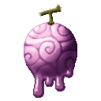
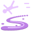

<!-- Generated by tools/build_pack_reference.py. Edit the pack sources and regenerate. -->

# Toro Toro no Mi

{ .entry-page-icon }

[Fruits](index.md) · [Missing Missing no Mi](../../reference/content/inomissing.md)

<!-- fruit inomissing:toro_toro_no_mi -->

| Stat | Value |
| --- | --- |
| Type | Logia |
| Tier | 3 |
| Fruit damage scaling | 1.00× at 10,000 Doriki → 1.75× at 50,000 Doriki |
| Abilities | 7 (6 active, 1 passive) |
| Fruit boxes | [Golden Box](../fruit-boxes.md) |

See [damage calculations](../combat-stats.md#damage-from-doriki).

!!! note "Reading the stats"
    Listed base damage is for the named part of the move. Pack and Doriki multipliers are shown separately. Times assume 20 ticks per second.

<!-- move inomissing:logia_invulnerability_toro -->

## Logia Invulnerability Toro

{ .entry-move-icon loading=lazy } *Passive*

Powder snow and freezing lock the user's liquid body in place, and it then lets every hit through. As a pool, an empty bucket or bottle used on the user shuts the user in a jar, no moving, no ability and no taking shape again.

| Stat | Value |
| --- | --- |
| Pack multiplier when dealing damage | 2.8× |

<!-- move inomissing:flow -->

## Flow

{ .entry-move-icon loading=lazy } *Active · Transformation*

The user becomes a pool of liquid that slides fast along the ground, under low ceilings and through one-block openings. Pressed against bars, a fence or a gate, the pool flows through it. The user takes shape again only where the body fits. As a pool the user cannot attack, only Geyser and Slick are used as a pool.

| Stat | Value |
| --- | --- |
| Cooldown | 5 s (100 ticks) |
| Pack multiplier when dealing damage | 2.8× |

<!-- move inomissing:liquid_blast -->

## Liquid Blast

{ .entry-move-icon loading=lazy } *Active*

The user shoots a jet of liquid where the user is looking, which hits the first enemy in its way and pushes it far back. The user shoots a thin jet of liquid under pressure that follows where the user is looking. It goes through enemies and keeps hitting all those on its line, without pushing them. Use the ability again to stop the jet.

| Stat | Value |
| --- | --- |
| Base damage | 12 HP |
| Cooldown | 4 s (80 ticks) |
| Jet damage | 6 HP |
| Jet cooldown | 14 s (280 ticks) |
| Pack multiplier when dealing damage | 2.8× |

<!-- move inomissing:great_wave -->

## Great Wave

{ .entry-move-icon loading=lazy } *Active*

The user sends a great wave of liquid in front of them, which hits all enemies in its path and sweeps them far away.

| Stat | Value |
| --- | --- |
| Base damage | 18 HP |
| Cooldown | 15 s (300 ticks) |
| Pack multiplier when dealing damage | 2.8× |

<!-- move inomissing:liquid_sphere -->

## Liquid Sphere

{ .entry-move-icon loading=lazy } *Active*

Traps the enemy the user is looking at inside a sphere of liquid, which holds it and drowns it.

| Stat | Value |
| --- | --- |
| Close damage | 2 HP |
| Smother damage | 3 HP |
| Cooldown | 18 s (360 ticks) |
| Pack multiplier when dealing damage | 2.8× |

<!-- move inomissing:geyser -->

## Geyser

{ .entry-move-icon loading=lazy } *Active*

Only as a pool. The pool bursts up in a column of liquid that hits all enemies standing over it and throws them high in the air, and the user takes shape again.

| Stat | Value |
| --- | --- |
| Base damage | 16 HP |
| Cooldown | 12 s (240 ticks) |
| Pack multiplier when dealing damage | 2.8× |

<!-- move inomissing:slick -->

## Slick

{ .entry-move-icon loading=lazy } *Active*

Only as a pool. The pool leaves a trail of liquid on the ground it slides over, everyone else slips on it as on ice. The trail stays until the ability ends, even after the user takes shape again. Use the ability again to remove it.

| Stat | Value |
| --- | --- |
| Cooldown | 20 s (400 ticks) |
| Pack multiplier when dealing damage | 2.8× |

