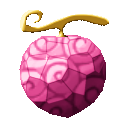

<!-- Generated by tools/build_pack_reference.py. Edit the pack sources and regenerate. -->

# Toshi Toshi no Mi

{ .entry-page-icon }

[Fruits](index.md) · [Missing Missing no Mi](../../reference/content/inomissing.md)

<!-- fruit inomissing:toshi_toshi_no_mi -->

| Stat | Value |
| --- | --- |
| Type | Paramecia |
| Tier | 3 |
| Fruit damage scaling | 1.00× at 10,000 Doriki → 1.75× at 50,000 Doriki |
| Abilities | 12 (11 active, 1 passive) |
| Fruit boxes | [Golden Box](../fruit-boxes.md) |

See [damage calculations](../combat-stats.md#damage-from-doriki).

!!! note "Reading the stats"
    Listed base damage is for the named part of the move. Pack and Doriki multipliers are shown separately. Times assume 20 ticks per second.

<!-- move inomissing:toshi_conviction -->

## Conviction

{ .entry-move-icon loading=lazy } *Passive*

The user's belief in their futures, up to 100. It rises when they land blows and beat enemies, and falls when they get hurt or stop fighting. Taking on a future costs conviction, and the future lasts while some is left.

| Stat | Value |
| --- | --- |
| Pack multiplier when dealing damage | 2.3× |

<!-- move inomissing:distortion_future -->

## Distortion Future

{ .entry-move-icon loading=lazy } *Active · Transformation*

The user ages into a possible future of theirs, big and muscular, they hit harder and take less damage. Kyojin Mitaina Mirai is a future like a giant, the user grows as big as a giant, but it costs the most and cannot last. Each future costs conviction to start and every second, and ends when none is left. Crouching, the user ages the enemy they touch instead, or gives a child they made its age back.

| Stat | Value |
| --- | --- |
| Touch cooldown | 5 s (100 ticks) |
| Conditional cooldown | 0.5 s (10 ticks) |
| Pack multiplier when dealing damage | 2.3× |

**Stats while transformed**

| Stat | Value |
| --- | --- |
| Punch damage | +12 HP |
| Punch damage | +8 HP |

<!-- move inomissing:nika_mitaina_mirai -->

## Distortion Future: Nika Mitaina Mirai

{ .entry-move-icon loading=lazy } *Active · Transformation*

The user ages into a future like Nika, their arms stretch and their fist inflates, they reach further, jump higher and take no fall damage. It allows Tokudai!! "Nika no Punch". It costs conviction to start and every second, and ends when none is left.

| Stat | Value |
| --- | --- |
| Cooldown | 10 s (200 ticks) |
| Npc cooldown | 60 s (1200 ticks) |
| Pack multiplier when dealing damage | 2.3× |

**Stats while transformed**

| Stat | Value |
| --- | --- |
| Punch damage | +8 HP |

<!-- move inomissing:tokudai_nika_no_punch -->

## Tokudai!! "Nika no Punch"

{ .entry-move-icon loading=lazy } *Active*

In a future like Nika, the user inflates their fist, coats it with Armament Haki and throws it forward, hitting every enemy in a line and sending them flying.

| Stat | Value |
| --- | --- |
| Base damage | 39 HP |
| Cooldown | 12 s (240 ticks) |
| Pack multiplier when dealing damage | 2.3× |

<!-- move inomissing:atashi_ga_ichiban_jiyuna_mirai -->

## Atashi Ga Ichiban Jiyuna Mirai

{ .entry-move-icon loading=lazy } *Active · Transformation*

The user ages into the freest future they can imagine, like Nika's awakened form, much stronger, faster and tougher, and Tokudai!! "Nika no Punch" is open. It needs full conviction and empties it, and afterwards the user is exhausted and cannot take on any future for a while.

| Stat | Value |
| --- | --- |
| Cooldown | 300 s (6000 ticks) |
| Pack multiplier when dealing damage | 2.3× |

**Stats while transformed**

| Stat | Value |
| --- | --- |
| Punch damage | +16 HP |

<!-- move inomissing:toshi_tsuki -->

## Toshi Tsuki

{ .entry-move-icon loading=lazy } *Active*

The user thrusts what they hold into the enemy in front of them. It takes the blow of the held object and becomes a child, small and weak, its lost years spilling out as jewels. A creature stays a child for good, a player or a boss only for a while. An aged enemy gets its age back instead.

| Stat | Value |
| --- | --- |
| Cooldown | 10 s (200 ticks) |
| Conditional cooldown | 0.5 s (10 ticks) |
| Pack multiplier when dealing damage | 2.3× |

<!-- move inomissing:oil_shock -->

## Oil Shock

{ .entry-move-icon loading=lazy } *Active*

The user ages metal until it rusts and breaks. Aimed at an enemy, their metal weapon and armor lose half their durability. Aimed at a block, the metal blocks around it crumble to dust.

| Stat | Value |
| --- | --- |
| Cooldown | 7 s (140 ticks) |
| Pack multiplier when dealing damage | 2.3× |

<!-- move inomissing:nde -->

## NDE

{ .entry-move-icon loading=lazy } *Active*

The user fires a shot, from a gun in their hand or with bare hands. It deals no damage, the enemy it hits ages into a skeleton for an instant, then stands shaken, unable to move or attack, and a creature runs away afterwards. The enemy stays old for a while after.

| Stat | Value |
| --- | --- |
| Cooldown | 14 s (280 ticks) |
| Npc cooldown | 20 s (400 ticks) |
| Pack multiplier when dealing damage | 2.3× |

<!-- move inomissing:roshi -->

## Roshi

{ .entry-move-icon loading=lazy } *Active*

The user lays a hand on the enemy in front of them and pushes its years to the end. An aged enemy takes a heavy blow and an aged creature that is weak enough dies of old age, an enemy that is not aged takes a lighter blow.

| Stat | Value |
| --- | --- |
| Base damage | 12 HP |
| Aged damage | 30 HP |
| Cooldown | 12 s (240 ticks) |
| Conditional cooldown | 0.5 s (10 ticks) |
| Pack multiplier when dealing damage | 2.3× |

<!-- move inomissing:old_age_wave -->

## Old Age Wave

{ .entry-move-icon loading=lazy } *Active*

The user shines with their power and every enemy around them grows old and takes some damage. A child the user made gets its age back instead.

| Stat | Value |
| --- | --- |
| Base damage | 8 HP |
| Cooldown | 40 s (800 ticks) |
| Pack multiplier when dealing damage | 2.3× |

<!-- move inomissing:rejuvenation -->

## Rejuvenation

{ .entry-move-icon loading=lazy } *Active*

The user takes years off an ally in front of them, or off themselves if nobody is there. It heals them and takes away old age, slowness, weakness and poison. Another player has to crouch to take it, and on the user it costs conviction.

| Stat | Value |
| --- | --- |
| Cooldown | 20 s (400 ticks) |
| Conditional cooldown | 0.5 s (10 ticks) |
| Pack multiplier when dealing damage | 2.3× |

<!-- move inomissing:child_self -->

## Child Self

{ .entry-move-icon loading=lazy } *Active · Transformation*

The user takes back their real age and is a child again, small and quick, and creatures notice them from half as far, but they have less health and their blows are weaker. Old Self makes the user an old woman instead, slower but harder to hurt and to push around. Marines who chase the user lose them if they get far enough away. Marines who do not already hunt the user ignore them in either body until they strike.

| Stat | Value |
| --- | --- |
| Cooldown | 5 s (100 ticks) |
| Pack multiplier when dealing damage | 2.3× |

**Stats while transformed**

| Stat | Value |
| --- | --- |
| Jump | +1.5 |
| Armour | +4 |

