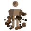
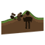
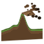
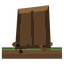
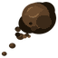
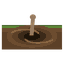
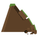

<!-- Generated by tools/build_pack_reference.py. Edit the pack sources and regenerate. -->

# Tsuchi Tsuchi no Mi

{ .entry-page-icon }

[Fruits](index.md) · [InoFruits](../../reference/content/inofruits.md)

<!-- fruit inofruits:tsuchi_tsuchi_no_mi -->

| Stat | Value |
| --- | --- |
| Type | Logia |
| Tier | 3 |
| Fruit damage scaling | 1.00× at 10,000 Doriki → 1.75× at 50,000 Doriki |
| Abilities | 9 (7 active, 2 passive) |
| Fruit boxes | [Golden Box](../fruit-boxes.md) |

See [damage calculations](../combat-stats.md#damage-from-doriki).

!!! note "Reading the stats"
    Listed base damage is for the named part of the move. Pack and Doriki multipliers are shown separately. Times assume 20 ticks per second.

<!-- move inofruits:logia_invulnerability_tsuchi -->

## Logia Invulnerability Tsuchi

{ .entry-move-icon loading=lazy } *Passive*

| Stat | Value |
| --- | --- |
| Pack multiplier when dealing damage | 1.7× |

<!-- move inofruits:dochu -->

## Dochu

{ .entry-move-icon loading=lazy } *Passive*

| Stat | Value |
| --- | --- |
| Pack multiplier when dealing damage | 1.7× |

<!-- move inofruits:jibashiri -->

## Jibashiri

{ .entry-move-icon loading=lazy } *Active*

Sends a ridge of earth along the ground, launching anything it reaches up The ridge goes 24 blocks instead of 16, hits harder and is wider.

| Stat | Value |
| --- | --- |
| Base damage | 12 HP |
| Cooldown | 9 s (180 ticks) |
| Amplified damage | 16 HP |
| Pack multiplier when dealing damage | 1.7× |

<!-- move inofruits:kabe -->

## Kabe

{ .entry-move-icon loading=lazy } *Active*

Raises a wall of packed earth 5 wide and 4 tall, which sinks back down after 12 seconds. The wall is 9 wide and 6 tall and appears 5 blocks away instead of 2.

| Stat | Value |
| --- | --- |
| Cooldown | 15 s (300 ticks) |
| Pack multiplier when dealing damage | 1.7× |

<!-- move inofruits:nomikomi -->

## Nomikomi

{ .entry-move-icon loading=lazy } *Active*

The ground opens under the first target in the way and traps it for 3 seconds. Reaches 14 blocks, traps for 5 seconds and also swallows everything within 4 blocks of the target

| Stat | Value |
| --- | --- |
| Cooldown | 20 s (400 ticks) |
| Pack multiplier when dealing damage | 1.7× |

<!-- move inofruits:tsubute -->

## Tsubute

{ .entry-move-icon loading=lazy } *Active*

Rips out a chunk of earth and throws it where the user is looking The chunk is a boulder bigger than the golem, exploding where it lands.

| Stat | Value |
| --- | --- |
| Cooldown | 11 s (220 ticks) |
| Pack multiplier when dealing damage | 1.7× |

<!-- move inofruits:tsuchi_tsuchi_golem -->

## Tsuchi Tsuchi Golem

{ .entry-move-icon loading=lazy } *Active · Transformation*

The user covers themselves in earth, becoming much harder to hurt but much slower.

| Stat | Value |
| --- | --- |
| Min cooldown | 5 s (100 ticks) |
| Max cooldown | 20 s (400 ticks) |
| Pack multiplier when dealing damage | 1.7× |

**Stats while transformed**

| Stat | Value |
| --- | --- |
| Movement speed | -20% of base |
| Punch damage | +6 HP |
| Armor | +7 |
| Toughness | +3 |
| Maximum health | +30% |

<!-- move inofruits:ryusa -->

## Ryusa

{ .entry-move-icon loading=lazy } *Active*

Turns the ground where the user looks into quicksand, enemies caught in it are slowed, damaged and dragged toward the middle. The quicksand is wider, lasts longer, grinds harder and swallows faster.

| Stat | Value |
| --- | --- |
| Pulse damage | 2 HP |
| Cooldown | 20 s (400 ticks) |
| Amplified pulse damage | 3 HP |
| Pack multiplier when dealing damage | 1.7× |

<!-- move inofruits:jisuberi -->

## Jisuberi

{ .entry-move-icon loading=lazy } *Active*

The ground in front of the user slides away, every enemy in a wide cone is damaged, knocked away and buried for a moment The landslide reaches 18 blocks instead of 12, spreads wider, hits harder and buries longer.

| Stat | Value |
| --- | --- |
| Base damage | 22 HP |
| Cooldown | 30 s (600 ticks) |
| Amplified damage | 30 HP |
| Pack multiplier when dealing damage | 1.7× |

