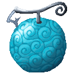

<!-- Generated by tools/build_pack_reference.py. Edit the pack sources and regenerate. -->

# Tsuri Tsuri no Mi

{ .entry-page-icon }

[Fruits](index.md) · [InoFruits](../../reference/content/inofruits.md)

<!-- fruit inofruits:tsuri_tsuri_no_mi -->

| Stat | Value |
| --- | --- |
| Type | Paramecia |
| Tier | 1 |
| Fruit damage scaling | 1.00× at 10,000 Doriki → 2.25× at 50,000 Doriki |
| Abilities | 4 (3 active, 1 passive) |
| Fruit boxes | [Wooden Box](../fruit-boxes.md) |

See [damage calculations](../combat-stats.md#damage-from-doriki).

!!! note "Reading the stats"
    Listed base damage is for the named part of the move. Pack and Doriki multipliers are shown separately. Times assume 20 ticks per second.

<!-- move inofruits:ipponzuri -->

## Ipponzuri

{ .entry-move-icon loading=lazy } *Active*

Casts a fishing line at whatever the user is looking at and reels it in.

| Stat | Value |
| --- | --- |
| Base damage | 4 HP |
| Cooldown | 8 s (160 ticks) |
| Conditional cooldown | 0.5 s (10 ticks) |
| Pack multiplier when dealing damage | 4.45× |

<!-- move inofruits:tsuriage -->

## Tsuriage

{ .entry-move-icon loading=lazy } *Active*

Throws a bunch of lines at the ground, bringing back every dropped item within 26 blocks.

| Stat | Value |
| --- | --- |
| Cooldown | 5 s (100 ticks) |
| Pack multiplier when dealing damage | 4.45× |

<!-- move inofruits:kaginawa -->

## Kaginawa

{ .entry-move-icon loading=lazy } *Active*

Hooks onto anything in sight up to 50 blocks away and pulls the user to it.

| Stat | Value |
| --- | --- |
| Base damage | 5 HP |
| Cooldown | 5 s (100 ticks) |
| Conditional cooldown | 0.5 s (10 ticks) |
| Pack multiplier when dealing damage | 2.7× |

<!-- move inofruits:tsuribito -->

## Tsuribito

{ .entry-move-icon loading=lazy } *Passive*

Anything the user fishes up comes up twice The fishing rod also never loses durability.

| Stat | Value |
| --- | --- |
| Pack multiplier when dealing damage | 4.45× |

