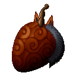
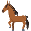
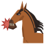
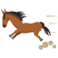

<!-- Generated by tools/build_pack_reference.py. Edit the pack sources and regenerate. -->

# Uma Uma no Mi

{ .entry-page-icon }

[Fruits](index.md) · [Missing Missing no Mi](../../reference/content/inomissing.md)

<!-- fruit inomissing:uma_uma_no_mi -->

| Stat | Value |
| --- | --- |
| Type | Zoan |
| Tier | 2 |
| Fruit damage scaling | 1.00× at 10,000 Doriki → 2× at 50,000 Doriki |
| Abilities | 5 (4 active, 1 passive) |
| Fruit boxes | [Iron Box](../fruit-boxes.md) |

See [damage calculations](../combat-stats.md#damage-from-doriki).

!!! note "Reading the stats"
    Listed base damage is for the named part of the move. Pack and Doriki multipliers are shown separately. Times assume 20 ticks per second.

<!-- move inomissing:uma_heavy_point -->

## Uma Heavy Point

{ .entry-move-icon loading=lazy } *Active · Transformation*

Transforms the user into a horse hybrid, a strong horse man with hooves and a mane.

| Stat | Value |
| --- | --- |
| Pack multiplier when dealing damage | 1.5× |

**Stats while transformed**

| Stat | Value |
| --- | --- |
| Movement speed | +15% of base |
| Punch damage | +9 HP |
| Armour | +12 |
| Toughness | +3 |
| Step height | +0.5 blocks |
| Jump | +1 |

<!-- move inomissing:uma_walk_point -->

## Uma Walk Point

{ .entry-move-icon loading=lazy } *Active · Transformation*

Transforms the user into a big horse that runs fast and can carry another player on its back

| Stat | Value |
| --- | --- |
| Pack multiplier when dealing damage | 1.5× |

**Stats while transformed**

| Stat | Value |
| --- | --- |
| Movement speed | +40% of base |
| Punch damage | +7 HP |
| Armour | +12 |
| Toughness | +3 |
| Step height | +0.4 blocks |
| Jump | +1.5 |

<!-- move inomissing:uma_rideable -->

## Uma Rideable

*Passive*

Allows another player to ride on the horse's back. The rider keeps fighting with their abilities and weapons and holds on at the gallop

| Stat | Value |
| --- | --- |
| Pack multiplier when dealing damage | 1.5× |

<!-- move inomissing:uma_kamitsuki -->

## Uma Kamitsuki

{ .entry-move-icon loading=lazy } *Active*

While in a horse form, the user bites the enemy in front of them. The bite hurts more if that enemy just hit the user's rider or an ally

| Stat | Value |
| --- | --- |
| Base damage | 20 HP |
| Cooldown | 8 s (160 ticks) |
| Pack multiplier when dealing damage | 1.5× |

<!-- move inomissing:kakeashi -->

## Kakeashi

{ .entry-move-icon loading=lazy } *Active*

While in the full horse form, the user gallops very fast and climbs high steps without jumping, the rider stays on. It uses up the stamina gauge which fills back at rest The user tramples the creatures smaller than them on the way, they get hurt, knocked down and thrown aside. Trampling uses the stamina faster

| Stat | Value |
| --- | --- |
| Trample damage | 10 HP |
| Cooldown | 1 s (20 ticks) |
| Conditional cooldown | 0.5 s (10 ticks) |
| Pack multiplier when dealing damage | 1.5× |

