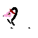
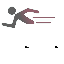

<!-- Generated by tools/build_pack_reference.py. Edit the pack sources and regenerate. -->

# Uma Uma no Mi, Model: Bakotsu

{ .entry-page-icon }

[Fruits](index.md) · [Akuma no Mi](../../reference/content/akuma.md)

<!-- fruit akuma:uma_uma_no_mi_model_bakotsu -->

| Stat | Value |
| --- | --- |
| Type | Mythical Zoan |
| Tier | 4 |
| Fruit damage scaling | 1.00× at 10,000 Doriki → 1.75× at 50,000 Doriki |
| Abilities | 10 (6 active, 4 passive) |
| Fruit boxes | [Noble Box](../fruit-boxes.md) |

See [damage calculations](../combat-stats.md#damage-from-doriki).

!!! note "Reading the stats"
    Listed base damage is for the named part of the move. Pack and Doriki multipliers are shown separately. Times assume 20 ticks per second.

<!-- move akuma:bakotsu_walk_point -->

## Bakotsu Walk Point

{ .entry-move-icon loading=lazy } *Active · Transformation*

Transforms the user into a nightmarish bakotsu

| Stat | Value |
| --- | --- |
| Pack multiplier when dealing damage | 2.9× |

<!-- move akuma:bakotsu_heavy_point -->

## Bakotsu Heavy Point

{ .entry-move-icon loading=lazy } *Active · Transformation*

Transforms the user into a hybrid bakotsu

| Stat | Value |
| --- | --- |
| Pack multiplier when dealing damage | 2.9× |

<!-- move akuma:chilling_chomp -->

## Chilling Chomp

{ .entry-move-icon loading=lazy } *Active*

The user bites down on a target and carries it around, dealing damage over time and inflicting frostbite.

| Stat | Value |
| --- | --- |
| Cooldown | 20 s (400 ticks) |
| Miss cooldown | 2 s (40 ticks) |
| Base damage | 4 HP |
| Pack multiplier when dealing damage | 1.7× |

<!-- move akuma:frost_imbuement -->

## Frost Imbuement

{ .entry-move-icon loading=lazy } *Active*

While active, the user's attacks with or without a weapon deal extra damage and inflict frostbite, for up to 20 seconds.

| Stat | Value |
| --- | --- |
| Bonus damage | 5 HP |
| Cooldown | 10 s (200 ticks) |
| Pack multiplier when dealing damage | 2.9× |

<!-- move akuma:spectral_speed -->

## Spectral Speed

{ .entry-move-icon loading=lazy } *Active*

The user's spectral body surges forward, doubling their speed for a short time.

| Stat | Value |
| --- | --- |
| Cooldown | 40 s (800 ticks) |
| Pack multiplier when dealing damage | 2.9× |

<!-- move akuma:chilling_presence -->

## Chilling Presence

{ .entry-move-icon loading=lazy } *Active*

The user releases an extremely cold mist around themselves, inflicting frostbite on everything nearby.

| Stat | Value |
| --- | --- |
| Cooldown | 30 s (600 ticks) |
| Pack multiplier when dealing damage | 2.9× |

<!-- move akuma:bakotsu_trample -->

## Bakotsu Trample

{ .entry-move-icon loading=lazy } *Passive*

Running speed increases with acceleration trampling any nearby entity.

| Stat | Value |
| --- | --- |
| Base damage | 2 HP |
| Pack multiplier when dealing damage | 2.9× |

<!-- move mineminenomi:frost_walker -->

## Frost Walker

{ .entry-move-icon loading=lazy } *Passive*

Turns all water the user walks on into ice Crouching temporarily disables the ability

| Stat | Value |
| --- | --- |
| Pack multiplier when dealing damage | 1.7× |

<!-- move akuma:bakotsu_night_vision -->

## Night Vision

*Passive*

Grants the user night vision.

| Stat | Value |
| --- | --- |
| Pack multiplier when dealing damage | 2.9× |

<!-- move akuma:bakotsu_immunities -->

## Bakotsu Immunities

*Passive*

| Stat | Value |
| --- | --- |
| Pack multiplier when dealing damage | 2.9× |

