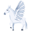
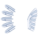

<!-- Generated by tools/build_pack_reference.py. Edit the pack sources and regenerate. -->

# Uma Uma no Mi, Model: Pegasus

{ .entry-page-icon }

[Fruits](index.md) · [Missing Missing no Mi](../../reference/content/inomissing.md)

<!-- fruit inomissing:uma_uma_no_mi_model_pegasus -->

| Stat | Value |
| --- | --- |
| Type | Mythical Zoan |
| Tier | 3 |
| Fruit damage scaling | 1.00× at 10,000 Doriki → 1.75× at 50,000 Doriki |
| Abilities | 11 (9 active, 2 passive) |
| Fruit boxes | [Golden Box](../fruit-boxes.md) |

See [damage calculations](../combat-stats.md#damage-from-doriki).

!!! note "Reading the stats"
    Listed base damage is for the named part of the move. Pack and Doriki multipliers are shown separately. Times assume 20 ticks per second.

<!-- move inomissing:pegasus_assault_point -->

## Pegasus Assault Point

{ .entry-move-icon loading=lazy } *Active · Transformation*

Transforms the user into a Pegasus hybrid, which flies and fights with hooves and wings

| Stat | Value |
| --- | --- |
| Pack multiplier when dealing damage | 1.6× |

**Stats while transformed**

| Stat | Value |
| --- | --- |
| Movement speed | +15% of base |
| Punch damage | +11 HP |
| Armour | +14 |
| Toughness | +3 |
| Step height | +0.5 blocks |
| Jump | +1 |

<!-- move inomissing:pegasus_fly_point -->

## Pegasus Fly Point

{ .entry-move-icon loading=lazy } *Active · Transformation*

Transforms the user into a Pegasus, a winged war horse that flies and carries two other players on its back

| Stat | Value |
| --- | --- |
| Pack multiplier when dealing damage | 1.6× |

**Stats while transformed**

| Stat | Value |
| --- | --- |
| Movement speed | +35% of base |
| Punch damage | +10 HP |
| Armour | +16 |
| Toughness | +4 |
| Step height | +1 blocks |
| Jump | +1.2 |

<!-- move inomissing:pegasus_flight -->

## Pegasus Flight

*Passive*

| Stat | Value |
| --- | --- |
| Pack multiplier when dealing damage | 1.6× |

<!-- move inomissing:pegasus_rideable -->

## Pegasus Rideable

*Passive*

Allows two other players to ride on the Pegasus's back. They keep fighting with their abilities and weapons

| Stat | Value |
| --- | --- |
| Pack multiplier when dealing damage | 1.6× |

<!-- move inomissing:pegasus_charge -->

## Charge

{ .entry-move-icon loading=lazy } *Active*

The user gallops forward on the ground or in the air, running through every enemy in front of them and throwing them aside. The riders stay on

| Stat | Value |
| --- | --- |
| Base damage | 22 HP |
| Cooldown | 12 s (240 ticks) |
| Pack multiplier when dealing damage | 1.6× |

<!-- move inomissing:pegasus_hoof_kick -->

## Hoof Kick

{ .entry-move-icon loading=lazy } *Active*

The user bucks and kicks behind them with their hooves, throwing back every enemy there

| Stat | Value |
| --- | --- |
| Base damage | 24 HP |
| Cooldown | 9 s (180 ticks) |
| Pack multiplier when dealing damage | 1.6× |

<!-- move inomissing:pegasus_wing_gust -->

## Wing Gust

{ .entry-move-icon loading=lazy } *Active*

The user opens their wings wide and beats them forward, pushing every enemy in front far away

| Stat | Value |
| --- | --- |
| Base damage | 8 HP |
| Cooldown | 10 s (200 ticks) |
| Pack multiplier when dealing damage | 1.6× |

<!-- move inomissing:pegasus_dive -->

## Dive

{ .entry-move-icon loading=lazy } *Active*

The user leaps into the air if on the ground, then dives on the enemy they look at or the spot they aim at. Every enemy around the landing is hit and thrown out

| Stat | Value |
| --- | --- |
| Base damage | 34 HP |
| Cooldown | 30 s (600 ticks) |
| Conditional cooldown | 0.5 s (10 ticks) |
| Pack multiplier when dealing damage | 1.6× |

<!-- move inomissing:pegasus_rearing -->

## Rearing

{ .entry-move-icon loading=lazy } *Active*

The user rears up and crashes their front hooves down, the shock throws up every enemy in front

| Stat | Value |
| --- | --- |
| Base damage | 18 HP |
| Cooldown | 12 s (240 ticks) |
| Pack multiplier when dealing damage | 1.6× |

<!-- move inomissing:pegasus_tailwind -->

## Tailwind

{ .entry-move-icon loading=lazy } *Active*

The user beats their wings and a wind carries them, their riders and their pets faster for a while Other players must be crouching to be carried

| Stat | Value |
| --- | --- |
| Cooldown | 40 s (800 ticks) |
| Pack multiplier when dealing damage | 1.6× |

<!-- move inomissing:pegasus_feather_volley -->

## Feather Volley

{ .entry-move-icon loading=lazy } *Active*

The user beats their wings and a fan of feathers flies where they look, each one cutting the first enemy it meets

| Stat | Value |
| --- | --- |
| Base damage | 4 HP |
| Cooldown | 12 s (240 ticks) |
| Pack multiplier when dealing damage | 1.6× |

