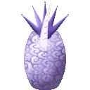
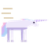
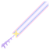

<!-- Generated by tools/build_pack_reference.py. Edit the pack sources and regenerate. -->

# Uma Uma no Mi, Model: Unicorn

{ .entry-page-icon }

[Fruits](index.md) · [InoFruits](../../reference/content/inofruits.md)

<!-- fruit inofruits:uma_uma_no_mi_model_unicorn -->

| Stat | Value |
| --- | --- |
| Type | Mythical Zoan |
| Tier | 3 |
| Fruit damage scaling | 1.00× at 10,000 Doriki → 1.75× at 50,000 Doriki |
| Abilities | 13 (10 active, 3 passive) |
| Fruit boxes | [Golden Box](../fruit-boxes.md) |

See [damage calculations](../combat-stats.md#damage-from-doriki).

!!! note "Reading the stats"
    Listed base damage is for the named part of the move. Pack and Doriki multipliers are shown separately. Times assume 20 ticks per second.

<!-- move inofruits:uma_uma_walk_point -->

## Uma Uma Walk Point

{ .entry-move-icon loading=lazy } *Active · Transformation*

Transforms the user into a unicorn, which focuses on speed and can carry allies.

| Stat | Value |
| --- | --- |
| Pack multiplier when dealing damage | 1.5× |

**Stats while transformed**

| Stat | Value |
| --- | --- |
| Movement speed | +70% of base |
| Maximum health | +25% |
| Armour | +4 |
| Jump | +1.5 |
| Step height | +1 blocks |
| Toughness | +2 |

<!-- move inofruits:uma_uma_heavy_point -->

## Uma Uma Heavy Point

{ .entry-move-icon loading=lazy } *Active · Transformation*

Transforms the user into a unicorn hybrid, which focuses on strength and the horn.

| Stat | Value |
| --- | --- |
| Pack multiplier when dealing damage | 1.5× |

**Stats while transformed**

| Stat | Value |
| --- | --- |
| Movement speed | +15% of base |
| Maximum health | +50% |
| Punch damage | +10 HP |
| Armour | +8 |
| Step height | +0.5 blocks |
| Toughness | +4 |

<!-- move inofruits:horn_thrust -->

## Horn Thrust

{ .entry-move-icon loading=lazy } *Active*

Stabs the target with the horn, ignoring armor, absorption and Logia intangibility. In the Heavy Point it also lifts the target.

| Stat | Value |
| --- | --- |
| Base damage | 24 HP |
| Cooldown | 8 s (160 ticks) |
| Conditional cooldown | 0.5 s (10 ticks) |
| Pack multiplier when dealing damage | 1.5× |

<!-- move inofruits:unicorn_charge -->

## Unicorn Charge

{ .entry-move-icon loading=lazy } *Active*

The user gallops forward with the horn first, hitting everyone in the way and pushing them aside

| Stat | Value |
| --- | --- |
| Base damage | 20 HP |
| Cooldown | 10 s (200 ticks) |
| Pack multiplier when dealing damage | 1.5× |

<!-- move inofruits:prism_lance -->

## Prism Lance

{ .entry-move-icon loading=lazy } *Active*

Fires a beam of light from the horn that goes through every enemy in a line, ignoring armor, absorption and Logia intangibility.

| Stat | Value |
| --- | --- |
| Base damage | 22 HP |
| Cooldown | 12 s (240 ticks) |
| Pack multiplier when dealing damage | 1.5× |

<!-- move inofruits:starfall -->

## Starfall

{ .entry-move-icon loading=lazy } *Active*

Makes 5 lances of light fall on the spot the user is looking at, damaging the enemies where they land.

| Stat | Value |
| --- | --- |
| Base damage | 6 HP |
| Cooldown | 16 s (320 ticks) |
| Pack multiplier when dealing damage | 1.5× |

<!-- move inofruits:purify -->

## Purify

{ .entry-move-icon loading=lazy } *Active*

The light of the horn removes harmful effects except stuns from the user and nearby allies, heals them a bit and makes them immune to harmful effects for a few seconds

| Stat | Value |
| --- | --- |
| Cooldown | 25 s (500 ticks) |
| Pack multiplier when dealing damage | 1.5× |

<!-- move inofruits:sanctuary -->

## Sanctuary

{ .entry-move-icon loading=lazy } *Active*

Creates a circle of light where the user stands. Allies inside regenerate and are immune to harmful effects, enemies inside are burned and weakened.

| Stat | Value |
| --- | --- |
| Pulse damage | 4 HP |
| Cooldown | 50 s (1000 ticks) |
| Pack multiplier when dealing damage | 1.5× |

<!-- move inofruits:guiding_light -->

## Guiding Light

{ .entry-move-icon loading=lazy } *Active*

A thread of light from the horn pulls the target to the user, it works on allies and on enemies.

| Stat | Value |
| --- | --- |
| Cooldown | 12 s (240 ticks) |
| Conditional cooldown | 0.5 s (10 ticks) |
| Pack multiplier when dealing damage | 1.5× |

<!-- move inofruits:moonlight_burst -->

## Moonlight Burst

{ .entry-move-icon loading=lazy } *Active*

The unicorn rears up and releases a burst of light, enemies around are pushed away, allies lose their harmful effects and are healed and the light of the horn is refilled

| Stat | Value |
| --- | --- |
| Base damage | 40 HP |
| Cooldown | 60 s (1200 ticks) |
| Pack multiplier when dealing damage | 1.5× |

<!-- move inofruits:alicorn -->

## Alicorn

{ .entry-move-icon loading=lazy } *Passive*

The light of the horn removes every harmful effect on the user except stuns and heals the user while transformed. Both use light, which comes back over time and with every horn hit.

| Stat | Value |
| --- | --- |
| Pack multiplier when dealing damage | 1.5× |

<!-- move inofruits:unicorn_rideable -->

## Unicorn Rideable

*Passive*

Allows other players to ride on the unicorn's back.

| Stat | Value |
| --- | --- |
| Pack multiplier when dealing damage | 1.5× |

<!-- move inofruits:unicorn_flight -->

## Unicorn Flight

{ .entry-move-icon loading=lazy } *Passive*

Allows the user to fly while transformed, leaving a rainbow behind them

| Stat | Value |
| --- | --- |
| Pack multiplier when dealing damage | 1.5× |

