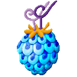
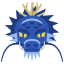
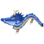
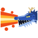
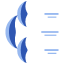
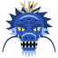

<!-- Generated by tools/build_pack_reference.py. Edit the pack sources and regenerate. -->

# Uo Uo no Mi, Model: Seiryu

{ .entry-page-icon }

[Fruits](index.md) · [Missing Missing no Mi](../../reference/content/inomissing.md)

<!-- fruit inomissing:uo_uo_no_mi_model_seiryu -->

| Stat | Value |
| --- | --- |
| Type | Mythical Zoan |
| Tier | 3 |
| Fruit damage scaling | 1.00× at 10,000 Doriki → 1.75× at 50,000 Doriki |
| Abilities | 13 (11 active, 2 passive) |
| Fruit boxes | [Golden Box](../fruit-boxes.md) |

See [damage calculations](../combat-stats.md#damage-from-doriki).

!!! note "Reading the stats"
    Listed base damage is for the named part of the move. Pack and Doriki multipliers are shown separately. Times assume 20 ticks per second.

<!-- move inomissing:seiryu_heavy_point -->

## Seiryu Heavy Point

{ .entry-move-icon loading=lazy } *Active · Transformation*

Transforms the user into a dragon hybrid with scales, claws and a long tail. Jumping again in the air kicks with the tail for a second jump, and the user takes no fall damage

**Stats while transformed**

| Stat | Value |
| --- | --- |
| Movement speed | +22% of base |
| Punch damage | +13 HP |
| Armor | +21 |
| Armor toughness | +8 |
| Toughness | +7 |
| Jump | +0.5 |

<!-- move inomissing:seiryu_fly_point -->

## Seiryu Fly Point

{ .entry-move-icon loading=lazy } *Active · Transformation*

Transforms the user into the azure dragon, a huge flying serpent 45 blocks long with scales that take most blows. It needs room to transform

**Stats while transformed**

| Stat | Value |
| --- | --- |
| Punch damage | +18 HP |
| Armor | +26 |
| Armor toughness | +12 |
| Toughness | +16 |

<!-- move inomissing:seiryu_scales -->

## Seiryu Scales

{ .entry-move-icon loading=lazy } *Passive*

While in a dragon form the user's scales take no damage from fire or lava, and the user never stays on fire

<!-- move inomissing:seiryu_flight -->

## Flame Clouds

*Passive*

<!-- move inomissing:seiryu_bolo_breath -->

## Bolo Breath

{ .entry-move-icon loading=lazy } *Active*

The user breathes a great beam of fire that burns every enemy in it and blows up where it hits, breaking blocks and setting fires. As the dragon the beam is much longer and wider and ends with a spread of fireballs

| Stat | Value |
| --- | --- |
| Base damage | 4 HP |
| Dragon damage | 9 HP |
| Fireball damage | 8 HP |
| Cooldown | 18 s (360 ticks) |
| Dragon cooldown | 40 s (800 ticks) |

<!-- move inomissing:seiryu_kaifu -->

## Kaifu

{ .entry-move-icon loading=lazy } *Active*

The user throws a fan of wind blades that cut the first enemy they meet. The dragon throws more of them and bigger

| Stat | Value |
| --- | --- |
| Base damage | 12 HP |
| Dragon damage | 18 HP |
| Cooldown | 10 s (200 ticks) |

<!-- move inomissing:seiryu_tail_grab -->

## Tail Grab

{ .entry-move-icon loading=lazy } *Active*

The user wraps their tail around the enemy they look at and squeezes it. As the dragon it is Whisker Grab, a whisker catching the enemy from further away. Use the ability again to throw it, it gets hurt if it hits a wall

| Stat | Value |
| --- | --- |
| Base damage | 3 HP |
| Dragon damage | 8 HP |
| Cooldown | 15 s (300 ticks) |

<!-- move inomissing:seiryu_bite -->

## Seiryu Bite

{ .entry-move-icon loading=lazy } *Active*

The user bites the enemies right in front of the mouth. As the dragon it is Dragon Bite, the great jaws snapping on every enemy at the muzzle

| Stat | Value |
| --- | --- |
| Base damage | 22 HP |
| Dragon damage | 36 HP |
| Cooldown | 7 s (140 ticks) |

<!-- move inomissing:seiryu_claws -->

## Seiryu Claws

{ .entry-move-icon loading=lazy } *Active*

The user rakes their claws across the enemies in front of them and pushes them away. As the dragon it is Dragon Claws, all four legs swiping at the enemies close to them

| Stat | Value |
| --- | --- |
| Base damage | 18 HP |
| Dragon damage | 28 HP |
| Cooldown | 6 s (120 ticks) |

<!-- move inomissing:seiryu_tail_sweep -->

## Dragon Tail Sweep

{ .entry-move-icon loading=lazy } *Active*

While in the dragon form, the user swings their tail round in front of them and sends flying the enemies in a wide arc

| Stat | Value |
| --- | --- |
| Base damage | 28 HP |
| Cooldown | 10 s (200 ticks) |

<!-- move inomissing:seiryu_tatsumaki -->

## Tatsumaki

{ .entry-move-icon loading=lazy } *Active*

While in the dragon form, the user raises tornadoes Tatsumaki is 3 tornadoes in front of the user that pull the enemies toward the jaws, which bite them Tatsumaki Kaifu is a great tornado where the user looks that pulls the enemies round and throws wind blades at the ones around

| Stat | Value |
| --- | --- |
| Wind damage | 2 HP |
| Bite damage | 4 HP |
| Cooldown | 25 s (500 ticks) |
| Blade damage | 4 HP |
| Kaifu cooldown | 30 s (600 ticks) |

<!-- move inomissing:seiryu_storm -->

## Dragon Storm

*Active*

While in the dragon form, the user calls a storm With Thunder Roar the user roars and lightning strikes the nearest enemies With Hail Storm a storm cloud gathers where the user looks and hail beats down on the enemies under it and slows them

Calls a local thunderstorm for 60 seconds.

| Stat | Value |
| --- | --- |
| Bolt damage | 32 HP |
| Cooldown | 25 s (500 ticks) |
| Hail damage | 4 HP |
| Hail cooldown | 25 s (500 ticks) |

<!-- move inomissing:seiryu_kaen_daiko -->

## Kaen Daiko

{ .entry-move-icon loading=lazy } *Active*

While in the dragon form, a giant dragon of fire wraps the user. Melee blows without Haki can't touch the user and burn the one who strikes, enemies against the body burn too Use it again while it burns for Kaen Hakke, the user lunges forward jaws first, biting and burning every enemy on the way, then the fire goes out Water puts it out

| Stat | Value |
| --- | --- |
| Base damage | 4 HP |
| Cooldown | 30 s (600 ticks) |
| Lunge damage | 40 HP |

