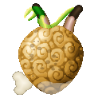
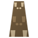
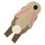

<!-- Generated by tools/build_pack_reference.py. Edit the pack sources and regenerate. -->

# Usa Usa no Mi, Model: Hare

{ .entry-page-icon }

[Fruits](index.md) · [InoFruits](../../reference/content/inofruits.md)

<!-- fruit inofruits:usa_usa_no_mi_model_hare -->

| Stat | Value |
| --- | --- |
| Type | Zoan |
| Tier | 1 |
| Fruit damage scaling | 1.00× at 10,000 Doriki → 2.25× at 50,000 Doriki |
| Abilities | 5 (5 active, 0 passive) |
| Fruit boxes | [Wooden Box](../fruit-boxes.md) |

See [damage calculations](../combat-stats.md#damage-from-doriki).

!!! note "Reading the stats"
    Listed base damage is for the named part of the move. Pack and Doriki multipliers are shown separately. Times assume 20 ticks per second.

<!-- move inofruits:usa_usa_walk_point -->

## Usa Usa Walk Point

{ .entry-move-icon loading=lazy } *Active · Transformation*

Transforms the user into a hare, which focuses on speed and being small

| Stat | Value |
| --- | --- |
| Pack multiplier when dealing damage | 1.95× |

**Stats while transformed**

| Stat | Value |
| --- | --- |
| Movement speed | +100% of base |
| Jump | +3.5 |
| Step height | +1 blocks |
| Punch damage | +1 HP |

<!-- move inofruits:usa_usa_heavy_point -->

## Usa Usa Heavy Point

{ .entry-move-icon loading=lazy } *Active · Transformation*

Transforms the user into a hare hybrid with long ears and hind legs, slower than the full hare.

| Stat | Value |
| --- | --- |
| Pack multiplier when dealing damage | 1.95× |

**Stats while transformed**

| Stat | Value |
| --- | --- |
| Movement speed | +60% of base |
| Jump | +2.4 |
| Step height | +0.8 blocks |
| Armour | +2 |
| Punch damage | +4 HP |

<!-- move inofruits:ushiro_geri -->

## Ushiro Geri

{ .entry-move-icon loading=lazy } *Active*

Kicks the closest target with both hind legs, launching it away and the user the other way Kicks with a person's legs instead of a hare's, reaching almost twice as far and hitting harder.

| Stat | Value |
| --- | --- |
| Base damage | 7 HP |
| Amplified damage | 11 HP |
| Cooldown | 5 s (100 ticks) |
| Conditional cooldown | 0.5 s (10 ticks) |
| Pack multiplier when dealing damage | 1.5× |

<!-- move inofruits:datto -->

## Datto

{ .entry-move-icon loading=lazy } *Active*

The hare starts running, outrunning anything on the ground until the ability ends Longer legs make it last 12 seconds instead of 8.

| Stat | Value |
| --- | --- |
| Min cooldown | 6 s (120 ticks) |
| Max cooldown | 18 s (360 ticks) |
| Pack multiplier when dealing damage | 1.95× |

<!-- move inofruits:usagitobi -->

## Usagitobi

{ .entry-move-icon loading=lazy } *Active*

The hare does a standing jump much higher than the user normally can. With longer legs the same jump goes a lot higher

| Stat | Value |
| --- | --- |
| Cooldown | 6 s (120 ticks) |
| Pack multiplier when dealing damage | 1.95× |

