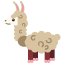
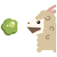
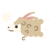
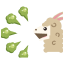

<!-- Generated by tools/build_pack_reference.py. Edit the pack sources and regenerate. -->

# Ushi Ushi no Mi, Model: Alpaca

{ .entry-page-icon }

[Fruits](index.md) · [Missing Missing no Mi](../../reference/content/inomissing.md)

<!-- fruit inomissing:ushi_ushi_no_mi_model_alpaca -->

| Stat | Value |
| --- | --- |
| Type | Zoan |
| Tier | 1 |
| Fruit damage scaling | 1.00× at 10,000 Doriki → 2.25× at 50,000 Doriki |
| Abilities | 8 (7 active, 1 passive) |
| Fruit boxes | [Wooden Box](../fruit-boxes.md) |

See [damage calculations](../combat-stats.md#damage-from-doriki).

!!! note "Reading the stats"
    Listed base damage is for the named part of the move. Pack and Doriki multipliers are shown separately. Times assume 20 ticks per second.

<!-- move inomissing:alpaca_heavy_point -->

## Alpaca Heavy Point

{ .entry-move-icon loading=lazy } *Active · Transformation*

Transforms the user into an alpaca hybrid, sturdy in thick wool and hard to push back.

| Stat | Value |
| --- | --- |
| Pack multiplier when dealing damage | 1.2× |

**Stats while transformed**

| Stat | Value |
| --- | --- |
| Movement speed | +10% of base |
| Punch damage | +7 HP |
| Armor | +9 |
| Toughness | +2 |

<!-- move inomissing:alpaca_walk_point -->

## Alpaca Walk Point

{ .entry-move-icon loading=lazy } *Active · Transformation*

Transforms the user into a white alpaca, a quick and sure-footed runner.

| Stat | Value |
| --- | --- |
| Pack multiplier when dealing damage | 1.2× |

**Stats while transformed**

| Stat | Value |
| --- | --- |
| Movement speed | +40% of base |
| Punch damage | +5 HP |
| Armor | +7 |
| Step height | +1 blocks |
| Jump | +1 |

<!-- move inomissing:alpaca_spit -->

## Alpaca Spit

{ .entry-move-icon loading=lazy } *Active*

While in an alpaca form, the user spits a green glob where they look. A player hit sees green spit over the middle of their screen and feels sick, a creature hit forgets its target for a while While in an alpaca form, the user spits a thick glob of chewed grass. The enemy hit gets slowed and a sticky green puddle stays where it lands, it slows whoever walks in it

| Stat | Value |
| --- | --- |
| Cooldown | 8 s (160 ticks) |
| Sticky cooldown | 10 s (200 ticks) |
| Pack multiplier when dealing damage | 1.2× |

<!-- move inomissing:woolly_kick -->

## Woolly Kick

{ .entry-move-icon loading=lazy } *Active*

While in an alpaca form, the user kicks with the hind legs behind them like a real alpaca, so the user has to show their back to the enemy. Enemies behind get hurt and thrown away

| Stat | Value |
| --- | --- |
| Base damage | 14 HP |
| Cooldown | 10 s (200 ticks) |
| Pack multiplier when dealing damage | 1.2× |

<!-- move inomissing:neck_ram -->

## Neck Ram

{ .entry-move-icon loading=lazy } *Active*

While in an alpaca form, the user charges forward head down. The first enemy in the way gets hit, thrown back and knocked down for a moment

| Stat | Value |
| --- | --- |
| Base damage | 10 HP |
| Cooldown | 10 s (200 ticks) |
| Pack multiplier when dealing damage | 1.2× |

<!-- move inomissing:guard_stomp -->

## Guard Stomp

{ .entry-move-icon loading=lazy } *Active*

While in an alpaca form, the user rears up and stomps the ground with the front feet. Enemies around get hurt and thrown in the air While in an alpaca form, the user crouches and leaps very high with stiff legs. Where the user lands enemies around get hurt and thrown away, the user takes no fall damage from the leap

| Stat | Value |
| --- | --- |
| Base damage | 12 HP |
| Pronk damage | 10 HP |
| Cooldown | 12 s (240 ticks) |
| Pack multiplier when dealing damage | 1.2× |

<!-- move inomissing:spit_volley -->

## Spit Volley

{ .entry-move-icon loading=lazy } *Active*

While in an alpaca form, the user chews for a moment, then sprays 5 globs of spit in a fan before them. Each glob does what Alpaca Spit does

| Stat | Value |
| --- | --- |
| Cooldown | 30 s (600 ticks) |
| Pack multiplier when dealing damage | 1.2× |

<!-- move inomissing:thick_wool -->

## Thick Wool

{ .entry-move-icon loading=lazy } *Passive*

While in an alpaca form, the thick wool takes a quarter of the damage from close blows and falls, but it burns and fire hurts a quarter more

| Stat | Value |
| --- | --- |
| Pack multiplier when dealing damage | 1.2× |

