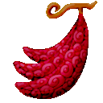
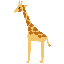
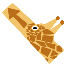
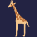
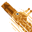

<!-- Generated by tools/build_pack_reference.py. Edit the pack sources and regenerate. -->

# Ushi Ushi no Mi, Model: Giraffe

{ .entry-page-icon }

[Fruits](index.md) · [Mine Mine no Mi](../../reference/content/mineminenomi.md)

<!-- fruit mineminenomi:ushi_ushi_no_mi_model_giraffe -->

| Stat | Value |
| --- | --- |
| Type | Zoan |
| Tier | 1 |
| Fruit damage scaling | 1.00× at 10,000 Doriki → 2.25× at 50,000 Doriki |
| Abilities | 4 (3 active, 1 passive) |
| Fruit boxes | [Wooden Box](../fruit-boxes.md) |

See [damage calculations](../combat-stats.md#damage-from-doriki).

[Jump to awakening](#awakening)

!!! note "Reading the stats"
    Listed base damage is for the named part of the move. Pack and Doriki multipliers are shown separately. Times assume 20 ticks per second.

<!-- move mineminenomi:giraffe_heavy_point -->

## Giraffe Heavy Point

{ .entry-move-icon loading=lazy } *Active · Transformation*

Transforms the user into a half-giraffe hybrid, which focuses on strength.

| Stat | Value |
| --- | --- |
| Pack multiplier when dealing damage | 2.1× |

<!-- move mineminenomi:giraffe_walk_point -->

## Giraffe Walk Point

{ .entry-move-icon loading=lazy } *Active · Transformation*

Transforms the user into a giraffe, which focuses on speed and high jumps.

| Stat | Value |
| --- | --- |
| Pack multiplier when dealing damage | 2.1× |

<!-- move mineminenomi:bigan -->

## Bigan

{ .entry-move-icon loading=lazy } *Active*

Hits using the hardened giraffe nose.

| Stat | Value |
| --- | --- |
| Cooldown | 5 s (100 ticks) |
| Pack multiplier when dealing damage | 1.55× |

<!-- move mineminenomi:giraffe_rideable -->

## Giraffe Rideable

*Passive*

Allows other players to ride on your back.

| Stat | Value |
| --- | --- |
| Pack multiplier when dealing damage | 2.1× |

## Awakening

**Source** · Awaken Awaken no Mi

| Stat | Value |
| --- | --- |
| Doriki | 40,000 |
| Active time with the fruit | About 24 hours (1,728,000 ticks) |

<!-- move awakenawakennomi:awaken_giraffe_heavy_point -->

### Awaken Giraffe Heavy Point { #awakening-awaken-giraffe-heavy-point }

{ .entry-move-icon loading=lazy } *Active · Transformation*

Transforms the user into an awakened giraffe hybrid, which focuses on strength and reach.

| Stat | Value |
| --- | --- |
| Cooldown | 0.5 s (10 ticks) |

**Stats while transformed**

| Stat | Value |
| --- | --- |
| Movement speed | +100% of base |
| Punch damage | +8 HP |
| Jump | +5 |
| Armour | +15 |
| Toughness | +7.5 |
| Step height | +1 blocks |

<!-- move awakenawakennomi:awaken_giraffe_walk_point -->

### Awaken Giraffe Walk Point { #awakening-awaken-giraffe-walk-point }

{ .entry-move-icon loading=lazy } *Active · Transformation*

Transforms the user into an awakened giraffe, which focuses on speed and reach.

| Stat | Value |
| --- | --- |
| Cooldown | 0.5 s (10 ticks) |

**Stats while transformed**

| Stat | Value |
| --- | --- |
| Movement speed | +120% of base |
| Jump | +0.75 |
| Punch damage | +2.5 HP |
| Step height | +1 blocks |
| Armour | +14 |
| Toughness | +4 |

<!-- move awakenawakennomi:longneck_ram -->

### Longneck Ram { #awakening-longneck-ram }

{ .entry-move-icon loading=lazy } *Active*

Squeezes the neck and shoots the head forward, hitting enemies with a powerful nose strike. While awakened the head shoots out faster and hits harder.

| Stat | Value |
| --- | --- |
| Based cooldown | 7.5 s (150 ticks) |
| Awaken cooldown | 26 s (520 ticks) |
| Cooldown | 7.5 s (150 ticks) |

<!-- move awakenawakennomi:neck_hammer -->

### Neck Hammer { #awakening-neck-hammer }

{ .entry-move-icon loading=lazy } *Active*

Pulls the long neck back and slams the head down on the enemy in front from high above. If the target is guarding the guard breaks and they can't guard again for a while, shields get knocked aside too.

| Stat | Value |
| --- | --- |
| Cooldown | 18 s (360 ticks) |
| Whiff cooldown | 2 s (40 ticks) |
| Base damage | 60 HP |

