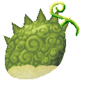
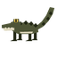
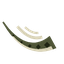
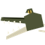
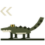

<!-- Generated by tools/build_pack_reference.py. Edit the pack sources and regenerate. -->

# Wani Wani no Mi, Model: Crocodile

{ .entry-page-icon }

[Fruits](index.md) · [InoFruits](../../reference/content/inofruits.md)

<!-- fruit inofruits:wani_wani_no_mi_model_crocodile -->

| Stat | Value |
| --- | --- |
| Type | Zoan |
| Tier | 2 |
| Fruit damage scaling | 1.00× at 10,000 Doriki → 2× at 50,000 Doriki |
| Abilities | 6 (6 active, 0 passive) |
| Fruit boxes | [Iron Box](../fruit-boxes.md) |

See [damage calculations](../combat-stats.md#damage-from-doriki).

!!! note "Reading the stats"
    Listed base damage is for the named part of the move. Pack and Doriki multipliers are shown separately. Times assume 20 ticks per second.

<!-- move inofruits:wani_wani_walk_point -->

## Wani Wani Walk Point

{ .entry-move-icon loading=lazy } *Active · Transformation*

Transforms the user into a crocodile, which is slow and armored on land but twice as fast in water.

| Stat | Value |
| --- | --- |
| Pack multiplier when dealing damage | 3.75× |

**Stats while transformed**

| Stat | Value |
| --- | --- |
| Movement speed | +10% of base |
| Punch damage | +10 HP |
| Armour | +9 |
| Toughness | +2.5 |

<!-- move inofruits:wani_wani_heavy_point -->

## Wani Wani Heavy Point

{ .entry-move-icon loading=lazy } *Active · Transformation*

Transforms the user into a crocodile hybrid with plates and long jaws, still good in the water

| Stat | Value |
| --- | --- |
| Pack multiplier when dealing damage | 3.75× |

**Stats while transformed**

| Stat | Value |
| --- | --- |
| Movement speed | +15% of base |
| Punch damage | +7 HP |
| Armour | +7 |
| Step height | +0.5 blocks |
| Toughness | +2 |

<!-- move inofruits:death_roll -->

## Death Roll

{ .entry-move-icon loading=lazy } *Active*

Grabs the target in the user's jaws and rolls, hurting it until released.

| Stat | Value |
| --- | --- |
| Maul damage | 1 HP |
| Finish damage | 8 HP |
| Cooldown | 12 s (240 ticks) |
| Pack multiplier when dealing damage | 3.75× |

<!-- move inofruits:tail_sweep -->

## Tail Sweep

{ .entry-move-icon loading=lazy } *Active*

Swings the tail around the user hitting everything nearby and pushing them away.

| Stat | Value |
| --- | --- |
| Base damage | 4 HP |
| Cooldown | 8 s (160 ticks) |
| Pack multiplier when dealing damage | 3.75× |

<!-- move inofruits:lunging_bite -->

## Lunging Bite

{ .entry-move-icon loading=lazy } *Active*

Lunges forward a few blocks biting the first enemy in the way. The whole crocodile lunges further and bites a lot harder.

| Stat | Value |
| --- | --- |
| Cooldown | 8 s (160 ticks) |
| Pack multiplier when dealing damage | 3.75× |

<!-- move inofruits:belly_crawl -->

## Belly Crawl

{ .entry-move-icon loading=lazy } *Active*

The user crawls low and fast, their next bite hits harder

| Stat | Value |
| --- | --- |
| Cooldown | 12 s (240 ticks) |
| Pack multiplier when dealing damage | 3.75× |

