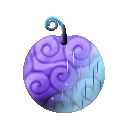
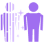
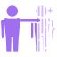
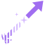
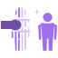
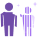

<!-- Generated by tools/build_pack_reference.py. Edit the pack sources and regenerate. -->

# Wapu Wapu no Mi

{ .entry-page-icon }

[Fruits](index.md) · [Missing Missing no Mi](../../reference/content/inomissing.md)

<!-- fruit inomissing:wapu_wapu_no_mi -->

| Stat | Value |
| --- | --- |
| Type | Paramecia |
| Tier | 2 |
| Fruit damage scaling | 1.00× at 10,000 Doriki → 2× at 50,000 Doriki |
| Abilities | 8 (8 active, 0 passive) |
| Fruit boxes | [Iron Box](../fruit-boxes.md) |

See [damage calculations](../combat-stats.md#damage-from-doriki).

!!! note "Reading the stats"
    Listed base damage is for the named part of the move. Pack and Doriki multipliers are shown separately. Times assume 20 ticks per second.

<!-- move inomissing:wapu_warp -->

## Warp

{ .entry-move-icon loading=lazy } *Active*

The user warps in an instant to where they look. They land on the ground, or in the air at the end of their sight and fall

| Stat | Value |
| --- | --- |
| Cooldown | 4 s (80 ticks) |
| Conditional cooldown | 0.5 s (10 ticks) |
| Pack multiplier when dealing damage | 1.5× |

<!-- move inomissing:wapu_warp_other -->

## Warp Other

{ .entry-move-icon loading=lazy } *Active*

The user touches the enemy in front of them and warps it to where they look. In the air, it falls. Bosses are too strong for it

| Stat | Value |
| --- | --- |
| Cooldown | 12 s (240 ticks) |
| Conditional cooldown | 0.5 s (10 ticks) |
| Pack multiplier when dealing damage | 1.5× |

<!-- move inomissing:wapu_group_warp -->

## Group Warp

{ .entry-move-icon loading=lazy } *Active*

The user warps where they look with the allies around them A player must be crouching to be taken

| Stat | Value |
| --- | --- |
| Cooldown | 30 s (600 ticks) |
| Conditional cooldown | 0.5 s (10 ticks) |
| Pack multiplier when dealing damage | 1.5× |

<!-- move inomissing:wapu_catch -->

## Catch

{ .entry-move-icon loading=lazy } *Active*

The user warps the ally they look at to their side, even from far away. An ally caught while falling takes no fall damage A player must be crouching to be caught

| Stat | Value |
| --- | --- |
| Cooldown | 20 s (400 ticks) |
| Conditional cooldown | 0.5 s (10 ticks) |
| Pack multiplier when dealing damage | 1.5× |

<!-- move inomissing:wapu_warp_shot -->

## Warp Shot

{ .entry-move-icon loading=lazy } *Active*

For a while every projectile the user fires vanishes and comes out behind the enemy they look at, flying at its back

| Stat | Value |
| --- | --- |
| Cooldown | 30 s (600 ticks) |
| Pack multiplier when dealing damage | 1.5× |

<!-- move inomissing:wapu_reflex_warp -->

## Reflex Warp

{ .entry-move-icon loading=lazy } *Active*

For a moment the user is on guard. The first hit or shot that comes misses them and they warp behind the one who dealt it

| Stat | Value |
| --- | --- |
| Cooldown | 20 s (400 ticks) |
| Pack multiplier when dealing damage | 1.5× |

<!-- move inomissing:wapu_behind_the_back -->

## Behind the Back

{ .entry-move-icon loading=lazy } *Active*

The user warps behind the enemy they look at, facing its back. Their next hit on it right after is stronger

| Stat | Value |
| --- | --- |
| Cooldown | 10 s (200 ticks) |
| Conditional cooldown | 0.5 s (10 ticks) |
| Pack multiplier when dealing damage | 1.5× |

<!-- move inomissing:wapu_scatter -->

## Scatter

{ .entry-move-icon loading=lazy } *Active*

Every enemy and projectile around the user is warped a few blocks away from them, each one somewhere else Their own pets and crouching allies stay. Bosses are too strong for it

| Stat | Value |
| --- | --- |
| Cooldown | 20 s (400 ticks) |
| Conditional cooldown | 0.5 s (10 ticks) |
| Pack multiplier when dealing damage | 1.5× |

