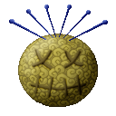
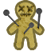
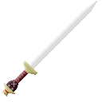
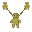
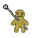
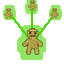

<!-- Generated by tools/build_pack_reference.py. Edit the pack sources and regenerate. -->

# Wara Wara no Mi

{ .entry-page-icon }

[Fruits](index.md) · [Mine Mine no Mi](../../reference/content/mineminenomi.md)

<!-- fruit mineminenomi:wara_wara_no_mi -->

| Stat | Value |
| --- | --- |
| Type | Paramecia |
| Tier | 3 |
| Fruit damage scaling | 1.00× at 10,000 Doriki → 1.75× at 50,000 Doriki |
| Abilities | 3 (2 active, 1 passive) |
| Fruit boxes | [Golden Box](../fruit-boxes.md) |

See [damage calculations](../combat-stats.md#damage-from-doriki).

[Jump to awakening](#awakening)

!!! note "Reading the stats"
    Listed base damage is for the named part of the move. Pack and Doriki multipliers are shown separately. Times assume 20 ticks per second.

<!-- move mineminenomi:straw_man -->

## Straw Man

{ .entry-move-icon loading=lazy } *Active*

Creates a doll that representing the entity you attacked, any damage will get redirected to it.

| Stat | Value |
| --- | --- |
| Cooldown | 30 s (600 ticks) |
| Pack multiplier when dealing damage | 6× |

<!-- move mineminenomi:warabide_sword -->

## Warabide Sword

{ .entry-move-icon loading=lazy } *Active*

Creates a sword that can shoot long thin straw-like projectiles.

| Stat | Value |
| --- | --- |
| Pack multiplier when dealing damage | 6× |

<!-- move mineminenomi:life_minus -->

## Life Minus

{ .entry-move-icon loading=lazy } *Passive*

Transfers the damage taken to a Straw Doll in your inventory.

| Stat | Value |
| --- | --- |
| Pack multiplier when dealing damage | 6× |

## Awakening

**Source** · Awaken Awaken no Mi

| Stat | Value |
| --- | --- |
| Doriki | 40,000 |
| Active time with the fruit | About 24 hours (1,728,000 ticks) |

<!-- move awakenawakennomi:harvest_of_fate -->

### Harvest of Fate { #awakening-harvest-of-fate }

{ .entry-move-icon loading=lazy } *Active*

Rips the straw doll out of every nearby enemy at once. Guarding enemies keep their doll and the user still can't carry more than ten

| Stat | Value |
| --- | --- |
| Cooldown | 45 s (900 ticks) |
| Empty cooldown | 3 s (60 ticks) |

<!-- move awakenawakennomi:nail_of_fate -->

### Nail of Fate { #awakening-nail-of-fate }

{ .entry-move-icon loading=lazy } *Active*

Drives a nail into the straw doll in the main hand, hitting its owner wherever they are. The doll is used up and goes back to its owner

| Stat | Value |
| --- | --- |
| Cooldown | 20 s (400 ticks) |
| Failed cooldown | 2 s (40 ticks) |
| Max damage | 60 HP |

<!-- move awakenawakennomi:shared_fate -->

### Shared Fate { #awakening-shared-fate }

{ .entry-move-icon loading=lazy } *Passive*

Damage the user takes is also dealt to the owners of every straw doll they carry. The user still takes their own damage normally
