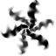

<!-- Generated by tools/build_pack_reference.py. Edit the pack sources and regenerate. -->

# Yami Yami no Mi

{ .entry-page-icon }

[Fruits](index.md) · [Mine Mine no Mi](../../reference/content/mineminenomi.md)

<!-- fruit mineminenomi:yami_yami_no_mi -->

| Stat | Value |
| --- | --- |
| Type | Logia |
| Tier | 3 |
| Fruit damage scaling | 1.00× at 10,000 Doriki → 1.75× at 50,000 Doriki |
| Abilities | 7 (6 active, 1 passive) |
| Fruit boxes | [Golden Box](../fruit-boxes.md) |

See [damage calculations](../combat-stats.md#damage-from-doriki).

[Jump to awakening](#awakening)

!!! note "Reading the stats"
    Listed base damage is for the named part of the move. Pack and Doriki multipliers are shown separately. Times assume 20 ticks per second.

<!-- move mineminenomi:black_hole -->

## Black Hole

{ .entry-move-icon loading=lazy } *Active*

The user spreads darkness over the target area, which engulfs and suffocates anyone and anything inside of it.

| Stat | Value |
| --- | --- |
| Max cooldown | 20 s (400 ticks) |
| Min cooldown | 10 s (200 ticks) |
| Pack multiplier when dealing damage | 4.7× |

<!-- move mineminenomi:black_road -->

## Black Road

{ .entry-move-icon loading=lazy } *Active*

The user spreads darkness in a forward path.

| Stat | Value |
| --- | --- |
| Cooldown | 20 s (400 ticks) |
| Pack multiplier when dealing damage | 4.7× |

<!-- move mineminenomi:liberation -->

## Liberation

{ .entry-move-icon loading=lazy } *Active*

The user sucks up any Darkness they've placed. The user releases all the Darkness stored at the location they're looking at.

| Stat | Value |
| --- | --- |
| Cooldown | 4 s (80 ticks) |
| Pack multiplier when dealing damage | 2.85× |

<!-- move mineminenomi:kurouzu -->

## Kurouzu

{ .entry-move-icon loading=lazy } *Active*

Creates a strong gravitational force, that pulls the opponent towards the user.

| Stat | Value |
| --- | --- |
| Cooldown | 12 s (240 ticks) |
| Base damage | 30 HP |
| Pack multiplier when dealing damage | 4.7× |

<!-- move mineminenomi:dark_matter -->

## Dark Matter

{ .entry-move-icon loading=lazy } *Active*

Launches a ball of darkness that engulfs the opponent.

| Stat | Value |
| --- | --- |
| Cooldown | 14 s (280 ticks) |
| Pack multiplier when dealing damage | 4.7× |

<!-- move mineminenomi:black_world -->

## Black World

{ .entry-move-icon loading=lazy } *Active*

The user spreads their power to the surroundings, blinding enemies and creating pillars of Darkness.

| Stat | Value |
| --- | --- |
| Cooldown | 10 s (200 ticks) |
| Pack multiplier when dealing damage | 4.7× |

<!-- move mineminenomi:absorbed_blocks -->

## Absorbed Blocks

{ .entry-move-icon loading=lazy } *Passive*

Displays the total amount of blocks the user has absorbed.

| Stat | Value |
| --- | --- |
| Pack multiplier when dealing damage | 4.7× |

## Awakening

**Source** · Awaken Awaken no Mi

| Stat | Value |
| --- | --- |
| Doriki | 40,000 |
| Active time with the fruit | About 24 hours (1,728,000 ticks) |

<!-- move awakenawakennomi:kyomu -->

### Kyomu { #awakening-kyomu }

{ .entry-move-icon loading=lazy } *Active*

Opens a dark void where no Devil Fruit works and the darkness hurts anyone inside. Devil Fruits stay silenced for a moment after leaving the void

| Stat | Value |
| --- | --- |
| Cooldown | 180 s (3600 ticks) |

<!-- move awakenawakennomi:singularity -->

### Singularity { #awakening-singularity }

{ .entry-move-icon loading=lazy } *Active*

Collapses every block the user has swallowed onto a single point, dragging everything nearby into it. The more blocks were swallowed the stronger the collapse, and it uses all of them.

| Stat | Value |
| --- | --- |
| Min damage | 90 HP |
| Max damage | 270 HP |
| Cooldown | 90 s (1800 ticks) |
| Aborted cooldown | 10 s (200 ticks) |

<!-- move awakenawakennomi:gluttony -->

### Gluttony { #awakening-gluttony }

{ .entry-move-icon loading=lazy } *Passive*

Everything the user has swallowed adds weight to their hits. The more they have stored, the harder they hit and the less damage they take Using up the stock takes the bonus away with it.
