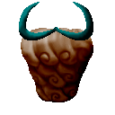

<!-- Generated by tools/build_pack_reference.py. Edit the pack sources and regenerate. -->

# Zou Zou no Mi, Model: Mammoth

{ .entry-page-icon }

[Fruits](index.md) · [Mine Mine no Mi](../../reference/content/mineminenomi.md)

<!-- fruit mineminenomi:zou_zou_no_mi_model_mammoth -->

| Stat | Value |
| --- | --- |
| Type | Ancient Zoan |
| Tier | 2 |
| Fruit damage scaling | 1.00× at 10,000 Doriki → 2× at 50,000 Doriki |
| Abilities | 7 (5 active, 2 passive) |
| Fruit boxes | [Iron Box](../fruit-boxes.md) |

See [damage calculations](../combat-stats.md#damage-from-doriki).

[Jump to awakening](#awakening)

!!! note "Reading the stats"
    Listed base damage is for the named part of the move. Pack and Doriki multipliers are shown separately. Times assume 20 ticks per second.

<!-- move mineminenomi:mammoth_guard_point -->

## Mammoth Guard Point

{ .entry-move-icon loading=lazy } *Active · Transformation*

Transforms the user into an ancient mammoth, which focuses on defense.

| Stat | Value |
| --- | --- |
| Pack multiplier when dealing damage | 1.8× |

<!-- move mineminenomi:mammoth_heavy_point -->

## Mammoth Heavy Point

{ .entry-move-icon loading=lazy } *Active · Transformation*

Transforms the user into an ancient mammoth hybrid, which focuses on strength.

| Stat | Value |
| --- | --- |
| Pack multiplier when dealing damage | 1.8× |

<!-- move mineminenomi:mammoth_trample -->

## Trample

*Passive*

Running speed increases with acceleration trampling any nearby entity.

| Stat | Value |
| --- | --- |
| Base damage | 6 HP |
| Pack multiplier when dealing damage | 1.8× |

<!-- move mineminenomi:ancient_stomp -->

## Ancient Stomp

{ .entry-move-icon loading=lazy } *Active*

Stomps the ground multiple times creating shockwaves that deal damage to all nearby enemies.

| Stat | Value |
| --- | --- |
| Cooldown | 10 s (200 ticks) |
| Base damage | 10 HP |
| Pack multiplier when dealing damage | 1.8× |

<!-- move mineminenomi:ancient_sweep -->

## Ancient Sweep

{ .entry-move-icon loading=lazy } *Active*

Hits all enemies in a frontal cone with your trunk.

| Stat | Value |
| --- | --- |
| Cooldown | 8 s (160 ticks) |
| Heavy damage | 15 HP |
| Guard damage | 20 HP |
| Pack multiplier when dealing damage | 1.8× |

<!-- move mineminenomi:ancient_trunk_shot -->

## Ancient Trunk Shot

{ .entry-move-icon loading=lazy } *Active*

Hit using the massive trunk.

| Stat | Value |
| --- | --- |
| Cooldown | 5 s (100 ticks) |
| Pack multiplier when dealing damage | 1.4× |

<!-- move mineminenomi:mammoth_rideable -->

## Mammoth Rideable

*Passive*

Allows other players to ride on your back.

| Stat | Value |
| --- | --- |
| Pack multiplier when dealing damage | 1.8× |

## Awakening

**Source** · Awaken Awaken no Mi

| Stat | Value |
| --- | --- |
| Doriki | 40,000 |
| Active time with the fruit | About 24 hours (1,728,000 ticks) |

<!-- move awakenawakennomi:awaken_mammoth_heavy_point -->

### Awaken Mammoth Heavy Point { #awakening-awaken-mammoth-heavy-point }

{ .entry-move-icon loading=lazy } *Active · Transformation*

Transforms the user into an awakened mammoth hybrid, which focuses on strength.

| Stat | Value |
| --- | --- |
| Cooldown | 0.5 s (10 ticks) |

**Stats while transformed**

| Stat | Value |
| --- | --- |
| Movement speed | +40% of base |
| Armour | +25 |
| Punch damage | +18 HP |
| Maximum health | +25% |
| Toughness | +8 |
| Jump | +2 |
| Step height | +1 blocks |

<!-- move awakenawakennomi:awaken_mammoth_guard_point -->

### Awaken Mammoth Guard Point { #awakening-awaken-mammoth-guard-point }

{ .entry-move-icon loading=lazy } *Active · Transformation*

Transforms the user into an awakened mammoth, which focuses on defense.

| Stat | Value |
| --- | --- |
| Cooldown | 0.5 s (10 ticks) |

**Stats while transformed**

| Stat | Value |
| --- | --- |
| Movement speed | +20% of base |
| Maximum health | +40% |
| Armour | +40 |
| Punch damage | +15 HP |
| Step height | +1 blocks |
| Toughness | +10 |
| Jump | +1.5 |

<!-- move awakenawakennomi:drought_calamity -->

### Drought Calamity { #awakening-drought-calamity }

{ .entry-move-icon loading=lazy } *Active*

Stomps the ground so hard all the water in the area dries up, leaving a wasteland and rotting enemies.

| Stat | Value |
| --- | --- |
| Cooldown | 60 s (1200 ticks) |
| Base damage | 70 HP |

<!-- move awakenawakennomi:drought_siphon -->

### Drought Siphon { #awakening-drought-siphon }

{ .entry-move-icon loading=lazy } *Active*

The mammoth raises its trunk and sucks the water out of every enemy around it, healing as much as they lose. Enemies that are wet from water or rain lose twice as much and are left dried out and slowed.

| Stat | Value |
| --- | --- |
| Pulse damage | 12 HP |
| Max cooldown | 45 s (900 ticks) |
| Min cooldown | 15 s (300 ticks) |
| Cooldown | 45 s (900 ticks) |

<!-- move awakenawakennomi:ancient_hide -->

### Ancient Hide { #awakening-ancient-hide }

{ .entry-move-icon loading=lazy } *Passive*

In an awakened form a single hit can never take more than a small part of the mammoth's health. Its wool keeps it warm so it can't be frozen or get frostbite.
