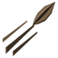

<!-- Generated by tools/build_pack_reference.py. Edit the pack sources and regenerate. -->

# Zuku Zuku no Mi, Model: Owl

{ .entry-page-icon }

[Fruits](index.md) · [InoFruits](../../reference/content/inofruits.md)

<!-- fruit inofruits:zuku_zuku_no_mi_model_owl -->

| Stat | Value |
| --- | --- |
| Type | Zoan |
| Tier | 2 |
| Fruit damage scaling | 1.00× at 10,000 Doriki → 2× at 50,000 Doriki |
| Abilities | 7 (5 active, 2 passive) |
| Fruit boxes | [Iron Box](../fruit-boxes.md) |

See [damage calculations](../combat-stats.md#damage-from-doriki).

!!! note "Reading the stats"
    Listed base damage is for the named part of the move. Pack and Doriki multipliers are shown separately. Times assume 20 ticks per second.

<!-- move inofruits:zuku_zuku_fly_point -->

## Zuku Zuku Fly Point

{ .entry-move-icon loading=lazy } *Active · Transformation*

Transforms the user into an owl, which is bad on foot but light as a feather when falling

| Stat | Value |
| --- | --- |
| Pack multiplier when dealing damage | 5.75× |

**Stats while transformed**

| Stat | Value |
| --- | --- |
| Movement speed | +25% of base |
| Punch damage | +3 HP |
| Armour | +2 |
| Jump | +1.1 |

<!-- move inofruits:zuku_zuku_assault_point -->

## Zuku Zuku Assault Point

{ .entry-move-icon loading=lazy } *Active · Transformation*

Transforms the user into an owl hybrid with talons, a beak and wings for arms.

| Stat | Value |
| --- | --- |
| Pack multiplier when dealing damage | 5.75× |

**Stats while transformed**

| Stat | Value |
| --- | --- |
| Movement speed | +20% of base |
| Punch damage | +5 HP |
| Armour | +3 |
| Toughness | +1.5 |
| Jump | +0.9 |

<!-- move inofruits:zuku_zuku_flight -->

## Zuku Zuku Flight

{ .entry-move-icon loading=lazy } *Passive*

| Stat | Value |
| --- | --- |
| Pack multiplier when dealing damage | 5.75× |

<!-- move inofruits:anshi -->

## Anshi

{ .entry-move-icon loading=lazy } *Passive*

While in either owl form, the user can see perfectly in the dark.

| Stat | Value |
| --- | --- |
| Pack multiplier when dealing damage | 5.75× |

<!-- move inofruits:washizukami -->

## Washizukami

{ .entry-move-icon loading=lazy } *Active*

The owl grabs whatever it flies into with its talons and carries it.

| Stat | Value |
| --- | --- |
| Cooldown | 10 s (200 ticks) |
| Pack multiplier when dealing damage | 5.75× |

<!-- move inofruits:habataki -->

## Habataki

{ .entry-move-icon loading=lazy } *Active*

The user flaps their wings once, launching everything within 8 blocks away and up.

| Stat | Value |
| --- | --- |
| Base damage | 3 HP |
| Cooldown | 10 s (200 ticks) |
| Pack multiplier when dealing damage | 5.75× |

<!-- move inofruits:kazakiribane -->

## Kazakiribane

{ .entry-move-icon loading=lazy } *Active*

Pulls out a flight feather and throws it, flying straight without dropping

| Stat | Value |
| --- | --- |
| Cooldown | 2.5 s (50 ticks) |
| Pack multiplier when dealing damage | 3.4× |

