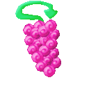
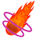
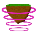
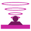

<!-- Generated by tools/build_pack_reference.py. Edit the pack sources and regenerate. -->

# Zushi Zushi no Mi

{ .entry-page-icon }

[Fruits](index.md) · [Mine Mine no Mi](../../reference/content/mineminenomi.md)

<!-- fruit mineminenomi:zushi_zushi_no_mi -->

| Stat | Value |
| --- | --- |
| Type | Paramecia |
| Tier | 3 |
| Fruit damage scaling | 1.00× at 10,000 Doriki → 1.75× at 50,000 Doriki |
| Abilities | 6 (6 active, 0 passive) |
| Fruit boxes | [Golden Box](../fruit-boxes.md) |

See [damage calculations](../combat-stats.md#damage-from-doriki).

[Jump to awakening](#awakening)

After awakening, this fruit’s original damaging moves deal **1.5× damage**. The awakening techniques below have their own values.

!!! note "Reading the stats"
    Listed base damage is for the named part of the move. Pack and Doriki multipliers are shown separately. Times assume 20 ticks per second.

<!-- move mineminenomi:jigoku_tabi -->

## Jigoku Tabi

{ .entry-move-icon loading=lazy } *Active*

Causes a powerful downward force of gravity, sending the enemies down in a crater. The longer its used the more damage it'll deal and the larger the crater will become.

| Stat | Value |
| --- | --- |
| Min cooldown | 5 s (100 ticks) |
| Max cooldown | 17 s (340 ticks) |
| Min damage | 8 HP |
| Max damage | 12 HP |
| Pack multiplier when dealing damage | 1.35× |

<!-- move mineminenomi:sagari_no_ryusei -->

## Sagari no Ryusei

{ .entry-move-icon loading=lazy } *Active*

Using gravity, the user pulls one (or rarely two) meteorites down on their enemies.

| Stat | Value |
| --- | --- |
| Cooldown | 45 s (900 ticks) |
| Pack multiplier when dealing damage | 1.3× |

<!-- move mineminenomi:moko -->

## Moko

{ .entry-move-icon loading=lazy } *Active*

Sends a wave of gravitational waves toward the enemies, slowing them down.

| Stat | Value |
| --- | --- |
| Cooldown | 14 s (280 ticks) |
| Pack multiplier when dealing damage | 1.35× |

<!-- move mineminenomi:abare_himatsuri -->

## Abare Himatsuri

{ .entry-move-icon loading=lazy } *Active*

Makes the user fly using gravity on the ground below you.

| Stat | Value |
| --- | --- |
| Cooldown | 15 s (300 ticks) |
| Pack multiplier when dealing damage | 1.35× |

<!-- move mineminenomi:gravi_zone -->

## Gravi Zone: Guard

{ .entry-move-icon loading=lazy } *Active*

Creates an area in which entities cannot move. Creates an area which pushed away all enemies.

| Stat | Value |
| --- | --- |
| Cooldown | 10 s (200 ticks) |
| Reject damage | 10 HP |
| Base damage | 10 HP |
| Pack multiplier when dealing damage | 1.35× |

<!-- move mineminenomi:gravi_pull -->

## Gravi Pull

{ .entry-move-icon loading=lazy } *Active*

Pulls all enemies in a radius toward the user.

| Stat | Value |
| --- | --- |
| Cooldown | 17 s (340 ticks) |
| Pack multiplier when dealing damage | 1.35× |

## Awakening

**Source** · Awaken Awaken no Mi

| Stat | Value |
| --- | --- |
| Doriki | 40,000 |
| Active time with the fruit | About 24 hours (1,728,000 ticks) |

<!-- move awakenawakennomi:ukiyo -->

### Ukiyo { #awakening-ukiyo }

{ .entry-move-icon loading=lazy } *Active*

Turns off gravity in the zone, lifting every enemy off the ground and leaving them floating helpless When the zone ends everyone falls back down, the higher they floated the harder they land.

| Stat | Value |
| --- | --- |
| Min damage | 30 HP |
| Max damage | 140 HP |
| Cooldown | 150 s (3000 ticks) |

<!-- move awakenawakennomi:deadweight -->

### Deadweight { #awakening-deadweight }

{ .entry-move-icon loading=lazy } *Active*

The user looks at one enemy and crushes it under the weight of the sky. The pressure keeps going up, pushing the target into the ground and ignoring armor. Looking away lets the weight go.

| Stat | Value |
| --- | --- |
| Min pulse damage | 16 HP |
| Max pulse damage | 48 HP |
| Total damage | 160 HP |
| Max cooldown | 45 s (900 ticks) |
| Min cooldown | 12 s (240 ticks) |
| Cooldown | 45 s (900 ticks) |

<!-- move awakenawakennomi:zenith -->

### Zenith { #awakening-zenith }

{ .entry-move-icon loading=lazy } *Passive*

The higher the user is off the ground, the harder they hit and the faster they fly The user never takes fall damage. Gives nothing while standing on solid ground
