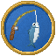

# Fisher

{ .entry-page-icon }

[All professions](index.md)

Cast a rod as usual and reel in when it bites. Cruise replaces eligible fish rolls with its own catches based on the water, depth and your trade level. Only Cruise catches award ordinary fishing XP. Size affects the quality of a [Cook’s dishes](cook.md#cook-for-the-job-ahead) and the value of your catch. Check the **Bestiary** for first-catch milestones and a **Record Board** for fishing records.

## Rods and fishing grounds

The [Inventor](inventor.md) makes the plain, Whopper and Sea King rods and their parts. Use the Upgrade Bench for reels and line upgrades. A [Fishing Boat](carpenter.md) improves catch odds. Search for schools, watch for storms that help weather-sensitive catches, and enter fishing tournaments for medals. At **Fisher 40**, the Sea King Fishing Rod can fish in lava.

### Rods and fittings

| Rod | Inventor level | Durability | Size bonus |
| --- | ---: | ---: | ---: |
| Vanilla Fishing Rod | — | 64 | — |
| Whopper Fishing Rod | 5 | 128 | +0.35 |
| Sea King Fishing Rod | 32 | 320 | +0.50 |

| Fitting (Inventor level) | Vanilla | Whopper | Sea King |
| --- | --- | --- | --- |
| Fishing Rod Upgrade (8) | Size +0.20 | Size +0.10 | Size +0.05 |
| Fishing Line Upgrade (8) | Chance ×1.50 | Chance ×1.35 | Chance ×1.25 |
| Whopper Rod Upgrade (18) | Size +0.10 | Size +0.25 | Size +0.15 |
| Sea King Rod Upgrade (40) | Size +0.10, chance ×1.10 | Size +0.20, chance ×1.15 | Size +0.30, chance ×1.25 |

Place the rod in the Upgrade Bench’s left slot and a part in the middle. Each part fits once per rod. A total size bonus of **+1.00** brings catches in at maximum size. Bait from the Hunter’s Tannery multiplies Cruise catch odds by **1.35 for two minutes**, and fishing from a Fishing Boat multiplies them by **1.25**. Any rod can hook a Sea King when the waters and your level qualify.

## Sea Kings

Fish for Sea Kings in the **Calm Belt**, with at least **20, 24 or 28 blocks of water** below the hook for the level **44, 47 or 50** entry respectively. These catches summon a living Sea King to fight. Bring a crew and a [coated ship](../../voyage/shipbuilding.md#kairoseki-coating) for the trip. Check [Sea King encounters](../../world/loot.md#sea-kings) before setting out. Scales, fins and other drops go into higher-end crew recipes.

## Combat techniques

Hold a fishing rod for these techniques.

| Technique | Effect | Cooldown | Base damage | Reach |
| --- | --- | ---: | ---: | ---: |
| Big Catch | Lifts and slams a target, damaging nearby enemies too. | 15 s | 50 target / 25 area | 6 blocks |
| Hook Shot | Pulls a target toward you. A target too large to pull brings you to it instead. | 8 s | 20 HP | 16 blocks |
| Line Snare | Binds a target for 3 seconds, halved for players and bosses. | 14 s | 10 HP | 12 blocks |

<!-- Pack profession tables -->

## Catch catalogue

Chances are base entry values. The place, depth and your level determine which catches can roll. Special conditions such as weather, dimension and fishing in lava still apply.

| Catch | Level | Waters | Depth | Chance | Size (cm) | XP / first |
| --- | --- | --- | --- | --- | --- | --- |
| Forked-Tail Killifish | 1 | River, Beach, Ocean, Swamp | 1–64 | 35.00% | 4–8 | 10 / 50 |
| Striped Clam | 1 | Beach, Ocean | 1–8 | 30.00% | 4–9 | 10 / 50 |
| Fist Crayfish | 6 | River, Swamp | 2–64 | 30.00% | 8–16 | 20 / 100 |
| Cutie Piranha | 8 | Jungle, Sparse Jungle, Bamboo Jungle, Lush Caves | 1–32 | 28.00% | 15–35 | 24 / 120 |
| Glistening Saury | 9 | Forest, Ocean | 2–64 | 30.00% | 25–45 | 26 / 130 |
| Scissor Shrimp | 10 | River, Beach, Stony Shore, Windswept Hills | 1–24 | 25.00% | 10–30 | 28 / 140 |
| Autumn Leaves Salmon | 11 | River, Frozen River, Taiga, Cherry Grove | 2–32 | 18.00% | 45–80 | 30 / 150 |
| Butterflyfish | 12 | Warm Ocean, Lukewarm Ocean, Deep Lukewarm Ocean | 3–48 | 22.00% | 10–20 | 32 / 160 |
| Pumpkin Octopus | 14 | Beach, Warm Ocean, Lukewarm Ocean | 4–32 | 16.00% | 35–70 | 36 / 180 |
| Adventure Fish | 16 | River, Beach, Ocean, Lush Caves, Dripstone Caves, Mountain | 1–64 | 20.00% | 40–90 | 40 / 200 |
| Treasure Pargai | 18 | Beach, Forest, Warm Ocean, Lukewarm Ocean | 2–48 | 14.00% | 12–30 | 44 / 220 |
| Bone Fish | 20 | Desert, Warm Ocean, Lukewarm Ocean, Deep Lukewarm Ocean | 1–64 | 12.00% | 20–40 | 48 / 240 |
| Smiley Jellyfish | 20 | Ocean | 8–256 | 10.00% | 20–40 | 48 / 240 |
| Balloon Catfish | 22 | Warm Ocean, Lukewarm Ocean, Deep Lukewarm Ocean, Swamp, Mangrove Swamp | 6–20 | 8.00% | 30–60 | 52 / 260 |
| Lantern Trilobite | 22 | Lush Caves, Dripstone Caves · Y at most 45 | 1–32 | 35.00% | 8–18 | 52 / 260 |
| Guidance Monkfish | 24 | Lush Caves, Dripstone Caves, Deep Dark · Y at most 30 | 2–64 | 18.00% | 40–90 | 56 / 280 |
| Caltrop Starfish | 25 | Warm Ocean, Lukewarm Ocean, Beach, Desert | 2–256 | 6.00% | 15–30 | 58 / 290 |
| Lovely Angel | 26 | Forest, Cherry Grove, River | 2+ | 8.00% | 15–30 | 60 / 300 |
| Lovely Angel | 26 | Cloud Sea | 1+ | 15.00% | 15–30 | 60 / 300 |
| Lovely Angel | 26 | Any eligible area · Y at least 150 | 1+ | 10.00% | 15–30 | 60 / 300 |
| Icefish | 27 | Frozen River, Frozen Ocean, Deep Frozen Ocean, Snowy Plains, Snowy Taiga, Snowy Slopes, Jagged Peaks, Frozen Peaks, Ice Spikes | 1–64 | 20.00% | 25–50 | 62 / 310 |
| Ice Sunfish | 28 | Cold Ocean, Deep Cold Ocean, Frozen Ocean, Deep Frozen Ocean | 10–256 | 8.00% | 80–180 | 64 / 320 |
| Shark | 30 | Deep Ocean | 16–256 | 5.00% | 150–400 | 68 / 340 |
| Missile Manta Ray | 32 | Deep Ocean | 20–256 | 6.00% | 150–400 | 72 / 360 |
| Hydramandrake | 34 | Swamp, Mangrove Swamp | 2–256 | 4.00% | 80–200 | 76 / 380 |
| Salamandrake | 36 | Desert, Badlands, Warm Ocean, Deep Lukewarm Ocean | 3–256 | 4.00% | 40–90 | 80 / 400 |
| Sky Fish | 38 | Any eligible area · Y at least 150 | 3+ | 8.00% | 30–70 | 84 / 420 |
| Sky Fish | 38 | Cloud Sea | 3+ | 12.00% | 30–70 | 84 / 420 |
| Lava Flounder | 40 | Any eligible area · Lava | 1–64 | 15.00% | 30–70 | 88 / 440 |
| Great Terigius | 42 | Deep Cold Ocean, Deep Frozen Ocean, Deep Ocean | 24+ | 3.00% | 200–500 | 92 / 460 |
| Giant Sky Fish | 44 | Any eligible area · Y at least 150 | 5+ | 3.00% | 150–350 | 96 / 480 |
| Giant Sky Fish | 44 | Cloud Sea | 5+ | 5.00% | 150–350 | 96 / 480 |
| Sea King | 44 | Calm Belt | 20–256 | 1.00% | — | 200 / 1000 |
| Skull Knight | 45 | Stony Shore, Windswept Hills, Windswept Gravelly Hills, River, Dripstone Caves · Y at most 60 | 6–64 | 3.50% | 20–45 | 98 / 490 |
| Beat Alligator | 46 | Swamp, Mangrove Swamp | 3+ | 2.50% | 250–600 | 100 / 500 |
| Burning Dragon | 47 | Any eligible area · Lava | 2–64 | 12.00% | 200–420 | 102 / 510 |
| Extra-large Sea King | 47 | Calm Belt | 24–256 | 0.70% | — | 300 / 1500 |
| Aurora Sunfish | 49 | Deep Frozen Ocean, Frozen Ocean, Deep Cold Ocean | 12–256 | 2.50% | 180–330 | 106 / 530 |
| Golden Whale | 50 | Deep Ocean | 24–256 | 1.50% | 800–1400 | 108 / 540 |
| Goldfish Sea King | 50 | Calm Belt | 28–256 | 0.40% | — | 450 / 2250 |

## Devil Fruit bonuses

These fruits also grant **15% more XP** in this trade.

| Fruit | Additional effect |
| --- | --- |
| [Ami Ami no Mi](../fruits/ami_ami_no_mi.md) | Shorter profession ability cooldowns |

## Talents

Spend your talent points in the profession book. Techniques open in the **Profession** tab of the ability screen.

| Talent | Kind | Effect | Connects to |
| --- | --- | --- | --- |
| Bigger catch 1 | Small · Start | Your catches run 3% bigger | Whopper |
| Bigger catch 2 | Small | Your catches run 3% bigger | Whopper, Good eye |
| Whopper | Major | Your catches run 10% bigger | Bigger catch 1, Bigger catch 3, Bigger catch 2, Fighting Fisher 1, Trophy Fish |
| Bigger catch 3 | Small | Your catches run 3% bigger | Whopper, Big Catch |
| Good eye | Small | A catch gives 5% more Fisher XP | Bigger catch 2, Big Catch |
| Trophy Fish | Major | A catch at its top size sells 25% dearer | Low Tide, Whopper |
| More bites 1 | Small · Start | Cruise fish bite 4% more often | Good Waters |
| More bites 2 | Small | Cruise fish bite 4% more often | Good Waters, Second fish 2 |
| Good Waters | Major | Cruise fish bite 20% more often | More bites 1, Second fish 1, More bites 2, Fighting Fisher 1, Double Hook |
| Second fish 1 | Small | 2% more chance of a second fish on the line | Good Waters, Line Snare |
| Second fish 2 | Small | 2% more chance of a second fish on the line | More bites 2, Line Snare |
| Double Hook | Major | 10% chance of a second fish on the line | Good Waters, Long Line |
| Deep bites 1 | Small · Start | Fish bite 5% more often over 20 blocks of water or more | Long Line |
| Deep bites 2 | Small | Fish bite 5% more often over 20 blocks of water or more | Long Line, Sea King slayer 2 |
| Long Line | Major | The water under your hook counts 50% deeper | Deep bites 1, Sea King slayer 1, Deep bites 2, Double Hook, Fighting Fisher 2 |
| Sea King slayer 1 | Small | You hit Sea Kings 5% harder | Long Line, Sea King Hunter |
| Sea King slayer 2 | Small | You hit Sea Kings 5% harder | Deep bites 2, Sea King Hunter |
| Sea King Hunter | Major | Sea Kings bite 2 times as often for you | Sea King slayer 1, Sea King slayer 2 |
| Shore bites 1 | Small · Start | Fish bite 5% more often over less than 8 blocks of water | Low Tide |
| Shore bites 2 | Small | Fish bite 5% more often over less than 8 blocks of water | Low Tide, Lasting bait 2 |
| Low Tide | Major | 25% of your shellfish come with a second | Shore bites 1, Lasting bait 1, Shore bites 2, Fighting Fisher 2, Trophy Fish |
| Lasting bait 1 | Small | Your bait lasts 15% longer | Low Tide, Patient Angler |
| Lasting bait 2 | Small | Your bait lasts 15% longer | Shore bites 2, Patient Angler |
| Patient Angler | Major | The bite comes 15% sooner | Lasting bait 1, Lasting bait 2 |
| Hook Shot | Ability | Needs a fishing rod. Cast the hook at a foe up to 16 blocks away. It hurts him and pulls him to you | Fighting Fisher 1 |
| Line Snare | Ability | Needs a fishing rod. Your line binds a foe where he stands for 3 seconds | Second fish 1, Second fish 2 |
| Harpoon Throw | Ability | Throw a heavy harpoon. It hits harder a foe who is in water | Fighting Fisher 2 |
| Big Catch | Ability | Needs a fishing rod. Lift a hooked foe and slam him down. It hits those around | Bigger catch 3, Good eye |
| Fighting Fisher 1 | Small | Your Fisher abilities hit 5% harder | Whopper, Good Waters, Hook Shot |
| Fighting Fisher 2 | Small | Your Fisher abilities hit 5% harder | Long Line, Low Tide, Harpoon Throw |

## Quest chapter

[[Ami Ami no Mi](../fruits/ami_ami_no_mi.md) milestones and rewards](../../reference/quests/fisher.md).
