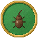

# Hunter

{ .entry-page-icon }

[All professions](index.md)

Craft a **Bug Catcher Net** with three string and two sticks. Sneak toward small creatures and use the net on them. The basic net gives **64 captures**. Catching a creature puts it in your inventory and can yield eggs, nectar or sap. Higher-level creatures demand the required Hunter level, and some are easier to reach with better net parts or traps from the [Inventor](inventor.md).

## Fill the Bestiary

Use the Bestiary to plan a trip around creatures you have yet to capture. Approach without scaring them, watch perches for small animals and use traps where a species is hard to reach. Rare variants award extra XP. Level 30 opens big-game hunts, and the later beasts require more Hunter levels. The Tannery turns hides and catches into parts for the [Tailor](tailor.md), bait, and other supplies.

## Combat techniques

| Technique | Effect | Cooldown | Base damage |
| --- | --- | ---: | ---: |
| Snap Trap | Places a trap for 30 seconds. Its first victim is held for 4 seconds. | 20 s | 30 HP |
| Hornet Swarm | Sends hornets up to 16 blocks to sting for 6 seconds and poison nearby enemies. | 25 s | 45 HP |
| Net Throw | Needs a bug net. Binds the target for up to 3 seconds and slows enemies near it. | 14 s | 10 HP |

<!-- Pack profession tables -->

## Small creatures

| Creature | Level | Habitat | Tool | XP / first | Rare XP |
| --- | --- | --- | --- | --- | --- |
| Doctor Hornet | 1 | Hornet Habitat | Net | 14 / 56 | 1× |
| Hercules Beetle | 1 | Jungle, Forest | Net | 14 / 56 | 3× |
| Mole | 1 | Mole Habitat | Net | 14 / 56 | 1× |
| Seagull | 1 | Beach, Ocean, Stony Shore | Net | 14 / 56 | 1× |
| Swallowtail Butterfly | 1 | See the Bestiary | Net | 14 / 56 | 3× |
| Tempest Mouse | 1 | See the Bestiary | Net | 14 / 56 | 1× |
| Tree Frog | 6 | Forest, River | Net | 24 / 96 | 1× |
| Clawed Scorpion | 8 | Desert, Badlands | Net | 28 / 112 | 1× |
| Rock Lizard | 8 | Desert, Badlands | Net | 28 / 112 | 1× |
| Umbrella Frog | 8 | Jungle, River | Net | 28 / 112 | 1× |
| Jungle Lizard | 10 | Jungle | Net | 32 / 128 | 1× |
| Lantern Firefly | 10 | River, Swamp, Forest | Net | 32 / 128 | 1× |
| Oil Stain Frog | 12 | Any eligible area | Net | 36 / 144 | 1× |
| Red-Eyed Spotted Frog | 12 | Swamp, Swamp | Net | 36 / 144 | 1× |
| Hidden Forest Bee | 14 | Jungle | Net | 40 / 160 | 1× |
| Horned Icicle Lizard | 14 | Snowy, Frozen Peaks, Jagged Peaks, Snowy Slopes | Net | 40 / 160 | 1× |
| Lightbulb Firefly | 14 | Any eligible area | Net | 40 / 160 | 1× |
| Fire Hercules | 15 | Desert, Badlands | Net | 42 / 168 | 1× |
| Atlas Beetle | 16 | Forest | Net | 44 / 176 | 1× |
| Ice Miyama Stag Beetle | 16 | Snowy Taiga, Grove, Old Growth Pine Taiga | Net | 44 / 176 | 1× |
| Purple Poison Frog | 16 | Any eligible area | Net | 44 / 176 | 1× |
| Crossbone Butterfly | 18 | Swamp, Swamp | Net | 48 / 192 | 1× |
| Doze Evil Eye Butterfly | 18 | Any eligible area | Net | 48 / 192 | 1× |
| Flying Penguin | 20 | Frozen Ocean, Deep Frozen Ocean, Snowy Beach, Ice Spikes | Net | 52 / 208 | 1× |
| Giant Devil Hand Moth | 20 | Swamp, Swamp | Net | 52 / 208 | 1× |
| A Class Toad | 22 | Snowy, Frozen Peaks, Jagged Peaks, Snowy Slopes | Net | 56 / 224 | 1× |
| Thunder Spider | 22 | Has Structure/Sky Island | Enhanced Bug Catcher Net | 56 / 224 | 1× |
| Antlion Lacewing | 24 | See the Bestiary | Net | 60 / 240 | 1× |
| Lightning Beetle | 25 | Has Structure/Sky Island | Enhanced Bug Catcher Net | 62 / 248 | 1× |
| Spirit Firefly | 30 | Swamp, Swamp | Enhanced Bug Catcher Net | 72 / 288 | 1× |
| Rainbow Phoenix | 40 | Has Structure/Sky Island | Net | 92 / 368 | 1× |

## Trapping

| Creature | Habitat | Open sky | Trap |
| --- | --- | --- | --- |
| Antlion Lacewing | Desert, Badlands | Yes | Enhanced |
| Seagull | Beach, Ocean, River, Stony Shore | Yes | Standard or enhanced |
| Swallowtail Butterfly | Plains, Sunflower Plains, Meadow, Flower Forest, Cherry Grove, Forest, Birch Forest | Yes | Standard or enhanced |
| Tempest Mouse | Plains, Sunflower Plains, Meadow, Forest, Taiga, Savanna | No | Standard or enhanced |

## Big game

| Beast | Level | XP / first |
| --- | --- | --- |
| Den Den Mushi | 30 | 30 / 120 |
| Super Spot-Billed Duck | 30 | 50 / 200 |
| Flying Fish | 32 | 60 / 240 |
| White Walkie | 33 | 70 / 280 |
| Boxing Dugong | 35 | 90 / 360 |
| Wrestling Dugong | 36 | 90 / 360 |
| Kung Fu Dugong | 37 | 100 / 400 |
| Bananawani | 38 | 110 / 440 |
| Fighting Fish | 40 | 120 / 480 |
| Blugori | 41 | 120 / 480 |
| Lapahn | 42 | 130 / 520 |
| Blagori | 44 | 140 / 560 |
| Humandrill | 47 | 170 / 680 |
| Legendary Master Dugong | 50 | 220 / 880 |

## Tannery

Craft the workstation at a crafting table.

| Top row | Middle row | Bottom row |
| --- | --- | --- |
| Leather · Leather · Leather | Leather · Crafting Table · Leather | Any Planks · Any Planks · Any Planks |

### Recipes

| Makes | Level | Yield | XP | Ingredients |
| --- | --- | --- | --- | --- |
| Leather | 5 | 3 | 20 | 2 × Any Hides |
| Firefly Lantern | 12 | 1 | 34 | 3 × Any Fireflies, Glass, Iron Nugget |
| Slime Ball | 16 | 2 | 42 | 2 × Any Frogs |
| Bait | 22 | 4 | 54 | 2 × Any Wings, Any Hides, Nectar |
| Scent Lure | 38 | 2 | 86 | 2 × Any Hides, 2 × Nectar, Any Wings, Glass Bottle |
| Specimen Case | 46 | 1 | 102 | 5 × Glass, 2 × Any Planks, Iron Nugget, Marble |

## Talents

Spend your talent points in the profession book. Techniques open in the **Profession** tab of the ability screen.

| Talent | Kind | Effect | Connects to |
| --- | --- | --- | --- |
| Careful catch 1 | Small · Start | 8% more chance that a net or a trap is not worn by a catch | Careful Hands |
| Careful Hands | Major | Your nets and traps wear half as fast | Careful catch 1, Long handle, Good hand 2, Light Step |
| Long handle | Small | Your net reaches half a block further | Careful Hands, Master Trapper |
| Master Trapper | Major | 25% of your traps that catch are not used up | Long handle, Net Throw, Careful catch 2 |
| Fighting Hunter 1 | Small · Start | Your Hunter abilities hit 5% harder | Good hand 2 |
| Net Throw | Ability | Needs a bug net. Throw a net at a foe. It wraps him 3 seconds and slows those by him | Master Trapper, Snap Trap |
| Tight knots | Small | Your net and your trap hold 10% longer | Good hand 2, Snap Trap |
| Snap Trap | Ability | Lay a trap for 30 seconds. The first foe on it is hurt and held 4 seconds | Net Throw, Tight knots, Sharp eye 2 |
| Sharp eye 1 | Small · Start | Rare variants are 10% more common around you | Keen Eye |
| Keen Eye | Major | Rare variants are twice as common around you | Good hand 2, Sharp eye 1, New page, Full Bag |
| New page | Small | The first catch of a kind gives 10% more Hunter XP | Keen Eye, Collector |
| Collector | Major | A rare variant pays 5 times its XP instead of 3 | Sharp eye 2, New page, Heavy net 2 |
| Heavy net 1 | Small · Start | 3% more chance that a catch's drops come twice | Full Bag |
| Full Bag | Major | 20% chance that a catch's drops come twice | Keen Eye, Heavy net 1, Beast slayer 1, Soft step 2 |
| Beast slayer 1 | Small | You hit big game 5% harder | Full Bag, Big Game Hunter |
| Big Game Hunter | Major | A beast you hunt gives 50% more Hunter XP | Heavy net 2, Beast slayer 1, Beast slayer 2 |
| Fighting Hunter 2 | Small · Start | Your Hunter abilities hit 5% harder | Soft step 2 |
| Hunter's Mark | Ability | Mark a foe for 20 seconds. You see him through walls and your blows do 15% more to him | Hornet Swarm, Still Air |
| Long trail | Small | Your mark lasts 10% longer | Soft step 2, Hornet Swarm |
| Hornet Swarm | Ability | Send a swarm at a foe. It stings him 6 seconds and poisons those by him | Beast slayer 2, Long trail, Hunter's Mark |
| Soft step 1 | Small · Start | Creatures notice you half a block later | Light Step |
| Light Step | Major | Creatures notice you 2 blocks later | Soft step 2, Soft step 1, Good hand 1, Careful Hands |
| Good hand 1 | Small | A catch gives 5% more Hunter XP | Light Step, Still Air |
| Still Air | Major | A creature that takes off waits 1 second more before it leaves | Hunter's Mark, Good hand 1, Careful catch 2 |
| Good hand 2 | Small | A catch gives 5% more Hunter XP | Careful Hands, Fighting Hunter 1, Tight knots, Keen Eye |
| Sharp eye 2 | Small | Rare variants are 10% more common around you | Snap Trap, Collector |
| Heavy net 2 | Small | 3% more chance that a catch's drops come twice | Collector, Big Game Hunter |
| Beast slayer 2 | Small | You hit big game 5% harder | Big Game Hunter, Hornet Swarm |
| Soft step 2 | Small | Creatures notice you half a block later | Full Bag, Fighting Hunter 2, Long trail, Light Step |
| Careful catch 2 | Small | 8% more chance that a net or a trap is not worn by a catch | Still Air, Master Trapper |

## Quest chapter

[Hunter milestones and rewards](../../reference/quests/hunter.md).
