<!-- Generated by tools/build_pack_reference.py. Edit the pack sources and regenerate. -->

# Professions

[Choosing your two trades](../factions-and-trades.md#professions)

Choose a trade for its controls, progression, crafting and talents. The quest chapter is linked from each guide.

| Profession | What you do |
| --- | --- |
| 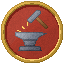{ .entry-move-icon } [Blacksmith](blacksmith.md) | Weapons, ammunition, and forged gear. |
| 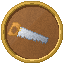{ .entry-move-icon } [Carpenter](carpenter.md) | Cruise boats, hull repairs, lockers, and building plans. |
| 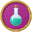{ .entry-move-icon } [Chemist](chemist.md) | Medicine, powders, thrown concoctions, and Rumble Balls. |
| 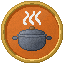{ .entry-move-icon } [Cook](cook.md) | Meals that feed, heal, and improve training. |
| { .entry-move-icon } [Farmer](farmer.md) | Orchards, crops, and higher-quality produce. |
| 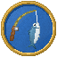{ .entry-move-icon } [Fisher](fisher.md) | Fish, shellfish, rare catches, and Calm Belt Sea Kings. |
| 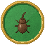{ .entry-move-icon } [Hunter](hunter.md) | Nets, traps, small creatures, and big-game hunts. |
| 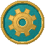{ .entry-move-icon } [Inventor](inventor.md) | Tools, instruments, dials, and upgrade parts. |
| 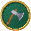{ .entry-move-icon } [Lumberjack](lumberjack.md) | Speciality woods and timber for the crew’s boatbuilder. |
| 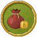{ .entry-move-icon } [Merchant](merchant.md) | Sales, contracts, auctions, and buried treasure. |
| 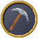{ .entry-move-icon } [Miner](miner.md) | Ore, rare finds, stonework, and refined materials. |
| 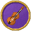{ .entry-move-icon } [Musician](musician.md) | Scores and trade, travel, or combat buffs for your crew. |
| 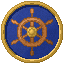{ .entry-move-icon } [Navigator](navigator.md) | Charts, bearings, weather forecasts, and exploration. |
| 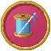{ .entry-move-icon } [Tailor](tailor.md) | Clothing, flags, sails, and temperature linings. |
