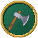

# Lumberjack

{ .entry-page-icon }

[All professions](index.md)

Cut wood from standing, naturally grown trees to earn XP. Placed logs give no XP. A trunk needs leaves or enough height to count as a standing tree. Planting a sapling earns **1 XP**. Ordinary timber gives **1 XP per log**, and fruit-tree timber gives **2**. Ask the [Inventor](inventor.md) for a **Woodsman’s Axe** to improve extra-log odds or a **Felling Saw** for long trunks.

## Specialty timber

| Tree | Where to look | Level to plant | XP per log |
| --- | --- | ---: | ---: |
| Kuuigosu | Beaches, stony shores and mangrove swamps | 15 | 3 |
| Burning Tree | Badlands and some savannas | 25 | 4 |
| Treasure Tree Adam | Dark forest and old-growth spruce or pine taiga | 50 | 6 |

Only a level 50 Lumberjack can fell **Adam**. Its saplings are rare and do not take bone meal. These woods use ordinary woodwork recipes for planks, stairs, fences and doors. Supply specialty planks to a [Carpenter](carpenter.md) to turn them into faster, tougher, or fireproof boats.

## Combat techniques

Hold an axe to use these abilities.

| Technique | Effect | Cooldown | Base damage |
| --- | --- | ---: | ---: |
| Timber | Hits a target within 4 blocks and fells it for up to 2 seconds. | 12 s | 60 HP |
| Whirling Axe | Knocks back enemies within 3.5 blocks. | 10 s | 30 HP |
| Axe Throw | Throws an axe projectile while you keep the weapon. | 8 s | 35 HP |

<!-- Pack profession tables -->

## Devil Fruit bonuses

These fruits also grant **15% more XP** in this trade.

| Fruit | Additional effect |
| --- | --- |
| [Mori Mori no Mi](../fruits/mori_mori_no_mi.md) | Faster gathering |

## Talents

Spend your talent points in the profession book. Techniques open in the **Profession** tab of the ability screen.

| Talent | Kind | Effect | Connects to |
| --- | --- | --- | --- |
| Good swing 1 | Small · Start | Logs give 5% faster under your axe | Strong Arm |
| Strong Arm | Major | Logs give 50% faster under your axe | Good swing 1, Good swing 2, Clean cut 2, Green hand 1 |
| Good swing 2 | Small | Logs give 5% faster under your axe | Strong Arm, Woodcraft 1 |
| Woodcraft 1 | Small | A log you fell gives 5% more Lumberjack XP | Good swing 2, Heartwood |
| Heartwood | Major | Logs of the Kuuigosu the Burning Tree and the Adam give 25% more Lumberjack XP | Woodcraft 1, Woodcraft 2, Timber, Fighting Lumberjack 4 |
| Woodcraft 2 | Small | A log you fell gives 5% more Lumberjack XP | Heartwood, Good swing 3, Clean cut 1 |
| Good swing 3 | Small | Logs give 5% faster under your axe | Woodcraft 2, Woodsman's Luck |
| Clean cut 1 | Small | 2% more chance that a log you fell gives two | Woodcraft 2, Old Growth |
| Woodsman's Luck | Major | 5% of the logs you fell give a Sweet Sap | Good swing 3, Woodcraft 3 |
| Old Growth | Major | Logs of a trunk taller than 12 give 50% more Lumberjack XP | Clean cut 1, Woodcraft 4 |
| Woodcraft 3 | Small | A log you fell gives 5% more Lumberjack XP | Woodsman's Luck, Axe Throw |
| Woodcraft 4 | Small | A log you fell gives 5% more Lumberjack XP | Old Growth, Axe Throw |
| Axe Throw | Ability | Needs an axe. Throw it straight ahead. You keep your axe | Woodcraft 3, Woodcraft 4, Fighting Lumberjack 1 |
| Fighting Lumberjack 1 | Small | Your Lumberjack abilities hit 5% harder | Axe Throw |
| Clean cut 2 | Small | 2% more chance that a log you fell gives two | Strong Arm, Second Log |
| Second Log | Major | 15% chance that a log you fell gives two | Clean cut 2, Clean cut 3, Kept edge |
| Clean cut 3 | Small | 2% more chance that a log you fell gives two | Second Log, Sharp Teeth |
| Kept edge | Small | 8% chance that a log does not wear your tool | Second Log, Sharp Teeth |
| Sharp Teeth | Major | Your Felling Saw brings down 96 logs in one cut instead of 64 | Clean cut 3, Kept edge, Fighting Lumberjack 3 |
| Green hand 1 | Small | Leaves you break drop saplings 10% more often | Strong Arm, Green Thumb |
| Green Thumb | Major | Leaves you break drop saplings twice as often | Green hand 1, Green hand 2, Planter |
| Green hand 2 | Small | Leaves you break drop saplings 10% more often | Green Thumb, Forester |
| Planter | Small | A sapling you plant gives 1 more Lumberjack XP when it grows into a tree | Green Thumb, Forester |
| Forester | Major | 10% of the saplings you plant give one back when they grow into a tree | Green hand 2, Planter, Fighting Lumberjack 5 |
| Fighting Lumberjack 2 | Small | Your Lumberjack abilities hit 5% harder | Timber, Fighting Lumberjack 3 |
| Timber | Ability | Needs an axe. A great blow from above on a foe. It fells him for 2 seconds | Heartwood, Fighting Lumberjack 2 |
| Fighting Lumberjack 3 | Small | Your Lumberjack abilities hit 5% harder | Fighting Lumberjack 2, Sharp Teeth |
| Fighting Lumberjack 4 | Small | Your Lumberjack abilities hit 5% harder | Heartwood, Whirling Axe |
| Whirling Axe | Ability | Needs an axe. Spin and hit every foe around you. They are thrown back | Fighting Lumberjack 4, Fighting Lumberjack 5 |
| Fighting Lumberjack 5 | Small | Your Lumberjack abilities hit 5% harder | Whirling Axe, Forester |

## Quest chapter

[[Mori Mori no Mi](../fruits/mori_mori_no_mi.md) milestones and rewards](../../reference/quests/lumberjack.md).
