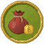

# Merchant

{ .entry-page-icon }

[All professions](index.md)

Take goods to a Cruise buyer and use the **Sell** window. Look for the Fishmonger, Hunting Merchant, Travelling Cook, Prospector or Materials Trader, depending on the cargo. Compare their contracts before selling ingredients you might need for a delivery. Contracts award **1 XP per 10 Belly**, at least one. Sales to travelling merchants pay XP per item based on its value. Auction lots award XP upon sale, using up to the amount a merchant would pay for the goods.

## Trade in town

A town’s market hall can host a stall to sell goods while you travel. Collect its takings to claim the XP. A Merchant’s sale and contract bonus is **0.5% per level** up to **25% at level 50**. Trade Network slows market saturation, Bargain reduces purchase prices, and Credit lifts the buyer’s purse limit. For auction limits and listing fees, see [Towns and island claims](../../world/conflict.md#markets-and-island-events).

The Merchant’s auction fee falls by **1.5% of the base fee per level**, down to a quarter of the standard fee at level 50. You can have **one additional listing per five levels** and keep lots up **one extra day per two levels**. The price history shows recent averages. Trade Network also opens a premium merchant contract that can include a Torn Old Map.

## Treasure maps

Read a torn map at the required Merchant level and follow it to a buried chest. Be first to open it for the XP.

| Map | Level | XP |
| --- | ---: | ---: |
| Rumor | 1 | 100 |
| Old | 20 | 400 |
| Legendary | 75 | 1,200 |

## Combat techniques

| Technique | Effect | Cooldown | Base damage |
| --- | --- | ---: | ---: |
| Golden Bulwark | Gives you and crewmates within 8 blocks 8 temporary HP for 20 seconds. | 45 s | — |
| Coin Toss | Throws coins at an enemy within 14 blocks. Costs no Belly. | 8 s | 25 HP |
| Bribe | Stops a non-boss creature within 8 blocks from attacking you for 10 seconds. | 20 s | — |

<!-- Pack profession tables -->

## Devil Fruit bonuses

These fruits also grant **15% more XP** in this trade.

| Fruit | Additional effect |
| --- | --- |
| [Goru Goru no Mi](../fruits/goru_goru_no_mi.md) | Shorter profession ability cooldowns |

## Talents

Spend your talent points in the profession book. Techniques open in the **Profession** tab of the ability screen.

| Talent | Kind | Effect | Connects to |
| --- | --- | --- | --- |
| Apprentice 1 | Small · Start | You earn 5% more Merchant XP | Contacts 1, Contacts 2, Trade Network |
| Contacts 1 | Small | The market fills 10% slower with what you sell | Apprentice 1 |
| Contacts 2 | Small | The market fills 10% slower with what you sell | Apprentice 1 |
| Trade Network | Major | The market fills half as fast with what you sell, and merchants show you the contract they keep for Merchants | Apprentice 1, Sharp deal 1 |
| Sharp deal 1 | Small | 3% less fee at the Auction House | Trade Network, Bargain |
| Bargain | Major | 15% off Cruise merchants' stalls | Sharp deal 1, Apprentice 2 |
| Apprentice 2 | Small | You earn 5% more Merchant XP | Bargain, Credit, Golden Bulwark |
| Credit | Major | A merchant's purse no longer limits what he buys from you | Apprentice 2, Apprentice 3, Apprentice 4, Contacts 3 |
| Apprentice 3 | Small | You earn 5% more Merchant XP | Credit |
| Golden Bulwark | Ability | A shield of gold for you and your crew | Apprentice 2 |
| Apprentice 4 | Small | You earn 5% more Merchant XP | Credit, Merchant's Notes |
| Merchant's Notes | Major | You earn 15% more Merchant XP | Apprentice 4, Fighting Merchant 1 |
| Fighting Merchant 1 | Small | Your Merchant abilities hit 5% harder | Merchant's Notes, Sharp deal 2, Market stall 1, Coin Toss |
| Contacts 3 | Small | The market fills 10% slower with what you sell | Credit, Wide Network |
| Wide Network | Major | The market fills slower again with what you sell | Contacts 3, Fighting Merchant 2 |
| Fighting Merchant 2 | Small | Your Merchant abilities hit 5% harder | Wide Network, Sharp deal 3, Bribe, Fighting Merchant 4 |
| Sharp deal 2 | Small | 3% less fee at the Auction House | Fighting Merchant 1, Auctioneer |
| Market stall 1 | Small | 1 more lot up at the Auction House | Fighting Merchant 1, Treasure Sense |
| Auctioneer | Major | 3 more lots up and 10% less fee at the Auction House | Sharp deal 2, Coin Toss |
| Contacts 4 | Small | The market fills 10% slower with what you sell | Fighting Merchant 3 |
| Treasure Sense | Major | A treasure hunt pays twice the XP | Market stall 1, Coin Toss |
| Fighting Merchant 3 | Small | Your Merchant abilities hit 5% harder | Coin Toss, Contacts 4 |
| Coin Toss | Ability | A fistful of coins at the foe you look at | Fighting Merchant 1, Auctioneer, Treasure Sense, Fighting Merchant 3 |
| Sharp deal 3 | Small | 3% less fee at the Auction House | Fighting Merchant 2, Bulk Dealer |
| Market stall 2 | Small | 1 more lot up at the Auction House | Fighting Merchant 5 |
| Bulk Dealer | Major | A warehouse order pays 50% more Merchant XP | Sharp deal 3, Fighting Merchant 4 |
| Fighting Merchant 4 | Small | Your Merchant abilities hit 5% harder | Fighting Merchant 2, Bulk Dealer, Apprentice 5, Fighting Merchant 5 |
| Apprentice 5 | Small | You earn 5% more Merchant XP | Bribe, Fighting Merchant 4 |
| Fighting Merchant 5 | Small | Your Merchant abilities hit 5% harder | Fighting Merchant 4, Market stall 2 |
| Bribe | Ability | The foe you look at stops fighting you for a while | Fighting Merchant 2, Apprentice 5 |

## Quest chapter

[[Goru Goru no Mi](../fruits/goru_goru_no_mi.md) milestones and rewards](../../reference/quests/merchant.md).
