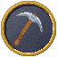

# Miner

{ .entry-page-icon }

[All professions](index.md)

Use a pickaxe of the correct tier. Mining ore awards trade XP, and some ordinary rock can produce extra finds when your level is high enough. **Silk Touch** skips the trade XP and finds. Start with common ores, then use the tables to choose what to mine for a particular material.

Give Kairoseki and Pure Iron Ore to the [Blacksmith](blacksmith.md) or save Kairoseki for [ship coating](../../voyage/shipbuilding.md#kairoseki-coating). Use the Masonry to refine ore and fragments and cut stone. Ask an [Inventor](inventor.md) for an **Enhanced Pick-axe**. Use caution around Explosive Rocks. Mining them and breaking Dials with a pickaxe can yield specialized fragments.

## Combat techniques

Hold a pickaxe for these techniques.

| Technique | Effect | Cooldown | Base damage |
| --- | --- | ---: | ---: |
| Ground Breaker | Sends a shockwave 8 blocks forward and launches targets. | 12 s | 35 HP |
| Pick Strike | Hits within 4 blocks and briefly holds the target. | 9 s | 55 HP |
| Blast Rock | Throws an explosive with a 3-block blast radius that leaves terrain intact. | 12 s | 40 HP |

<!-- Pack profession tables -->

## Mining XP

| Block | XP |
| --- | --- |
| Ancient Debris | 20 |
| Diamond Ores | 12 |
| Emerald Ores | 12 |
| Kairoseki Ore, Deepslate Kairoseki Ore | 10 |
| Gold Ores | 6 |
| Lapis Ores | 6 |
| Iron Ores | 4 |
| Redstone Ores | 4 |
| Coal Ores | 2 |
| Copper Ores | 2 |
| Nether Quartz Ore | 2 |
| Axe Dial, Breath Dial, Eisen Dial, Flame Dial, Flash Dial, Impact Dial, Milky Dial, Reject Dial | 0 |
| Calcite | 0 |
| Deepslate | 0 |
| Deepslate, Tuff | 0 |
| Diorite | 0 |
| Explosive Rock | 0 |
| Star Core | 0 |

## Finds in the rock

| Mine | Find | Level | Chance | Extra XP |
| --- | --- | --- | --- | --- |
| Diamond Ores | Diamond Fragment | 5 | 30.00% | 4 |
| Explosive Rock | Explosive Rock Fragment | 5 | 100.00% | 6 |
| Axe Dial, Breath Dial, Eisen Dial, Flame Dial, Flash Dial, Impact Dial, Milky Dial, Reject Dial | Dial Fragment | 10 | 100.00% | 10 |
| Calcite | Marble | 10 | 8.00% | 6 |
| Diorite | Marble | 10 | 4.00% | 6 |
| Kairoseki Ore, Deepslate Kairoseki Ore | Kairoseki | 15 | 25.00% | 4 |
| Iron Ores | Iron Scrap | 18 | 12.00% | 8 |
| Iron Ores | Pure Iron Ore | 25 | 10.00% | 8 |
| Coal Ores | Explosive Rock Fragment | 28 | 8.00% | 10 |
| Deepslate | Diamond Fragment | 35 | 0.40% | 15 |
| Deepslate, Tuff | Mysterious Parts | 38 | 0.30% | 16 |
| Kairoseki Ore, Deepslate Kairoseki Ore | Dense Kairoseki | 42 | 10.00% | 20 |
| Iron Ores | Pure Iron Ore | 45 | 15.00% | 8 |
| Ancient Debris | Netherite Scrap | 46 | 25.00% | 25 |
| Deepslate, Tuff | Kairoseki | 50 | 0.15% | 30 |
| Star Core | Star Fragment | 50 | 100.00% | 60 |

## Masonry

Craft the workstation at a crafting table.

| Top row | Middle row | Bottom row |
| --- | --- | --- |
| Stone · Stone · Stone | Stone · Crafting Table · Stone | Stone · Stone · Stone |

### Recipes

| Makes | Level | Yield | XP | Ingredients |
| --- | --- | --- | --- | --- |
| Marble Block | 1 | 1 | 12 | 4 × Marble |
| Marble Slab | 5 | 6 | 20 | 3 × Marble Block |
| Marble Stairs | 8 | 4 | 26 | 3 × Marble Block |
| Polished Marble | 14 | 4 | 38 | 4 × Marble Block |
| Polished Marble Slab | 16 | 6 | 42 | 3 × Polished Marble |
| Iron Ingot | 30 | 2 | 70 | Pure Iron Ore |
| Diamond | 44 | 1 | 98 | 9 × Diamond Fragment |

## Devil Fruit bonuses

These fruits also grant **15% more XP** in this trade.

| Fruit | Additional effect |
| --- | --- |
| [Goru Goru no Mi](../fruits/goru_goru_no_mi.md) | Faster gathering |
| [Ishi Ishi no Mi](../fruits/ishi_ishi_no_mi.md) | Shorter profession ability cooldowns |
| [Mogu Mogu no Mi](../fruits/mogu_mogu_no_mi.md) | Faster gathering |

## Talents

Spend your talent points in the profession book. Techniques open in the **Profession** tab of the ability screen.

| Talent | Kind | Effect | Connects to |
| --- | --- | --- | --- |
| Sharp eye 1 | Small · Start | Your finds in the rock turn up 5% more often | Keen Pick |
| Keen Pick | Major | Your finds in the rock turn up 50% more often | Sharp eye 1, Good arm 1, Clean strike 1, Ore sense 1 |
| Clean strike 1 | Small | 2% more chance that an ore gives its drops twice | Keen Pick, Double Strike |
| Double Strike | Major | 10% chance that an ore gives its drops twice | Clean strike 1, Clean strike 2 |
| Clean strike 2 | Small | 2% more chance that an ore gives its drops twice | Double Strike, Rich Vein, Ground Breaker |
| Rich Vein | Major | 10% more chance that an ore gives its drops twice | Clean strike 2, Good arm 3 |
| Ore sense 1 | Small | An ore gives 5% more Miner XP | Keen Pick, Prospector |
| Prospector | Major | An ore gives 25% more Miner XP | Ore sense 1, Ore sense 2 |
| Ore sense 2 | Small | An ore gives 5% more Miner XP | Prospector, Pick Strike, Gem Cutter |
| Pick Strike | Ability | Needs a pickaxe. A blow on a foe. It holds him for 1 second | Ore sense 2, Ore sense 3 |
| Good arm 1 | Small | Rock and ore give 5% faster under your pickaxe | Keen Pick, Stone Breaker |
| Stone Breaker | Major | Rock and ore give 25% faster under your pickaxe | Good arm 1, Sharp eye 3, Good arm 2, Kept point |
| Good arm 2 | Small | Rock and ore give 5% faster under your pickaxe | Stone Breaker, Fighting Miner 1 |
| Fighting Miner 1 | Small | Your Miner abilities hit 5% harder | Good arm 2, Ground Breaker, Seastone Sense |
| Ground Breaker | Ability | Needs a pickaxe. A shock wave runs 8 blocks ahead. Foes on its way are thrown up | Fighting Miner 1, Good arm 3, Clean strike 2 |
| Good arm 3 | Small | Rock and ore give 5% faster under your pickaxe | Ground Breaker, Rich Vein |
| Kept point | Small | 8% chance that an ore does not wear your tool | Stone Breaker, Sharp eye 2 |
| Sharp eye 2 | Small | Your finds in the rock turn up 5% more often | Kept point, Gem Cutter, Blast Rock |
| Gem Cutter | Major | 20% chance that a find comes with one more | Sharp eye 2, Ore sense 3, Ore sense 2 |
| Ore sense 3 | Small | An ore gives 5% more Miner XP | Gem Cutter, Pick Strike |
| Sharp eye 3 | Small | Your finds in the rock turn up 5% more often | Stone Breaker, Deep Digger |
| Deep Digger | Major | Your finds in deepslate and tuff turn up twice as often | Sharp eye 3, Ore sense 4, Sharp eye 4, Fighting Miner 3 |
| Sharp eye 4 | Small | Your finds in the rock turn up 5% more often | Deep Digger, Seastone Sense |
| Seastone Sense | Major | Your finds in Kairoseki ore turn up twice as often | Sharp eye 4, Fighting Miner 2, Fighting Miner 1 |
| Fighting Miner 2 | Small | Your Miner abilities hit 5% harder | Seastone Sense |
| Fighting Miner 3 | Small | Your Miner abilities hit 5% harder | Deep Digger, Blast Rock |
| Blast Rock | Ability | Needs a pickaxe. Throw an Explosive Rock. It bursts on 3 blocks and breaks no block | Fighting Miner 3, Fighting Miner 4, Sharp eye 2 |
| Fighting Miner 4 | Small | Your Miner abilities hit 5% harder | Blast Rock |
| Ore sense 4 | Small | An ore gives 5% more Miner XP | Deep Digger, Fighting Miner 5 |
| Fighting Miner 5 | Small | Your Miner abilities hit 5% harder | Ore sense 4 |

## Quest chapter

[[Mogu Mogu no Mi](../fruits/mogu_mogu_no_mi.md) milestones and rewards](../../reference/quests/miner.md).
