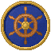

# Navigator

{ .entry-page-icon }

[All professions](index.md)

Travel, record discoveries in the **Log Book** and make instruments at the Chart Table. First-time chunks give **2 XP**. A new biome gives **25 XP**, and a new type of place gives **50 XP** when recorded. Drawing a Sea Chart gives **20 XP** and calibrating an Eternal Pose gives **40 XP**.

## Use your instruments

| Instrument | Level | How to use it |
| --- | ---: | --- |
| Cruise Log Pose | 1 | Select an island type and crouch-use the instrument to take a bearing from your position. Use [One Piece World’s Log Pose](../../voyage/navigation.md#log-pose-and-atlas) for story destinations and island missions. |
| Sounding Lead | 10 | Check the depth below the vessel before fishing or landing. |
| Barometer | 20 | Check direction, distance and the strength of a nearby [storm](../../world/weather.md#read-the-weather-and-protect-your-ship). |
| Sea Chart | 30 | Draw a chart for a treasure position and use it to mark your Atlas. |
| Eternal Pose | 50 | Calibrate on the current island to keep a permanent bearing. |
| Poneglyph Compass | 50 | Follow a bearing toward the next stone when the voyage calls for readings. |

Fair Wind and Trade Winds improve the speed of [Cruise boats](carpenter.md) you steer.

## Combat techniques

Carry a Barometer for these moves.

| Technique | Effect | Cooldown | Base damage |
| --- | --- | ---: | ---: |
| Thunder Call | Calls a lightning strike up to 16 blocks away. | 15 s | 30 HP |
| Gust | Pushes enemies within 8 blocks in front of you. | 10 s | 20 HP |
| Mirage | Makes creatures lose track of you for 5 seconds. | 30 s | — |

<!-- Pack profession tables -->

## Chart Table

Craft the workstation at a crafting table.

| Top row | Middle row | Bottom row |
| --- | --- | --- |
| Paper · Compass · Paper | Any Planks · Any Planks · Any Planks | Any Planks · — · Any Planks |

### Recipes

| Makes | Level | Yield | XP | Ingredients |
| --- | --- | --- | --- | --- |
| Log Pose | 1 | 1 | 12 | Compass, Glass Pane, Leather, Gold Nugget |
| Sounding Lead | 10 | 1 | 30 | Iron Ingot, 3 × String |
| Barometer | 20 | 1 | 50 | Glass Bottle, 2 × Copper Ingot, Tempest Mouse, Redstone |
| Sea Chart | 30 | 1 | 70 | 2 × Paper, Compass, Pumpkin Octopus |
| Eternal Pose | 50 | 1 | 110 | Log Pose, Lens, Magnet, 2 × Gold Ingot |
| Poneglyph Compass | 50 | 1 | 120 | Log Pose, Magnet, 2 × Lapis Lazuli, Diamond |

## Talents

Spend your talent points in the profession book. Techniques open in the **Profession** tab of the ability screen.

| Talent | Kind | Effect | Connects to |
| --- | --- | --- | --- |
| Keen eye 1 | Small · Start | Your Log Pose looks 10% further | Keen eye 2, Thrifty pen 2, Long Sight |
| Keen eye 2 | Small | Your Log Pose looks 10% further | Keen eye 1, Apprentice 1, Quick Bearings |
| Keen eye 3 | Small | Your Log Pose looks 10% further | Long Sight, Quick Bearings |
| Apprentice 1 | Small · Start | You earn 5% more Navigator XP | Keen eye 2, Tidy table 1, Navigator's Notes |
| Apprentice 2 | Small · Start | You earn 5% more Navigator XP | Tidy table 1, Tidy table 2, Fair Wind |
| Apprentice 3 | Small | You earn 5% more Navigator XP | Quick Bearings, Navigator's Notes |
| Apprentice 4 | Small | You earn 5% more Navigator XP | Trade Winds, Fair Wind |
| Tidy table 1 | Small | 2% more of your work at the Chart Table gives an ingredient back | Apprentice 1, Apprentice 2, Trade Winds |
| Tidy table 2 | Small | 2% more of your work at the Chart Table gives an ingredient back | Apprentice 2, Thrifty pen 1, Fighting Navigator 2 |
| Tidy table 3 | Small | 2% more of your work at the Chart Table gives an ingredient back | Navigator's Notes, Trade Winds |
| Thrifty pen 1 | Small · Start | 3% more of the Sea Charts you draw are not used up | Tidy table 2, Thrifty pen 2, Pathfinder |
| Thrifty pen 2 | Small | 3% more of the Sea Charts you draw are not used up | Thrifty pen 1, Keen eye 1, Spare Paper |
| Thrifty pen 3 | Small | 3% more of the Sea Charts you draw are not used up | Fighting Navigator 2, Pathfinder |
| Thrifty pen 4 | Small | 3% more of the Sea Charts you draw are not used up | Pathfinder, Spare Paper |
| Fighting Navigator 1 | Small | Your Navigator abilities hit 5% harder | Fair Wind, Fighting Navigator 2 |
| Fighting Navigator 2 | Small | Your Navigator abilities hit 5% harder | Tidy table 2, Fighting Navigator 1, Thrifty pen 3 |
| Fighting Navigator 3 | Small | Your Navigator abilities hit 5% harder | Spare Paper, Long Sight, Thunder Call |
| Fighting Navigator 4 | Small | Your Navigator abilities hit 5% harder | Navigator's Notes, Gust |
| Fighting Navigator 5 | Small | Your Navigator abilities hit 5% harder | Pathfinder, Mirage |
| Fair Wind | Major | The boats you steer make a little more way | Apprentice 2, Apprentice 4, Fighting Navigator 1, Careful Hands |
| Long Sight | Major | Your Log Pose looks twice as far | Keen eye 1, Keen eye 3, Fighting Navigator 3 |
| Trade Winds | Major | The boats you steer make a little more way again | Tidy table 1, Tidy table 3, Apprentice 4 |
| Navigator's Notes | Major | You earn 15% more Navigator XP | Apprentice 1, Apprentice 3, Tidy table 3, Fighting Navigator 4 |
| Pathfinder | Major | A chunk you never set foot in pays twice the XP | Thrifty pen 1, Thrifty pen 3, Thrifty pen 4, Fighting Navigator 5 |
| Quick Bearings | Major | Your Log Pose and Sea Charts wait half as long | Keen eye 2, Keen eye 3, Apprentice 3 |
| Spare Paper | Major | 25% of the Sea Charts you draw are not used up | Thrifty pen 2, Thrifty pen 4, Fighting Navigator 3 |
| Careful Hands | Major | 25% of your work at the Chart Table gives an ingredient back | Fair Wind |
| Thunder Call | Ability | Lightning on the foe you look at | Fighting Navigator 3 |
| Gust | Ability | A gust that hurts and blows back the foes in front of you | Fighting Navigator 4 |
| Mirage | Ability | You vanish and the foes after you lose you | Fighting Navigator 5 |

## Quest chapter

[Navigator milestones and rewards](../../reference/quests/navigator.md).
