<!-- Generated by tools/build_pack_reference.py. Edit the pack sources and regenerate. -->

# Cyborg

{ .entry-page-icon }

[Races](index.md) · [Race Race no Mi](../../reference/content/racenomi.md)

Fit body parts and accessories and use Cola to power your moves. The quest chapter tracks head, arm, chest, leg and shoulder upgrades, and the techniques available depend on what you have fitted.

| Stat | Value |
| --- | --- |
| Racial damage scaling | 1.00× at 10,000 Doriki → 1.40× at 50,000 Doriki |

[See combat stats](../combat-stats.md).

!!! note "Reading the stats"
    Listed base damage is for the named part of the move. Pack and Doriki multipliers are shown separately. Times assume 20 ticks per second.

<!-- move racenomi:franky_airbag -->

## Franky Airbag

{ .entry-move-icon loading=lazy } *Active*

Cushions blow up from the neck and the waist of the user, for five seconds no fall hurts him and no blow pushes him back

| Stat | Value |
| --- | --- |
| Cooldown | 15 s (300 ticks) |

<!-- move racenomi:body -->

## Body

{ .entry-move-icon loading=lazy } *Active*

The user opens his body and fits or takes out his parts, one in each zone (head, arms, chest and legs) and up to 3 accessories Each part gives its own techniques and makes its zone stronger, and better metal makes it stronger still. Not right after being hit

| Stat | Value |
| --- | --- |
| Cooldown | 1 s (20 ticks) |

<!-- move racenomi:cola_overdrive -->

## Cola Overdrive

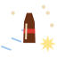{ .entry-move-icon loading=lazy } *Active*

With the Super Fridge the user burns cola from his reserves every moment to boost his body. He runs and swims faster, jumps higher and falls softer until he stops or runs out

| Stat | Value |
| --- | --- |
| Cooldown | 5 s (100 ticks) |

<!-- move racenomi:coup_de_boo -->

## Coup de Boo

{ .entry-move-icon loading=lazy } *Active*

The user charges his thruster and blasts himself off where he looks and up. The blast blows back every enemy behind him. Charged past half it burns more cola and goes half again as far, and he takes no fall damage when he lands

| Stat | Value |
| --- | --- |
| Cooldown | 10 s (200 ticks) |

<!-- move racenomi:coup_de_vent -->

## Coup de Vent

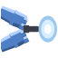{ .entry-move-icon loading=lazy } *Active*

The user joins his palms and draws in air, and the longer he charges the more cola it burns. Then he lets it out in one blast of air that blows the enemy away and pushes him back

| Stat | Value |
| --- | --- |
| Min damage | 10 HP |
| Max damage | 40 HP |
| Cooldown | 12 s (240 ticks) |

<!-- move racenomi:cyborg_suplex -->

## Franky Southland Suplex

*Active*

The user seizes the enemy before him with both metal arms, swings it over his head and drives it head first into the ground behind him Burning cola the user swings the enemy over with all his iron strength, it is driven into the ground and bounces back up

| Stat | Value |
| --- | --- |
| Conditional cooldown | 0.5 s (10 ticks) |

<!-- move racenomi:destroy_ho -->

## Franky Destroy Ho

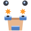{ .entry-move-icon loading=lazy } *Active*

With the Cannon Shoulders the user opens the shoulders and after a short moment fires a cannonball from each of them. They burst where they land and the shot hurts the user a little

| Stat | Value |
| --- | --- |
| Base damage | 14 HP |
| Cooldown | 10 s (200 ticks) |

<!-- move racenomi:franky_boxing -->

## Franky Boxing

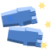{ .entry-move-icon loading=lazy } *Active*

The user throws a quick flurry of metal jabs at every enemy right before him, the last one pushes them back

| Stat | Value |
| --- | --- |
| Base damage | 4 HP |
| Cooldown | 8 s (160 ticks) |

<!-- move racenomi:franky_butterfly -->

## Franky Butterfly

{ .entry-move-icon loading=lazy } *Passive*

While the Striking Arms are fitted the user spins them like propellers in the water and swims much faster

<!-- move racenomi:franky_cannon -->

## Franky Cannon

{ .entry-move-icon loading=lazy } *Active*

With the Rocket Shoulders the user opens the hatches of the shoulders and after a moment fires one heavy shell. It bursts wide where it lands and the shot pushes the user back

| Stat | Value |
| --- | --- |
| Base damage | 30 HP |
| Cooldown | 12 s (240 ticks) |

<!-- move racenomi:franky_tank -->

## Franky Tank

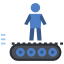{ .entry-move-icon loading=lazy } *Active*

Treads come out of the legs of the user. He runs faster, climbs higher steps and knocks over every enemy he runs into, and it burns one cola each second. Used again the treads go back

| Stat | Value |
| --- | --- |
| Base damage | 6 HP |
| Cooldown | 5 s (100 ticks) |

<!-- move racenomi:fresh_fire -->

## Fresh Fire

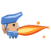{ .entry-move-icon loading=lazy } *Active*

With the Fire Jaw the user heats up and breathes fire like a flamethrower, burst after burst, and each burst burns a little cola The user spits one big ball of fire. Where it lands it bursts and sets everything around on fire

| Stat | Value |
| --- | --- |
| Fire cooldown | 5 s (100 ticks) |
| Ball cooldown | 8 s (160 ticks) |

<!-- move racenomi:cyborg_furnace -->

## Furnace

{ .entry-move-icon loading=lazy } *Active*

The user opens the furnace in his body and smelts anything a furnace smelts, each thing burns 1 of his cola

| Stat | Value |
| --- | --- |
| Cooldown | 1 s (20 ticks) |

<!-- move racenomi:hakugeki_ho -->

## Hakugeki Ho

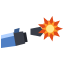{ .entry-move-icon loading=lazy } *Active*

The user fires an anti-monster shell point-blank from his joined arms. It bursts where it lands and hits a big creature twice as hard

| Stat | Value |
| --- | --- |
| Base damage | 18 HP |
| Cooldown | 12 s (240 ticks) |

<!-- move racenomi:franky_heel_boost -->

## Heel Boost

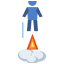{ .entry-move-icon loading=lazy } *Passive*

With the Heel Boosters the user jumps a second time in the air, thrown up by the thrusters behind his heels, and his fall after it does not hurt

<!-- move racenomi:hoshi_shield -->

## Hoshi Shield

{ .entry-move-icon loading=lazy } *Active*

The forearm of the user opens into a round shield that stops every blow from the front. He walks slower and it burns cola each second Used again the shield closes

| Stat | Value |
| --- | --- |
| Cooldown | 3 s (60 ticks) |

<!-- move racenomi:kentauros -->

## Franky Kentauros

{ .entry-move-icon loading=lazy } *Active*

The legs of the user split in four and pin the enemy in front of him. It can neither move nor jump while he holds it and he is slowed. Used again he lets go

| Stat | Value |
| --- | --- |
| Cooldown | 10 s (200 ticks) |

<!-- move racenomi:master_nail -->

## Master Nail

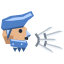{ .entry-move-icon loading=lazy } *Active*

With the Nail Jaw the user sweeps his head and spits a fan of nails in front of him. A nail that hits pins the enemy in place for a moment

| Stat | Value |
| --- | --- |
| Base damage | 4 HP |
| Cooldown | 7 s (140 ticks) |

<!-- move racenomi:nipple_light -->

## Franky Nipple Light

{ .entry-move-icon loading=lazy } *Active*

With the Armored Chest the user lights up, he sees in the dark for a while and every enemy around who looks at him is blinded

| Stat | Value |
| --- | --- |
| Cooldown | 15 s (300 ticks) |

<!-- move racenomi:ouch_finger -->

## Ouch Finger

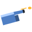{ .entry-move-icon loading=lazy } *Active*

The user points a finger of his Armed Arm and fires one fast bullet from its tip The user fires a burst of small pellets from his left hand, each one bursts where it hits

| Stat | Value |
| --- | --- |
| Ouch damage | 10 HP |
| Ouch cooldown | 3 s (60 ticks) |
| Bean damage | 2.5 HP |
| Beans cooldown | 7 s (140 ticks) |

<!-- move racenomi:radical_beam -->

## Franky Radical Beam

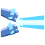{ .entry-move-icon loading=lazy } *Active*

The user holds out the palms of his Vegapunk arms, light gathers in them and after a long cast a powerful beam leaves them and bursts where it lands

| Stat | Value |
| --- | --- |
| Base damage | 50 HP |
| Cooldown | 13 s (260 ticks) |

<!-- move racenomi:rocket_launcher -->

## Franky Rocket Launcher

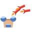{ .entry-move-icon loading=lazy } *Active*

With the Rocket Shoulders the user fires three rockets one after another, each turns a little toward the nearest enemy ahead and bursts where it lands

| Stat | Value |
| --- | --- |
| Base damage | 18 HP |
| Cooldown | 15 s (300 ticks) |

<!-- move racenomi:franky_skywalk -->

## Franky Skywalk

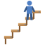{ .entry-move-icon loading=lazy } *Active*

With the Skywalk Kit the user walks on air for a while: planks lay themselves under his feet over the void, jump to climb, look down to drop

| Stat | Value |
| --- | --- |
| Cooldown | 8 s (160 ticks) |

<!-- move racenomi:cyborg_storage -->

## Storage

{ .entry-move-icon loading=lazy } *Active*

The user opens a hatch in his body and keeps nine stacks of things inside, they fall out when he dies

| Stat | Value |
| --- | --- |
| Cooldown | 1 s (20 ticks) |

<!-- move racenomi:strong_hammer -->

## Strong Hammer

{ .entry-move-icon loading=lazy } *Active*

The user raises his metal arm and brings it down like a hammer on the first enemy before him, it is stunned and thrown back

| Stat | Value |
| --- | --- |
| Base damage | 20 HP |
| Cooldown | 10 s (200 ticks) |

<!-- move racenomi:strong_impact_right -->

## Strong Impact Right

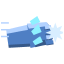{ .entry-move-icon loading=lazy } *Active*

The user fires his giant Vegapunk fist like a rocket, the first enemy it hits is thrown far away

| Stat | Value |
| --- | --- |
| Base damage | 26 HP |
| Cooldown | 10 s (200 ticks) |

<!-- move racenomi:strong_right -->

## Strong Right

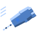{ .entry-move-icon loading=lazy } *Active*

The user shoots his right fist out on its chain, it hits the first enemy on its way and comes back to the arm

| Stat | Value |
| --- | --- |
| Base damage | 12 HP |
| Cooldown | 5 s (100 ticks) |

<!-- move racenomi:super_strong_dexter -->

## Super Strong Dexter

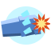{ .entry-move-icon loading=lazy } *Active*

Only on Super Vega Cola, the user puts the full power of his Vegapunk arm in one punch on the first enemy before him, it bursts on it and throws it very far

| Stat | Value |
| --- | --- |
| Base damage | 45 HP |
| Cooldown | 15 s (300 ticks) |

<!-- move racenomi:triangle_jacker -->

## Franky Triangle Jacker

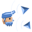{ .entry-move-icon loading=lazy } *Active*

With the Steel Hair the user throws his two steel sideburns like blades, they fly through every enemy on their way and cut the soft blocks they cross

| Stat | Value |
| --- | --- |
| Base damage | 9 HP |
| Cooldown | 5 s (100 ticks) |

<!-- move racenomi:tsuiseki_hodan -->

## Tsuiseki Hodan

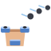{ .entry-move-icon loading=lazy } *Active*

With the Cannon Shoulders the user fires a cannonball where he looks every half second while he runs freely. Each shot burns a little cola. Use again to stop

| Stat | Value |
| --- | --- |
| Base damage | 6 HP |
| Cooldown | 8 s (160 ticks) |

<!-- move racenomi:ultimate_hammer -->

## Ultimate Hammer

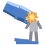{ .entry-move-icon loading=lazy } *Active*

On the enemy pinned by Franky Kentauros, the user strikes point-blank with all his weight. The blow goes through armor, frees it from the legs and throws it back

| Stat | Value |
| --- | --- |
| Base damage | 30 HP |
| Cooldown | 12 s (240 ticks) |

<!-- move racenomi:weapons_left -->

## Weapons Left

{ .entry-move-icon loading=lazy } *Active*

The left hand of the user opens on a cannon and fires a cannonball that bursts where it hits

| Stat | Value |
| --- | --- |
| Base damage | 16 HP |
| Cooldown | 8 s (160 ticks) |

<!-- move racenomi:cyborg_workbench -->

## Workbench

{ .entry-move-icon loading=lazy } *Active*

A crafting table folds out of the user's body, he crafts anywhere he is

| Stat | Value |
| --- | --- |
| Cooldown | 1 s (20 ticks) |

## Lineage Factors

See the [graft guide](../bloodlines/index.md#grafted-lineage-factors) for factors you can add to this character.

## Quests

See [the quest chapter](../../reference/quests/r_cyborg.md) for milestones and rewards.
