<!-- Generated by tools/build_pack_reference.py. Edit the pack sources and regenerate. -->

# Fish-Man

{ .entry-page-icon }

[Races](index.md) · [Race Race no Mi](../../reference/content/racenomi.md)

Fish-Men breathe underwater and train Fishman Karate. Their standard body size starts at 1.25×. The Whale Shark variant uses a 1.50× body.

**Variants**

- [Saw-shark Fish-Man](#fishman-sawshark)
- [Ray Fish-Man](#fishman-ray)
- [Garfish Fish-Man](#fishman-garfish)
- [Octopus Fish-Man](#fishman-octopus)
- [Whale Shark Fish-Man](#fishman-whale-shark)
- [Pufferfish Fish-Man](#fishman-pufferfish)
- [Hammerhead Fish-Man](#fishman-hammerhead)

| Stat | Value |
| --- | --- |
| Racial damage scaling | 1.00× at 10,000 Doriki → 1.40× at 50,000 Doriki |

[See combat stats](../combat-stats.md).

!!! note "Reading the stats"
    Listed base damage is for the named part of the move. Pack and Doriki multipliers are shown separately. Times assume 20 ticks per second.

<!-- move racenomi:fishman_body -->

## Fishman Body

{ .entry-move-icon loading=lazy } *Passive*

The user swims fast and breathes and sees under water

| Stat | Value |
| --- | --- |
| Swim speed | +200% |

<!-- move mineminenomi:kachiage_haisoku -->

## Kachiage Haisoku

{ .entry-move-icon loading=lazy } *Active*

The user delivers a powerful kick to the opponent's chin, which is stronger inside water

| Stat | Value |
| --- | --- |
| Cooldown | 8 s (160 ticks) |
| Base damage | 20 HP |

<!-- move mineminenomi:karakusagawara_seiken -->

## Karakusagawara Seiken

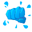{ .entry-move-icon loading=lazy } *Active*

The user punches the air, which sends a shockwave through water vapor in the air

| Stat | Value |
| --- | --- |
| Cooldown | 25 s (500 ticks) |
| Base damage | 20 HP |

<!-- move mineminenomi:mizu_osu -->

## Mizu Osu

{ .entry-move-icon loading=lazy } *Active*

Spits water with enough force to push away any enemy in front of the user.

| Stat | Value |
| --- | --- |
| Cooldown | 8 s (160 ticks) |

<!-- move mineminenomi:mizu_shuryudan -->

## Mizu Shuryudan

{ .entry-move-icon loading=lazy } *Active*

Launches multiple bubbles in the direction the user is looking, these bubbles will linger around until an enemy comes close to them at which point they'll start targeting the enemy and move toward them.

| Stat | Value |
| --- | --- |
| Cooldown | 12 s (240 ticks) |

<!-- move mineminenomi:mizu_taiho -->

## Mizu Taiho

{ .entry-move-icon loading=lazy } *Active*

Launches a giant bubble, dealing massive damage and exploding on contact.

| Stat | Value |
| --- | --- |
| Cooldown | 17 s (340 ticks) |

<!-- move mineminenomi:pack_of_sharks -->

## Pack of Sharks

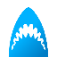{ .entry-move-icon loading=lazy } *Active*

The user fires densely compressed shark-shaped waterbullets at the opponent

| Stat | Value |
| --- | --- |
| Cooldown | 15 s (300 ticks) |

<!-- move mineminenomi:samehada_shotei -->

## Samehada Shotei

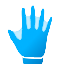{ .entry-move-icon loading=lazy } *Active*

The user concentrates their power to their palms, sending melee damage back to its owner and pushing them a few blocks back

| Stat | Value |
| --- | --- |
| Intrerupt cooldown | 10 s (200 ticks) |
| Min cooldown | 5 s (100 ticks) |
| Max cooldown | 20 s (400 ticks) |
| Base damage | 15 HP |

<!-- move mineminenomi:shark_on_tooth -->

## Shark on Tooth

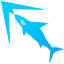{ .entry-move-icon loading=lazy } *Active*

Launches the user forward while spinning, biting the first enemy it comes in contact with.

| Stat | Value |
| --- | --- |
| Cooldown | 15 s (300 ticks) |
| Base damage | 40 HP |

<!-- move mineminenomi:two_fish_engine -->

## Two Fish Engine

{ .entry-move-icon loading=lazy } *Active*

Increases the user's swimming speed

| Stat | Value |
| --- | --- |
| Min cooldown | 5 s (100 ticks) |
| Max cooldown | 15 s (300 ticks) |

<!-- move mineminenomi:uchimizu -->

## Uchimizu

{ .entry-move-icon loading=lazy } *Active*

The user hurls big and fast water droplets at the opponent

| Stat | Value |
| --- | --- |
| Cooldown | 4 s (80 ticks) |

<!-- move mineminenomi:yarinami -->

## Yarinami

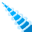{ .entry-move-icon loading=lazy } *Active*

The user fires a densely compressed spear-shaped waterbullet at the opponent

| Stat | Value |
| --- | --- |
| Cooldown | 12 s (240 ticks) |

## Variants

### Saw-shark Fish-Man { #fishman-sawshark }

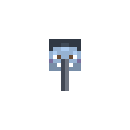{ .entry-move-icon }

<!-- move racenomi:sawshark_body -->

#### Saw-shark Body { #fishman-sawshark-sawshark-body }

{ .entry-move-icon loading=lazy } *Passive*

The user hits harder, and a bare-fisted blow now and then leaves a bleeding wound

| Stat | Value |
| --- | --- |
| Added melee damage | 3 HP |
| Bleed chance on an eligible hit | 5% |
| Bleed | 3 s (60 ticks) |
| Bare-handed damage | +3 HP |

### Ray Fish-Man { #fishman-ray }

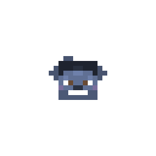{ .entry-move-icon }

<!-- move racenomi:ray_body -->

#### Ray Body { #fishman-ray-ray-body }

{ .entry-move-icon loading=lazy } *Passive*

The user is a master of Fishman Karate: sturdier than other fishmen, and their bare-handed blows hit harder and faster

| Stat | Value |
| --- | --- |
| Base damage | 2 HP |
| Armor toughness | +1 |
| Bare-handed damage | +2 HP |
| Bare-handed attack speed | +25% of base |

### Garfish Fish-Man { #fishman-garfish }

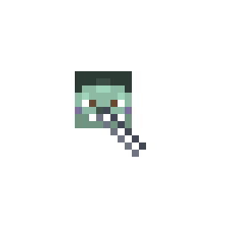{ .entry-move-icon }

<!-- move racenomi:garfish_body -->

#### Garfish Body { #fishman-garfish-garfish-body }

{ .entry-move-icon loading=lazy } *Passive*

The user is the swiftest of the fishmen in the water

| Stat | Value |
| --- | --- |
| Swim speed | +100% of base |

### Octopus Fish-Man { #fishman-octopus }

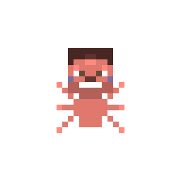{ .entry-move-icon }

Fishmen with six arms, as quick with six swords as with their fists.

<!-- move racenomi:octopus_body -->

#### Octopus Body { #fishman-octopus-octopus-body }

{ .entry-move-icon loading=lazy } *Passive*

The user's six arms strike faster, armed or not

| Stat | Value |
| --- | --- |
| Attack speed (armed or unarmed) | +30% of base |

### Whale Shark Fish-Man { #fishman-whale-shark }

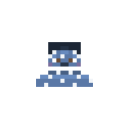{ .entry-move-icon }

The largest Fish-Man variant starts at 1.50× body size. The extra size helps with reach and damage but takes more room aboard ship.

<!-- move racenomi:whale_shark_body -->

#### Whale Shark Body { #fishman-whale-shark-whale-shark-body }

{ .entry-move-icon loading=lazy } *Passive*

The user is the biggest of the fishmen, sturdier and harder to bring down

| Stat | Value |
| --- | --- |
| Armor toughness | +2 |
| Maximum health from passive | +4 HP |

### Pufferfish Fish-Man { #fishman-pufferfish }

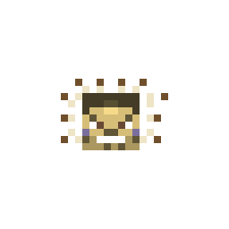{ .entry-move-icon }

Fishmen whose spines rise when they are struck, pricking and poisoning the attacker.

<!-- move racenomi:pufferfish_body -->

#### Pufferfish Body { #fishman-pufferfish-pufferfish-body }

{ .entry-move-icon loading=lazy } *Passive*

The user's spines prick whoever strikes them up close, and now and then poison them

| Stat | Value |
| --- | --- |
| Spine damage | 2 HP |
| Spine damage on an eligible hit | 2 HP |
| Poison chance | 25% |
| Poison duration | 3 s (60 ticks) |

### Hammerhead Fish-Man { #fishman-hammerhead }

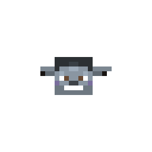{ .entry-move-icon }

Fishmen with a hammer-shaped head, behind blows that throw their foes back.

<!-- move racenomi:hammerhead_body -->

#### Hammerhead Body { #fishman-hammerhead-hammerhead-body }

{ .entry-move-icon loading=lazy } *Passive*

The user's blows hit harder and throw the target further back

| Stat | Value |
| --- | --- |
| Base damage | 2 HP |
| Melee damage | +2 HP |
| Knockback strength | 1.5 |

## Lineage Factors

| Graft | Effect | Source |
| --- | --- | --- |
| 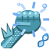{ .entry-move-icon } Fish-Man Strength | The Lineage Factor of a fish-man gives the bearer a fish-man's strength, breath under water and swimming. Never on a fish-man. | Missing Missing no Mi |
| 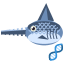{ .entry-move-icon } Saw-shark Lineage | The Lineage Factor of a saw-shark fishman makes the bearer hit harder, and a bare-fisted blow now and then leaves a bleeding wound. | Race Race no Mi |
| 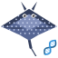{ .entry-move-icon } Ray Lineage | The Lineage Factor of a ray fishman makes the bearer a born karateka: sturdier, and their bare-handed blows hit harder and faster. | Race Race no Mi |
| 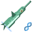{ .entry-move-icon } Garfish Lineage | The Lineage Factor of a garfish fishman makes the bearer swift in the water. | Race Race no Mi |
| 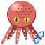{ .entry-move-icon } Octopus Lineage | The Lineage Factor of an octopus fishman grows two more arms on the bearer, and they strike faster, armed or not. | Race Race no Mi |
| 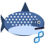{ .entry-move-icon } Whale Shark Lineage | The Lineage Factor of a whale shark fishman makes the bearer broad, sturdier and harder to bring down. | Race Race no Mi |
| 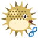{ .entry-move-icon } Pufferfish Lineage | The Lineage Factor of a pufferfish fishman covers the bearer in spines that prick whoever strikes them up close, and now and then poison them. | Race Race no Mi |
| 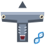{ .entry-move-icon } Hammerhead Lineage | The Lineage Factor of a hammerhead fishman makes the bearer's blows hit harder and throw the target further back. | Race Race no Mi |

See [grafting and capacity](../bloodlines/index.md#grafted-lineage-factors) before choosing a factor.

## Quests

See [the quest chapter](../../reference/quests/r_fishman.md) for milestones and rewards.
