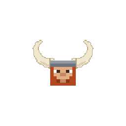
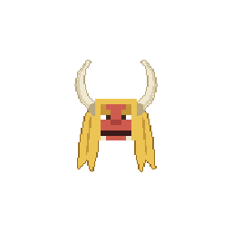
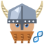

<!-- Generated by tools/build_pack_reference.py. Edit the pack sources and regenerate. -->

# Giant

{ .entry-page-icon }

[Races](index.md) · [Race Race no Mi](../../reference/content/racenomi.md)

Many times a man's height: their reach, their blows and their strides are a giant's.

**Variants**

- [Elbaf Giant](#elbaf-giant)
- [Ancient Giant](#ancient-giant)

| Stat | Value |
| --- | --- |
| Racial damage scaling | 1.00× at 10,000 Doriki → 1.40× at 50,000 Doriki |

[See combat stats](../combat-stats.md).

!!! note "Reading the stats"
    Listed base damage is for the named part of the move. Pack and Doriki multipliers are shown separately. Times assume 20 ticks per second.

<!-- move racenomi:boulder_throw -->

## Boulder Throw

{ .entry-move-icon loading=lazy } *Active*

The user tears a boulder out of the ground in front of them and lifts it over their head, used again it is thrown where they look and bursts on what it hits The hole closes after a while

| Stat | Value |
| --- | --- |
| Base damage | 14 HP |
| Cooldown | 12 s (240 ticks) |
| Conditional cooldown | 0.5 s (10 ticks) |

<!-- move racenomi:elbaf_charge -->

## Elbaf Charge

{ .entry-move-icon loading=lazy } *Active*

The user charges straight ahead and hits every enemy on the way, the ones half their size or less are thrown aside Blocks are not broken, a wall stops the charge. Only works standing up

| Stat | Value |
| --- | --- |
| Base damage | 8 HP |
| Cooldown | 8.9 s (178 ticks) |

<!-- move racenomi:elbaf_roar -->

## Roar of Elbaf

{ .entry-move-icon loading=lazy } *Active*

The user roars and enemies half their size or less around them are slowed and weakened, the user and their crew or faction hit harder for a while

| Stat | Value |
| --- | --- |
| Cooldown | 22.2 s (444 ticks) |
| Slow and weak seconds | 4 s |
| Strength seconds | 10 s |

<!-- move racenomi:giant_grip -->

## Giant's Grip

{ .entry-move-icon loading=lazy } *Active*

The user grabs a body in their fist and holds it, press again to throw it where they look. Too big a body cannot be held, getting hit makes them let go

| Stat | Value |
| --- | --- |
| Base damage | 10 HP |
| Cooldown | 15 s (300 ticks) |

<!-- move racenomi:giant_stomp -->

## Stomp

{ .entry-move-icon loading=lazy } *Active*

The user brings their foot down and the ground shakes, those at their feet are hurt and thrown up and back. Bigger the bigger they are

| Stat | Value |
| --- | --- |
| Base damage | 10 HP |
| Cooldown | 10 s (200 ticks) |

<!-- move racenomi:hakoku -->

## Hakoku

{ .entry-move-icon loading=lazy } *Active*

The strike of Elbaf's warriors, the user swings a cut that flies straight on and goes through every body on its way. Needs a weapon

| Stat | Value |
| --- | --- |
| Base damage | 20 HP |
| Cooldown | 15 s (300 ticks) |

<!-- move racenomi:shoulder_carry -->

## Shoulder Carry

{ .entry-move-icon loading=lazy } *Passive*

The user takes a crouching player at least twice smaller on their shoulder with an empty hand, the one carried crouches to get down

## Variants

### Elbaf Giant { #elbaf-giant }

{ .entry-move-icon }

A Giant with a standard size of 4× and Pride of Elbaf. You have more room to maneuver in buildings than an Ancient Giant.

<!-- move racenomi:elbaf_pride -->

#### Pride of Elbaf { #elbaf-giant-elbaf-pride }

{ .entry-move-icon loading=lazy } *Passive*

The user does not give way, weakness and despair do not take hold of them, and below 30% health they hit 25% harder

| Stat | Value |
| --- | --- |
| Damage under 30% health | +25% |

### Ancient Giant { #ancient-giant }

{ .entry-move-icon }

A Giant with a standard size of 6×, Ancient Blood and Continent Puller. Your larger body makes tight spaces harder to navigate.

<!-- move racenomi:ancient_blood -->

#### Ancient Blood { #ancient-giant-ancient-blood }

{ .entry-move-icon loading=lazy } *Passive*

The user has the blood of the first conquerors of the New World: they are tough and blows do not push them back

| Stat | Value |
| --- | --- |
| Toughness | +3 |

<!-- move racenomi:continent_puller -->

#### Continent Puller { #ancient-giant-continent-puller }

{ .entry-move-icon loading=lazy } *Active*

The user sinks their hands into the ground and hauls it in, every enemy on a wide line ahead is hit and dragged to their feet

| Stat | Value |
| --- | --- |
| Base damage | 24 HP |
| Cooldown | 14 s (280 ticks) |

## Lineage Factors

| Graft | Effect | Source |
| --- | --- | --- |
| { .entry-move-icon } Giant Lineage | The Lineage Factor of a body twice a man's size or more makes the bearer grow, over the size of their race. Never with a Dwarf Lineage. | Missing Missing no Mi |
| { .entry-move-icon } Elbaf Lineage | The Lineage Factor of an Elbaf giant gives the bearer the pride of Elbaf: weakness and despair do not take hold of them, and they hit harder when near defeat. | Race Race no Mi |
| { .entry-move-icon } Ancient Lineage | The Lineage Factor of an ancient giant gives the bearer the first conquerors' blood, horns and skin: they are tough and blows do not push them back. | Race Race no Mi |

See [grafting and capacity](../bloodlines/index.md#grafted-lineage-factors) before choosing a factor.

## Quests

See [the quest chapter](../../reference/quests/r_giant.md) for milestones and rewards.
