<!-- Generated by tools/build_pack_reference.py. Edit the pack sources and regenerate. -->

# Human

{ .entry-page-icon }

[Races](index.md) · [Race Race no Mi](../../reference/content/racenomi.md)

**Variants**

- [Ordinary Human](#human-ordinary)
- [Hidden Modified Human](#human-hidden-modified)
- [Modified Human](#modified-human)

| Stat | Value |
| --- | --- |
| Racial damage scaling | 1.00× at 10,000 Doriki → 1.40× at 50,000 Doriki |

[See combat stats](../combat-stats.md).

!!! note "Reading the stats"
    Listed base damage is for the named part of the move. Pack and Doriki multipliers are shown separately. Times assume 20 ticks per second.

<!-- move mineminenomi:geppo -->

## Geppo

{ .entry-move-icon loading=lazy } *Active*

The user kicks the air beneath them to launch themselves into the air

| Stat | Value |
| --- | --- |
| Short cooldown | 0.5 s (10 ticks) |
| Long cooldown | 2.5 s (50 ticks) |

<!-- move mineminenomi:kamie -->

## Kami-E

{ .entry-move-icon loading=lazy } *Active*

Makes the user's body flexible like paper in order to avoid attacks

| Stat | Value |
| --- | --- |
| Min cooldown | 5 s (100 ticks) |
| Max cooldown | 20 s (400 ticks) |

<!-- move mineminenomi:kamisori -->

## Kamisori

{ .entry-move-icon loading=lazy } *Active*

A combination of Geppo and Soru, where the user uses Soru in a zigzag motion in midair, allowing extremely fast movements in three dimensions.

| Stat | Value |
| --- | --- |
| Cooldown | 15 s (300 ticks) |

<!-- move mineminenomi:rankyaku -->

## Rankyaku

{ .entry-move-icon loading=lazy } *Active*

By kicking at a very high speed, the user launches an air blade at the opponent

| Stat | Value |
| --- | --- |
| Cooldown | 12 s (240 ticks) |
| Explosion damage | 15 HP |

<!-- move mineminenomi:rokuogan -->

## Rokuogan

{ .entry-move-icon loading=lazy } *Active*

The user places both their fists right in front of the target to focus their physical strength to launch a devastating shockwave forward

| Stat | Value |
| --- | --- |
| Cooldown | 35 s (700 ticks) |

<!-- move mineminenomi:shigan -->

## Shigan

{ .entry-move-icon loading=lazy } *Active*

The user thrusts their finger at the opponent to pierce them

| Stat | Value |
| --- | --- |
| Cooldown | 8 s (160 ticks) |

<!-- move mineminenomi:soru -->

## Soru

{ .entry-move-icon loading=lazy } *Active*

Allows the user to move at an extremely high speed in bursts.

| Stat | Value |
| --- | --- |
| Long cooldown | 10 s (200 ticks) |
| Short cooldown | 0.5 s (10 ticks) |

<!-- move mineminenomi:tekkai -->

## Tekkai

{ .entry-move-icon loading=lazy } *Active*

Hardens the user's body to protect themselves, but they're unable to move   HEAVY immobile, more protection   WALK can move, less protection

| Stat | Value |
| --- | --- |
| Min cooldown | 3 s (60 ticks) |
| Max cooldown | 13 s (260 ticks) |

## Variants

### Ordinary Human { #human-ordinary }

{ .entry-move-icon }

<!-- move racenomi:human_will -->

#### Human Will { #human-ordinary-human-will }

{ .entry-move-icon loading=lazy } *Passive*

The user has no body bonus as the other races have, but grows faster: more Doriki and more Haki experience from all they do

### Hidden Modified Human { #human-hidden-modified }

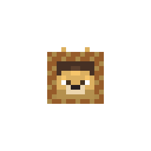{ .entry-move-icon }

Play twenty hours as a Hidden Modified Human and reach 5,000 Doriki to wake the modification.

### Modified Human { #modified-human }

{ .entry-move-icon }

Equip a Raid Suit with the Germa 66 Ration Box. Sneak and use it to pick the suit colour. Suit-specific moves require the corresponding suit.

<!-- move racenomi:modified_body -->

#### Modified Body { #modified-human-modified-body }

{ .entry-move-icon loading=lazy } *Passive*

The body of the user was changed before birth, a skin hard as a shell against bullets and blades, wounds that close fast and more strength and speed than a man With no emotions nothing plays on their mind, love and gloom do not take and the Haki of kings knocks them out half as long

<!-- move racenomi:black_bug -->

#### Black Bug { #modified-human-black-bug }

{ .entry-move-icon loading=lazy } *Active*

In the red, blue or green suit the user gathers then rushes ahead through every enemy on the way, each is hit harder for each other colour of suit that just struck it

| Stat | Value |
| --- | --- |
| Base damage | 18 HP |
| Cooldown | 15 s (300 ticks) |

<!-- move racenomi:cape_shield -->

#### Cape Shield { #modified-human-cape-shield }

{ .entry-move-icon loading=lazy } *Active*

The cape of the suit spreads into a shield in front of the user, for a moment it stops every attack that comes from the front Used again the cape comes down

| Stat | Value |
| --- | --- |
| Cooldown | 12 s (240 ticks) |

<!-- move racenomi:dengeki_kick -->

#### Dengeki Kick { #modified-human-dengeki-kick }

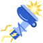{ .entry-move-icon loading=lazy } *Active*

In the Dengeki Blue suit the user leaps on the enemy they look at as fast as lightning and kicks it, the kick throws it far and paralyses it a moment

| Stat | Value |
| --- | --- |
| Base damage | 14 HP |
| Cooldown | 8 s (160 ticks) |
| Conditional cooldown | 0.5 s (10 ticks) |

<!-- move racenomi:germa_boots -->

#### Germa Boots { #modified-human-germa-boots }

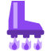{ .entry-move-icon loading=lazy } *Active*

The jets in the boots of the suit hold the user up in the air where they are, used again or when the time runs out the jets throw them in a big leap where they look

| Stat | Value |
| --- | --- |
| Cooldown | 6 s (120 ticks) |

<!-- move racenomi:henry_blazer -->

#### Henry Blazer { #modified-human-henry-blazer }

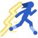{ .entry-move-icon loading=lazy } *Active*

In the Dengeki Blue suit the user runs ahead in a zigzag like a lightning bolt and strikes every enemy they pass With a sword in hand the electricity runs down the blade and it hits harder

| Stat | Value |
| --- | --- |
| Base damage | 12 HP |
| Cooldown | 12 s (240 ticks) |

<!-- move racenomi:henry_cracker -->

#### Henry Cracker { #modified-human-henry-cracker }

{ .entry-move-icon loading=lazy } *Active*

In the Dengeki Blue suit the user flies up and darts from side to side in a storm of electricity that strikes and paralyses every enemy around

| Stat | Value |
| --- | --- |
| Base damage | 6 HP |
| Cooldown | 25 s (500 ticks) |

<!-- move racenomi:henry_needle -->

#### Henry Needle { #modified-human-henry-needle }

{ .entry-move-icon loading=lazy } *Active*

In the Dengeki Blue suit the user throws a needle of electricity from the hand, it flies fast and far, hits hard and paralyses the target a while

| Stat | Value |
| --- | --- |
| Base damage | 14 HP |
| Cooldown | 10 s (200 ticks) |

<!-- move racenomi:pink_hornet -->

#### Pink Hornet { #modified-human-pink-hornet }

{ .entry-move-icon loading=lazy } *Active*

In the Poison Pink suit the user throws a ball of poison, where it bursts a cloud of poison stays and poisons every enemy in it The user holds out a palm and, after a short cast, a thin ray of poison leaves it far and straight through every enemy on the line

| Stat | Value |
| --- | --- |
| Hornet cooldown | 8 s (160 ticks) |
| Kosen cooldown | 14 s (280 ticks) |
| Cooldown | 8 s (160 ticks) |

<!-- move racenomi:pink_rasen -->

#### Pink Rasen { #modified-human-pink-rasen }

{ .entry-move-icon loading=lazy } *Active*

In the Poison Pink suit the user turns a finger and a tornado of poison rises around them, it draws the enemies near in, hurts and poisons them and at the end throws them up

| Stat | Value |
| --- | --- |
| Base damage | 6 HP |
| Cooldown | 18 s (360 ticks) |

<!-- move racenomi:poison_draw -->

#### Poison Draw { #modified-human-poison-draw }

{ .entry-move-icon loading=lazy } *Active*

In the Poison Pink suit the user draws all the poison and bad effects out of the one they touch and heals them a little, looking at no one they do it on themselves

| Stat | Value |
| --- | --- |
| Cooldown | 15 s (300 ticks) |

<!-- move racenomi:poison_mist -->

#### Poison Mist { #modified-human-poison-mist }

{ .entry-move-icon loading=lazy } *Active*

In the Poison Pink suit the user breathes out a mist of poison all around, the enemies in it are poisoned and slowed and the user heals in it because they eat poison

| Stat | Value |
| --- | --- |
| Cooldown | 25 s (500 ticks) |

<!-- move racenomi:poison_touch -->

#### Poison Touch { #modified-human-poison-touch }

{ .entry-move-icon loading=lazy } *Passive*

In the Poison Pink suit the bare hand blows of the user poison what they hit

<!-- move racenomi:raid_suit -->

#### Raid Suit { #modified-human-raid-suit }

{ .entry-move-icon loading=lazy } *Passive*

While the user wears a Raid Suit its cloth bears fire, its boots land any fall and make the blows hit harder The suits are in the Germa 66 ration box, only a modified human can open it, and a suit gives its own techniques for as long as it is worn

<!-- move racenomi:silent_steps -->

#### Silent Steps { #modified-human-silent-steps }

{ .entry-move-icon loading=lazy } *Passive*

In the Stealth Black suit, while Stealth hides the user nothing hears their steps and the mobs lose them

<!-- move racenomi:sparking_blast -->

#### Sparking Blast { #modified-human-sparking-blast }

{ .entry-move-icon loading=lazy } *Active*

In the Sparking Red suit the user gathers light between both hands then throws a great ball of it, it bursts on what it hits and hurts all around it

| Stat | Value |
| --- | --- |
| Base damage | 22 HP |
| Cooldown | 20 s (400 ticks) |

<!-- move racenomi:sparking_figure -->

#### Sparking Figure { #modified-human-sparking-figure }

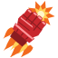{ .entry-move-icon loading=lazy } *Active*

In the Sparking Red suit the user rushes ahead fist first and the fist bursts on the first enemy it meets, the blast hurts all around it Both fists at once after a longer cast, harder and wider, but the blast hurts the user too

<!-- move racenomi:sparking_flash -->

#### Sparking Flash { #modified-human-sparking-flash }

{ .entry-move-icon loading=lazy } *Active*

In the Sparking Red suit the user shines like the sun for a moment, every enemy near who looks at them is blinded and slowed

| Stat | Value |
| --- | --- |
| Cooldown | 15 s (300 ticks) |

<!-- move racenomi:sparking_valkyrie -->

#### Sparking Valkyrie { #modified-human-sparking-valkyrie }

{ .entry-move-icon loading=lazy } *Active*

In the Sparking Red suit 5 beams of light shoot from the eyes of the user one after the other where they look, each goes through every enemy on its way

| Stat | Value |
| --- | --- |
| Base damage | 6 HP |
| Cooldown | 12 s (240 ticks) |

<!-- move racenomi:stealth -->

#### Stealth { #modified-human-stealth }

{ .entry-move-icon loading=lazy } *Active*

In the Stealth Black suit the user vanishes with all they hold, the first blow they strike hits harder and shows them again

| Stat | Value |
| --- | --- |
| Cooldown | 20 s (400 ticks) |

<!-- move racenomi:stealth_ambush -->

#### Stealth Ambush { #modified-human-stealth-ambush }

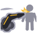{ .entry-move-icon loading=lazy } *Active*

In the Stealth Black suit, while Stealth hides the user, they appear behind the enemy they look at and strike it, as the first blow from nowhere it hits twice as hard

| Stat | Value |
| --- | --- |
| Base damage | 18 HP |
| Cooldown | 12 s (240 ticks) |
| Conditional cooldown | 0.5 s (10 ticks) |

<!-- move racenomi:stealth_decoy -->

#### Stealth Decoy { #modified-human-stealth-decoy }

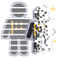{ .entry-move-icon loading=lazy } *Active*

In the Stealth Black suit the user leaves an image of themselves where they stand and vanishes at once, the mobs that were after the user go after the image

| Stat | Value |
| --- | --- |
| Cooldown | 25 s (500 ticks) |

<!-- move racenomi:stealth_rescue -->

#### Stealth Rescue { #modified-human-stealth-rescue }

{ .entry-move-icon loading=lazy } *Active*

In the Stealth Black suit, while Stealth hides the user, the one they reach out to beside them vanishes too for as long as they stay near

| Stat | Value |
| --- | --- |
| Cooldown | 20 s (400 ticks) |

<!-- move racenomi:unsociable -->

#### Unsociable { #modified-human-unsociable }

{ .entry-move-icon loading=lazy } *Passive*

A flaw: with no emotions nobody warms to the user, villagers and merchants will not trade with them and no village thinks better of them

<!-- move racenomi:winch_arm -->

#### Winch Arm { #modified-human-winch-arm }

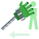{ .entry-move-icon loading=lazy } *Active*

In the Winch Green suit the hand of the user shoots out on its cable to the enemy they look at, grabs it and the winch pulls it back to them The hand holds on to the block or the enemy the user looks at and the winch pulls the user there

| Stat | Value |
| --- | --- |
| Cooldown | 6 s (120 ticks) |
| Conditional cooldown | 0.5 s (10 ticks) |

<!-- move racenomi:winch_bomber -->

#### Winch Bomber { #modified-human-winch-bomber }

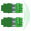{ .entry-move-icon loading=lazy } *Active*

In the Winch Green suit the user winds up then punches the air again and again, small shocks on what is in front, then both fists throw one great shock along the line

| Stat | Value |
| --- | --- |
| Cooldown | 18 s (360 ticks) |

<!-- move racenomi:winch_danton -->

#### Winch Danton { #modified-human-winch-danton }

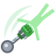{ .entry-move-icon loading=lazy } *Active*

In the Winch Green suit the user grabs the head of the enemy in front of them and swings it round on the winch, every enemy it hits is hurt and at the end it is thrown where they look Hits on the user make them let go

| Stat | Value |
| --- | --- |
| Base damage | 12 HP |
| Cooldown | 18 s (360 ticks) |

<!-- move racenomi:winch_punch -->

#### Winch Punch { #modified-human-winch-punch }

{ .entry-move-icon loading=lazy } *Active*

In the Winch Green suit the fist of the user shoots out on its cable with the compressed air of the winch behind it, hits the first enemy on its way and throws it far

| Stat | Value |
| --- | --- |
| Base damage | 14 HP |
| Cooldown | 8 s (160 ticks) |

## Lineage Factors

| Graft | Effect | Source |
| --- | --- | --- |
| { .entry-move-icon } Human Lineage | The Lineage Factor of a human makes the bearer grow faster: more Doriki and more Haki experience from all they do. | AkumaLib |
| 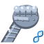{ .entry-move-icon } Steel Skin | The Lineage Factor of an iron golem gives the bearer a steel exoskeleton, as Germa 66's modified children. | Missing Missing no Mi |
| { .entry-move-icon } Regeneration | The Lineage Factor of an axolotl makes the bearer heal on their own, as Germa 66's modified children. | Missing Missing no Mi |
| 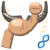{ .entry-move-icon } Superhuman Strength | The Lineage Factor of a ravager gives the bearer the strength of Germa 66's modified children. | Missing Missing no Mi |

See [grafting and capacity](../bloodlines/index.md#grafted-lineage-factors) before choosing a factor.

## Quests

See [the quest chapter](../../reference/quests/r_human.md) for milestones and rewards.
