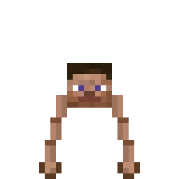
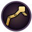
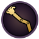

<!-- Generated by tools/build_pack_reference.py. Edit the pack sources and regenerate. -->

# Long-Arm

{ .entry-page-icon }

[Races](index.md) · [Haki Realm](../../reference/content/hakirework.md)

Use bare hands to strike or grab enemies from farther away.

| Stat | Value |
| --- | --- |
| Racial damage scaling | 1.00× at 10,000 Doriki → 1.40× at 50,000 Doriki |

[See combat stats](../combat-stats.md).

!!! note "Reading the stats"
    Listed base damage is for the named part of the move. Pack and Doriki multipliers are shown separately. Times assume 20 ticks per second.

<!-- move hakirework:long_arm_strike -->

## Long-Arm Strike

{ .entry-move-icon loading=lazy }

A blow thrown from far away by arms with two elbows.

| Stat | Value |
| --- | --- |
| Conditional cooldown | 4 s (80 ticks) |

<!-- move hakirework:long_arm_grab -->

## Long-Arm Grab

{ .entry-move-icon loading=lazy }

The arm shoots out, seizes the one the user looks at and drags them close, slowed for a moment. Needs an empty hand.

| Stat | Value |
| --- | --- |
| Conditional cooldown | 6 s (120 ticks) |

<!-- move hakirework:windmill_lariat -->

## Windmill Lariat

{ .entry-move-icon loading=lazy }

Both long arms out and spinning: everyone nearby is battered again and again and thrown outward. Needs an empty hand.

| Stat | Value |
| --- | --- |
| Conditional cooldown | 10 s (200 ticks) |

## Lineage Factors

See the [graft guide](../bloodlines/index.md#grafted-lineage-factors) for factors you can add to this character.

## Quests

See [the quest chapter](../../reference/quests/r_tribes.md) for milestones and rewards.
