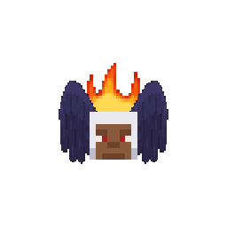
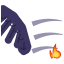

<!-- Generated by tools/build_pack_reference.py. Edit the pack sources and regenerate. -->

# Lunarian

{ .entry-page-icon }

[Races](index.md) · [Race Race no Mi](../../reference/content/racenomi.md)

Switch your flame on for defence and flame techniques, or extinguish it for speed and offensive mobility. Lunarians are protected from the hot temperature extreme.

| Stat | Value |
| --- | --- |
| Racial damage scaling | 1.00× at 10,000 Doriki → 1.40× at 50,000 Doriki |

[See combat stats](../combat-stats.md).

!!! note "Reading the stats"
    Listed base damage is for the named part of the move. Pack and Doriki multipliers are shown separately. Times assume 20 ticks per second.

<!-- move racenomi:black_wings -->

## Black Wings

{ .entry-move-icon loading=lazy } *Active*

The user flies with their wings for a few seconds, when it ends they fall, their flame must be lit

| Stat | Value |
| --- | --- |
| Cooldown | 15 s (300 ticks) |

<!-- move racenomi:flame_blast -->

## Flame Blast

{ .entry-move-icon loading=lazy } *Active*

The user blows a jet of flame straight ahead that burns everyone on the way, their flame must be lit

| Stat | Value |
| --- | --- |
| Base damage | 9.79832 HP |
| Cooldown | 9.16003 s (183.201 ticks) |

<!-- move racenomi:flame_shroud -->

## Flame Shroud

{ .entry-move-icon loading=lazy } *Active*

Flames wrap around the user for a few seconds and burn everyone close, their flame must be lit

| Stat | Value |
| --- | --- |
| Base damage | 2.44958 HP |
| Cooldown | 22.9001 s (458.001 ticks) |

<!-- move racenomi:flame_switch -->

## Flame Switch

{ .entry-move-icon loading=lazy } *Active*

The user lights the flame on their back or puts it out

| Stat | Value |
| --- | --- |
| Cooldown | 10 s (200 ticks) |

<!-- move racenomi:flameless_rush -->

## Flameless Rush

{ .entry-move-icon loading=lazy } *Active*

The user rushes straight ahead very fast and hits the first enemy on the way, their flame must be out

| Stat | Value |
| --- | --- |
| Base damage | 8.16526 HP |
| Cooldown | 7.32802 s (146.56 ticks) |

<!-- move racenomi:flaming_blow -->

## Flaming Blow

{ .entry-move-icon loading=lazy } *Active*

The user hits the nearest enemy with a burning blow, their flame must be lit

| Stat | Value |
| --- | --- |
| Base damage | 11.4314 HP |
| Cooldown | 7.32802 s (146.56 ticks) |
| Conditional cooldown | 0.5 s (10 ticks) |

<!-- move racenomi:lunarian_blood -->

## Lunarian Blood

{ .entry-move-icon loading=lazy } *Passive*

Fire does not burn the user. With the flame on their back lit they take much less damage and can use their abilities, with it out they run, hit and jump faster and harder. Under water it goes out

<!-- move racenomi:lunarian_flight -->

## Lunarian Flight

*Passive*

<!-- move racenomi:wing_gust -->

## Wing Gust

{ .entry-move-icon loading=lazy } *Active*

The user beats their wings once, the wind throws every enemy ahead far back, it burns them if the flame is lit

| Stat | Value |
| --- | --- |
| Base damage | 3.26611 HP |
| Cooldown | 10.992 s (219.841 ticks) |

## Lineage Factors

| Graft | Effect | Source |
| --- | --- | --- |
| { .entry-move-icon } Lunarian Traits | The Lineage Factor of a Lunarian gives the bearer the Lunarian traits of the Seraphim: a tough body, fire and burning do not hurt them (lava still does), Lunarian wings grow on their back, and holding jump in the air lets them glide down. Never on a Lunarian. | Missing Missing no Mi |

See [grafting and capacity](../bloodlines/index.md#grafted-lineage-factors) before choosing a factor.

## Quests

See [the quest chapter](../../reference/quests/r_lunarian.md) for milestones and rewards.
