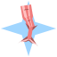
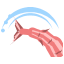
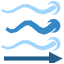
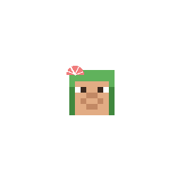
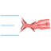
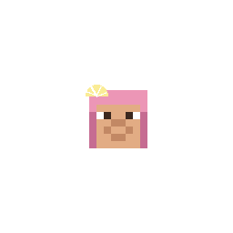
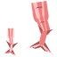
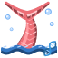
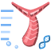

<!-- Generated by tools/build_pack_reference.py. Edit the pack sources and regenerate. -->

# Merfolk

{ .entry-page-icon }

[Races](index.md) · [Race Race no Mi](../../reference/content/racenomi.md)

Merfolk swim quickly and have legs on land. They can learn Fishman Karate alongside their own aquatic techniques.

**Variants**

- [Mermaid](#mermaid)
- [Great Merfolk](#great-merfolk)

| Stat | Value |
| --- | --- |
| Racial damage scaling | 1.00× at 10,000 Doriki → 1.40× at 50,000 Doriki |

[See combat stats](../combat-stats.md).

!!! note "Reading the stats"
    Listed base damage is for the named part of the move. Pack and Doriki multipliers are shown separately. Times assume 20 ticks per second.

<!-- move racenomi:merfolk_body -->

## Merfolk Body

{ .entry-move-icon loading=lazy } *Passive*

The user has a fish tail in the water: they swim faster than anyone in the sea and breathe and see under water. Not with a Devil Fruit

<!-- move racenomi:princely_fist -->

## Princely Fist

{ .entry-move-icon loading=lazy } *Active*

The user lands a heavy punch on the enemy in front of them, who is stunned and can neither move nor strike for a moment

| Stat | Value |
| --- | --- |
| Base damage | 12 HP |
| Cooldown | 11 s (220 ticks) |
| Conditional cooldown | 0.5 s (10 ticks) |

<!-- move racenomi:sea_escort -->

## Sea Escort

{ .entry-move-icon loading=lazy } *Active*

The user guides their allies around them through the sea, they swim as fast as dolphins and breathe under water for a while

| Stat | Value |
| --- | --- |
| Cooldown | 25 s (500 ticks) |
| Conditional cooldown | 0.5 s (10 ticks) |

<!-- move racenomi:siren_song -->

## Siren Song

{ .entry-move-icon loading=lazy } *Active*

The user sings for a while, enemies around them are slowed and weakened as long as they hear it, and creatures forget who they were fighting. The user strikes no blow while singing Used again the song stops

| Stat | Value |
| --- | --- |
| Cooldown | 30 s (600 ticks) |

<!-- move racenomi:tail_sweep -->

## Tail Sweep

{ .entry-move-icon loading=lazy } *Active*

The user sweeps everything around them with their tail and throws enemies away. Much stronger in the water The user bounds ahead on their tail and, landing, the tail strikes every enemy around them. Higher and further out of the water

| Stat | Value |
| --- | --- |
| Base damage | 10 HP |
| Cooldown | 12 s (240 ticks) |
| Leap damage | 10 HP |
| Leap cooldown | 10 s (200 ticks) |

<!-- move racenomi:trident_assault -->

## Trident Assault

{ .entry-move-icon loading=lazy } *Active*

The user throws a trident of water far ahead. Stronger with a trident in hand The user thrusts the trident straight ahead and runs through every enemy on the line. Stronger with a trident in hand

| Stat | Value |
| --- | --- |
| Cooldown | 12 s (240 ticks) |

<!-- move racenomi:ultramarine -->

## Merman Combat: Ultramarine

{ .entry-move-icon loading=lazy } *Active*

The user takes the water in their hands and hurls it ahead in one great torrent that throws enemies far away. Further and stronger in the water

| Stat | Value |
| --- | --- |
| Base damage | 14 HP |
| Cooldown | 12 s (240 ticks) |

<!-- move racenomi:undertow -->

## Undertow

{ .entry-move-icon loading=lazy } *Active*

The user sends a rush of water in front of them that carries enemies away and slows them. Stronger in the water

| Stat | Value |
| --- | --- |
| Cooldown | 8 s (160 ticks) |
| Base damage | 6 HP |

<!-- move mineminenomi:kachiage_haisoku -->

## Kachiage Haisoku

{ .entry-move-icon loading=lazy } *Active*

The user delivers a powerful kick to the opponent's chin, which is stronger inside water

| Stat | Value |
| --- | --- |
| Cooldown | 8 s (160 ticks) |
| Base damage | 20 HP |

<!-- move mineminenomi:karakusagawara_seiken -->

## Karakusagawara Seiken

{ .entry-move-icon loading=lazy } *Active*

The user punches the air, which sends a shockwave through water vapor in the air

| Stat | Value |
| --- | --- |
| Cooldown | 25 s (500 ticks) |
| Base damage | 20 HP |

<!-- move mineminenomi:mizu_osu -->

## Mizu Osu

{ .entry-move-icon loading=lazy } *Active*

Spits water with enough force to push away any enemy in front of the user.

| Stat | Value |
| --- | --- |
| Cooldown | 8 s (160 ticks) |

<!-- move mineminenomi:mizu_shuryudan -->

## Mizu Shuryudan

{ .entry-move-icon loading=lazy } *Active*

Launches multiple bubbles in the direction the user is looking, these bubbles will linger around until an enemy comes close to them at which point they'll start targeting the enemy and move towards them.

| Stat | Value |
| --- | --- |
| Cooldown | 12 s (240 ticks) |

<!-- move mineminenomi:mizu_taiho -->

## Mizu Taiho

{ .entry-move-icon loading=lazy } *Active*

Launches a giant bubble, dealing massive damage and exploding on contact.

| Stat | Value |
| --- | --- |
| Cooldown | 17 s (340 ticks) |

<!-- move mineminenomi:pack_of_sharks -->

## Pack of Sharks

{ .entry-move-icon loading=lazy } *Active*

The user fires densely compressed shark-shaped waterbullets at the opponent

| Stat | Value |
| --- | --- |
| Cooldown | 15 s (300 ticks) |

<!-- move mineminenomi:samehada_shotei -->

## Samehada Shotei

{ .entry-move-icon loading=lazy } *Active*

The user concentrates their power to their palms, sending melee damage back to its owner and pushing them a few blocks back

| Stat | Value |
| --- | --- |
| Intrerupt cooldown | 10 s (200 ticks) |
| Min cooldown | 5 s (100 ticks) |
| Max cooldown | 20 s (400 ticks) |
| Base damage | 15 HP |

<!-- move mineminenomi:shark_on_tooth -->

## Shark on Tooth

{ .entry-move-icon loading=lazy } *Active*

Launches the user forward while spinning, biting the first enemy it comes in contact with.

| Stat | Value |
| --- | --- |
| Cooldown | 15 s (300 ticks) |
| Base damage | 40 HP |

<!-- move mineminenomi:two_fish_engine -->

## Two Fish Engine

{ .entry-move-icon loading=lazy } *Active*

Increases the user's swimming speed

| Stat | Value |
| --- | --- |
| Min cooldown | 5 s (100 ticks) |
| Max cooldown | 15 s (300 ticks) |

<!-- move mineminenomi:uchimizu -->

## Uchimizu

{ .entry-move-icon loading=lazy } *Active*

The user hurls big and fast water droplets at the opponent

| Stat | Value |
| --- | --- |
| Cooldown | 4 s (80 ticks) |

<!-- move mineminenomi:yarinami -->

## Yarinami

{ .entry-move-icon loading=lazy } *Active*

The user fires a densely compressed spear-shaped waterbullet at the opponent

| Stat | Value |
| --- | --- |
| Cooldown | 12 s (240 ticks) |

## Variants

### Mermaid { #mermaid }

{ .entry-move-icon }

Choose Swift Tail for faster swimming. At 1× body size, you trade Great Merfolk’s extra toughness for speed.

<!-- move racenomi:swift_tail -->

#### Swift Tail { #mermaid-swift-tail }

{ .entry-move-icon loading=lazy } *Passive*

The user swims faster still than other merfolk. Not with a Devil Fruit

### Great Merfolk { #great-merfolk }

{ .entry-move-icon }

Choose Great Body for more toughness and a 1.25× body. Mermaid’s Swift Tail is the faster option in water.

<!-- move racenomi:great_merfolk_body -->

#### Great Body { #great-merfolk-great-merfolk-body }

{ .entry-move-icon loading=lazy } *Passive*

The user is bigger than other merfolk, as big as a fishman, and sturdier

## Lineage Factors

| Graft | Effect | Source |
| --- | --- | --- |
| { .entry-move-icon } Merfolk Lineage | The Lineage Factor of the merfolk gives the bearer a fish tail in the water: they swim faster than anyone in the sea and breathe and see under water. Not with a Devil Fruit. | Race Race no Mi |
| { .entry-move-icon } Mermaid Lineage | The Lineage Factor of a mermaid makes the bearer swim faster still. Not with a Devil Fruit. | Race Race no Mi |
| { .entry-move-icon } Great Merfolk Lineage | The Lineage Factor of the great merfolk makes the bearer sturdier, with a great merfolk's tail in the water. | Race Race no Mi |

See [grafting and capacity](../bloodlines/index.md#grafted-lineage-factors) before choosing a factor.

## Quests

See [the quest chapter](../../reference/quests/r_merfolk.md) for milestones and rewards.
