<!-- Generated by tools/build_pack_reference.py. Edit the pack sources and regenerate. -->

# Mink

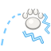{ .entry-page-icon }

[Races](index.md) · [Race Race no Mi](../../reference/content/racenomi.md)

Train Electro for charged strikes and Sulong for full-moon fights. Each variant adds a body trait and its own Electro techniques.

**Variants**

- [Dog Mink](#mink-dog)
- [Lion Mink](#mink-lion)
- [Bunny Mink](#mink-bunny)
- [Cat Mink](#mink-cat)
- [Jaguar Mink](#mink-jaguar)
- [Polar Bear Mink](#mink-polar-bear)
- [Bull Mink](#mink-bull)

| Stat | Value |
| --- | --- |
| Racial damage scaling | 1.00× at 10,000 Doriki → 1.40× at 50,000 Doriki |

[See combat stats](../combat-stats.md).

!!! note "Reading the stats"
    Listed base damage is for the named part of the move. Pack and Doriki multipliers are shown separately. Times assume 20 ticks per second.

<!-- move racenomi:eleclaw -->

## Eleclaw

{ .entry-move-icon loading=lazy } *Active*

The user leaps onto the enemy in sight and strikes it with a fist charged with Electro, paralysing it. Needs Electro. Stronger in Sulong

| Stat | Value |
| --- | --- |
| Base damage | 10 HP |
| Cooldown | 0.4 s (8 ticks) |
| Electro charges | 1 |
| Sulong damage | 15 HP |
| Sulong cooldown | 4 s |
| Sulong Electro charges | 0 |

<!-- move racenomi:electrical_luna -->

## Electrical Luna

{ .entry-move-icon loading=lazy } *Active*

The user charges a ball of lightning between both hands and slams it into the ground, a wide blast that shocks and paralyses every enemy around. Needs Electro. Stronger in Sulong

| Stat | Value |
| --- | --- |
| Base damage | 14 HP |
| Cooldown | 0.5 s (10 ticks) |
| Electro charges | 2 |
| Sulong damage | 21 HP |
| Sulong cooldown | 5 s |
| Sulong Electro charges | 0 |

<!-- move racenomi:electrical_shower -->

## Electrical Shower

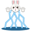{ .entry-move-icon loading=lazy } *Active*

The user leaps straight up and, coming down slowly, rains bolts of lightning on the enemies below. Needs Electro. Stronger in Sulong

| Stat | Value |
| --- | --- |
| Cooldown | 0.6 s (12 ticks) |
| Damage per bolt | 4 HP |
| Electro charges | 2 |
| Sulong damage per bolt | 6 HP |
| Sulong cooldown | 6 s |
| Sulong Electro charges | 0 |

<!-- move racenomi:electrical_tempesta -->

## Electrical Tempesta

{ .entry-move-icon loading=lazy } *Active*

The user lets a discharge out of their whole body that shocks, paralyses and throws back every enemy around. Needs Electro. Stronger in Sulong

| Stat | Value |
| --- | --- |
| Base damage | 8 HP |
| Cooldown | 0.4 s (8 ticks) |
| Electro charges | 1 |
| Sulong damage | 12 HP |
| Sulong cooldown | 4 s |
| Sulong Electro charges | 0 |

<!-- move racenomi:electro -->

## Electro

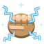{ .entry-move-icon loading=lazy } *Active*

The user runs electricity through their fists and whatever they hold, blows hurt more and may paralyse. Other Electro techniques spend its charges (none in Sulong)

| Stat | Value |
| --- | --- |
| Min cooldown | 2.5 s (50 ticks) |
| Max cooldown | 9 s (180 ticks) |

<!-- move racenomi:mink_assault -->

## Mink Assault

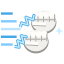{ .entry-move-icon loading=lazy } *Active*

The user rushes ahead fists first and strikes through everything in the way, paralysing it. Needs Electro. Stronger in Sulong

| Stat | Value |
| --- | --- |
| Base damage | 8 HP |
| Cooldown | 0.45 s (9 ticks) |
| Electro charges | 1 |
| Sulong damage | 12 HP |
| Sulong cooldown | 4.5 s |
| Sulong Electro charges | 0 |

<!-- move racenomi:moon_raid -->

## Moon Raid

{ .entry-move-icon loading=lazy }

In Sulong, the user dashes and claws the first enemy they meet. A mink of their crew in Sulong nearby strikes it at the same time

<!-- move racenomi:sulong -->

## Sulong

{ .entry-move-icon loading=lazy } *Active*

Under the full moon, seen from the open sky, the user takes their true form, faster, stronger and bigger. Electro spends no charge and every mink technique grows. The user is tired when it ends

A Mink under the Chemist’s Rumble effect can enter Sulong without a full moon.

| Stat | Value |
| --- | --- |
| Min cooldown | 5 s (100 ticks) |
| Max cooldown | 60 s (1200 ticks) |

## Variants

### Dog Mink { #mink-dog }

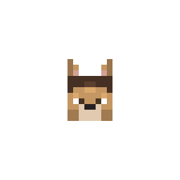{ .entry-move-icon }

Fight alongside crewmates to gain the most from Pack damage. Inu Odoshi is a charging kick.

<!-- move racenomi:dog_mink_pack -->

#### Dog Mink Pack { #mink-dog-dog-mink-pack }

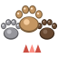{ .entry-move-icon loading=lazy } *Passive*

The user strikes faster, and harder with each ally of their crew close by

| Stat | Value |
| --- | --- |
| Pack damage | 0.1 HP |

<!-- move racenomi:inu_odoshi -->

#### Inu Odoshi { #mink-dog-inu-odoshi }

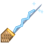{ .entry-move-icon loading=lazy } *Active*

The user charges at full speed and kicks the first enemy they meet, a kick that pierces and shocks. Needs Electro. Stronger in Sulong

| Stat | Value |
| --- | --- |
| Base damage | 16 HP |
| Cooldown | 0.65 s (13 ticks) |
| Electro charges | 2 |
| Sulong damage | 24 HP |
| Sulong cooldown | 6.5 s |
| Sulong Electro charges | 0 |

### Lion Mink { #mink-lion }

{ .entry-move-icon }

Choose Lion for the strongest flat damage bonus among Minks and a lightning cone that handles groups.

<!-- move racenomi:lion_mink_body -->

#### Lion Mink Body { #mink-lion-lion-mink-body }

{ .entry-move-icon loading=lazy } *Passive*

The user hits the hardest of the minks

| Stat | Value |
| --- | --- |
| Base damage | 3 HP |

<!-- move racenomi:electro_roar -->

#### Electro Roar { #mink-lion-electro-roar }

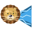{ .entry-move-icon loading=lazy } *Active*

The user roars with Electro and the enemies in a cone in front of them are shocked, paralysed and thrown back. Needs Electro. Stronger in Sulong

| Stat | Value |
| --- | --- |
| Base damage | 8 HP |
| Cooldown | 0.55 s (11 ticks) |
| Electro charges | 1 |
| Sulong damage | 12 HP |
| Sulong cooldown | 5.5 s |
| Sulong Electro charges | 0 |

### Bunny Mink { #mink-bunny }

{ .entry-move-icon }

Choose Bunny for speed, jumps and safe falls of up to 12 blocks. Its moves close distance along the ground or from above.

<!-- move racenomi:bunny_mink_legs -->

#### Bunny Mink Legs { #mink-bunny-bunny-mink-legs }

{ .entry-move-icon loading=lazy } *Passive*

The user jumps higher and runs faster, and lands unhurt from up to 12 blocks

<!-- move racenomi:moon_rabbit -->

#### Moon Rabbit { #mink-bunny-moon-rabbit }

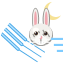{ .entry-move-icon loading=lazy } *Active*

The user runs at full speed, claws out, scratching and shocking everything in their path. Needs Electro. Stronger in Sulong

| Stat | Value |
| --- | --- |
| Base damage | 10 HP |
| Cooldown | 0.6 s (12 ticks) |
| Electro charges | 1 |
| Sulong damage | 15 HP |
| Sulong cooldown | 6 s |
| Sulong Electro charges | 0 |

<!-- move racenomi:comet_rabbit -->

#### Comet Rabbit { #mink-bunny-comet-rabbit }

{ .entry-move-icon loading=lazy } *Active*

The user leaps high and comes down on the enemy in sight with a double kick, the shock hurting and paralysing all around. Needs Electro. Stronger in Sulong

| Stat | Value |
| --- | --- |
| Base damage | 14 HP |
| Cooldown | 0.7 s (14 ticks) |
| Electro charges | 2 |
| Sulong damage | 21 HP |
| Sulong cooldown | 7 s |
| Sulong Electro charges | 0 |

### Cat Mink { #mink-cat }

{ .entry-move-icon }

Choose Cat for night vision and faster attacks. Aka Byobu picks out the first target you hit in a rush.

<!-- move racenomi:cat_mink_eyes -->

#### Cat Mink Eyes { #mink-cat-cat-mink-eyes }

{ .entry-move-icon loading=lazy } *Passive*

The user sees in the dark and strikes faster

<!-- move racenomi:aka_byobu -->

#### Aka Byobu { #mink-cat-aka-byobu }

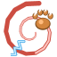{ .entry-move-icon loading=lazy } *Active*

The user charges spinning at full speed and strikes the first enemy they meet with a heavy claw that shocks it and throws it back. Needs Electro. Stronger in Sulong

| Stat | Value |
| --- | --- |
| Base damage | 14 HP |
| Cooldown | 0.65 s (13 ticks) |
| Electro charges | 2 |
| Sulong damage | 21 HP |
| Sulong cooldown | 6.5 s |
| Sulong Electro charges | 0 |

### Jaguar Mink { #mink-jaguar }

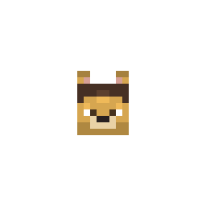{ .entry-move-icon }

Choose Jaguar for higher damage and an occasional bleed with bare fists. Juken Karajishi hits harder with a sword.

<!-- move racenomi:jaguar_mink_claws -->

#### Jaguar Mink Claws { #mink-jaguar-jaguar-mink-claws }

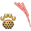{ .entry-move-icon loading=lazy } *Passive*

The user hits harder, and a bare-handed blow now and then leaves a bleeding wound

| Stat | Value |
| --- | --- |
| Base damage | 2 HP |
| Bleed | 3 s (60 ticks) |

<!-- move racenomi:juken_karajishi -->

#### Juken Karajishi { #mink-jaguar-juken-karajishi }

{ .entry-move-icon loading=lazy } *Active*

The user cuts across everything in front of them with a great slash charged with Electro, with what they hold or their claws, deeper with a sword. Needs Electro. Stronger in Sulong

| Stat | Value |
| --- | --- |
| Base damage | 14 HP |
| Cooldown | 0.5 s (10 ticks) |
| Electro charges | 2 |
| Sulong damage | 21 HP |
| Sulong cooldown | 5 s |
| Sulong Electro charges | 0 |
| Damage with a sword | 17.5 HP |
| Sulong damage with a sword | 26.25 HP |

### Polar Bear Mink { #mink-polar-bear }

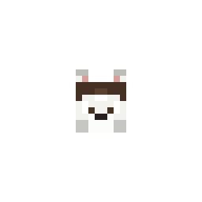{ .entry-move-icon }

Choose Polar Bear for cold protection, faster swimming, toughness and a grab. Its 1.50× body needs more room to move.

<!-- move racenomi:polar_bear_mink_fur -->

#### Polar Bear Mink Fur { #mink-polar-bear-polar-bear-mink-fur }

{ .entry-move-icon loading=lazy } *Passive*

The user is the biggest of the minks, sturdier, swims better, and the cold never freezes them

<!-- move racenomi:bear_hug -->

#### Bear Hug { #mink-polar-bear-bear-hug }

{ .entry-move-icon loading=lazy } *Active*

The user seizes the enemy in front of them in both arms and squeezes it with Electro, shocking it every half second, then lets it go. Hits on the user set it free. Needs Electro. Stronger in Sulong

| Stat | Value |
| --- | --- |
| Cooldown | 0.75 s (15 ticks) |
| Damage per catch or squeeze | 3 HP |
| Electro charges | 1 |
| Sulong damage per catch or squeeze | 4.5 HP |
| Sulong cooldown | 15 s |
| Sulong Electro charges | 0 |

### Bull Mink { #mink-bull }

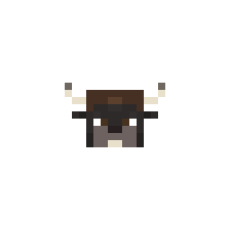{ .entry-move-icon }

Choose Bull for a strong running hit and knockback. Its 1.25× body is larger than most Minks.

<!-- move racenomi:bull_mink_charge -->

#### Bull Mink Charge { #mink-bull-bull-mink-charge }

{ .entry-move-icon loading=lazy } *Passive*

The user hits harder, stands firmer, and a blow struck at a run throws the target twice as far

| Stat | Value |
| --- | --- |
| Base damage | 2 HP |

<!-- move racenomi:mo_golova -->

#### Mo Golova { #mink-bull-mo-golova }

{ .entry-move-icon loading=lazy } *Active*

The user lunges head down and headbutts the first enemy they meet with Electro, paralysing it. Needs Electro. Stronger in Sulong

| Stat | Value |
| --- | --- |
| Base damage | 12 HP |
| Cooldown | 0.4 s (8 ticks) |
| Electro charges | 1 |
| Sulong damage | 18 HP |
| Sulong cooldown | 4 s |
| Sulong Electro charges | 0 |

## Lineage Factors

| Graft | Effect | Source |
| --- | --- | --- |
| { .entry-move-icon } Mink Lineage | The Lineage Factor of a mink gives the bearer a mink's legs, its ears and its tail: they run fast, leap high and land unhurt. | AkumaLib |
| { .entry-move-icon } Dog Mink Lineage | The Lineage Factor of a dog mink makes the bearer strike faster, and harder with each ally of their crew close by. | Race Race no Mi |
| { .entry-move-icon } Lion Mink Lineage | The Lineage Factor of a lion mink makes the bearer hit harder, and grows a mane around their head. | Race Race no Mi |
| { .entry-move-icon } Bunny Mink Lineage | The Lineage Factor of a bunny mink makes the bearer jump higher, run faster and land unhurt from higher up. | Race Race no Mi |
| { .entry-move-icon } Cat Mink Lineage | The Lineage Factor of a cat mink lets the bearer see in the dark and strike faster. | Race Race no Mi |
| { .entry-move-icon } Jaguar Mink Lineage | The Lineage Factor of a jaguar mink makes the bearer hit harder, and a bare-handed blow now and then leaves a bleeding wound. | Race Race no Mi |
| { .entry-move-icon } Polar Bear Mink Lineage | The Lineage Factor of a polar bear mink makes the bearer broad and sturdier, a better swimmer, and the cold never freezes them. | Race Race no Mi |
| { .entry-move-icon } Bull Mink Lineage | The Lineage Factor of a bull mink makes the bearer broad, hit harder and stand firmer, and a blow struck at a run throws the target twice as far. | Race Race no Mi |

See [grafting and capacity](../bloodlines/index.md#grafted-lineage-factors) before choosing a factor.

## Quests

See [the quest chapter](../../reference/quests/r_mink.md) for milestones and rewards.
