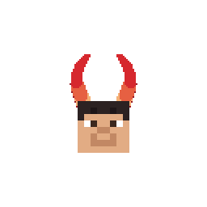
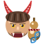

<!-- Generated by tools/build_pack_reference.py. Edit the pack sources and regenerate. -->

# Oni

{ .entry-page-icon }

[Races](index.md) · [Race Race no Mi](../../reference/content/racenomi.md)

Big horned folk who count as humans, nearly twice a man's height, they hit hard with bare hands and harder with a blunt weapon

| Stat | Value |
| --- | --- |
| Racial damage scaling | 1.00× at 10,000 Doriki → 1.40× at 50,000 Doriki |

[See combat stats](../combat-stats.md).

!!! note "Reading the stats"
    Listed base damage is for the named part of the move. Pack and Doriki multipliers are shown separately. Times assume 20 ticks per second.

<!-- move racenomi:demon_leap -->

## Demon Leap

{ .entry-move-icon loading=lazy } *Active*

The user jumps high onto the enemy they are looking at, landing hits them and a wave throws those around

| Stat | Value |
| --- | --- |
| Base damage | 12 HP |
| Wave damage | 6 HP |
| Cooldown | 16 s (320 ticks) |
| Conditional cooldown | 0.5 s (10 ticks) |

<!-- move racenomi:demon_quake -->

## Demon Quake

{ .entry-move-icon loading=lazy } *Active*

The user hits the ground, a shock throws up every enemy around, only on the ground

| Stat | Value |
| --- | --- |
| Base damage | 8 HP |
| Cooldown | 16 s (320 ticks) |

<!-- move racenomi:demon_skin -->

## Demon Skin

{ .entry-move-icon loading=lazy } *Active*

The user hardens for a few seconds, they take less damage and their blows push enemies further

| Stat | Value |
| --- | --- |
| Cooldown | 30 s (600 ticks) |
| Damage taken | -30% |
| Knockback of the blows | +50% |

<!-- move racenomi:demon_sweep -->

## Demon Sweep

{ .entry-move-icon loading=lazy } *Active*

The user swings all the way round, every enemy close is hit and thrown away

| Stat | Value |
| --- | --- |
| Base damage | 9 HP |
| Cooldown | 12 s (240 ticks) |

<!-- move racenomi:guard_breaker -->

## Guard Breaker

{ .entry-move-icon loading=lazy } *Active*

The next blow of the user comes down from above, it goes through part of the armor and breaks a guard

| Stat | Value |
| --- | --- |
| Base damage | 10 HP |
| Cooldown | 12 s (240 ticks) |
| Through Armor | +30% |

<!-- move racenomi:horn_toss -->

## Horn Toss

{ .entry-move-icon loading=lazy } *Active*

The user gores the nearest enemy and throws them up and behind, a body bigger than the user is not lifted

| Stat | Value |
| --- | --- |
| Base damage | 8 HP |
| Cooldown | 10 s (200 ticks) |
| Conditional cooldown | 0.5 s (10 ticks) |

<!-- move racenomi:oni_blood -->

## Oni Blood

{ .entry-move-icon loading=lazy } *Passive*

The user hits hard with bare hands and harder with a blunt weapon. Drink makes them stronger and tougher, up to level 5 of Drunk, and does not turn their head

| Stat | Value |
| --- | --- |
| Drunk damage | 0.1 HP |
| Bare-handed damage | +2 HP |
| Toughness | +1 |
| Damage with a blunt weapon | +20% |
| Damage for each level of Drunk | +10% |
| Resistance for each level of Drunk | +5% |

<!-- move racenomi:shock_fist -->

## Shock Fist

{ .entry-move-icon loading=lazy } *Active*

The user punches the air and a shock goes straight ahead, it hits and pushes every enemy on the line

| Stat | Value |
| --- | --- |
| Base damage | 7 HP |
| Cooldown | 9 s (180 ticks) |

## Lineage Factors

| Graft | Effect | Source |
| --- | --- | --- |
| { .entry-move-icon } Oni Lineage | The Lineage Factor of an Oni gives the bearer an Oni's horns and fists: they hit hard bare-handed and harder with a blunt weapon, and drink makes them stronger and tougher, up to level 5 of Drunk, and Drunk never makes them dizzy. | Race Race no Mi |

See [grafting and capacity](../bloodlines/index.md#grafted-lineage-factors) before choosing a factor.

## Quests

See [the quest chapter](../../reference/quests/r_oni.md) for milestones and rewards.
