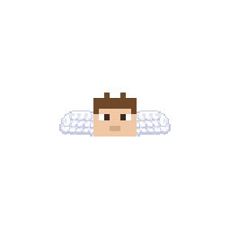
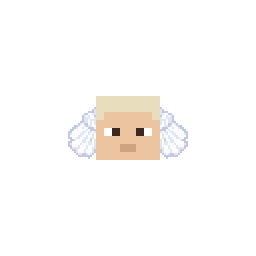
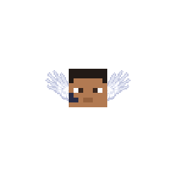

<!-- Generated by tools/build_pack_reference.py. Edit the pack sources and regenerate. -->

# Sky People

{ .entry-page-icon }

[Races](index.md) · [Race Race no Mi](../../reference/content/racenomi.md)

The peoples of the sky islands: wings on their backs, the dials of Skypiea in their hands, stronger the higher they stand.

**Variants**

- [Skypiean](#skypiean)
- [Birkan](#birkan)
- [Wingless Birkan](#wingless-birkan)
- [Shandia](#shandia)

| Stat | Value |
| --- | --- |
| Racial damage scaling | 1.00× at 10,000 Doriki → 1.40× at 50,000 Doriki |

[See combat stats](../combat-stats.md).

!!! note "Reading the stats"
    Listed base damage is for the named part of the move. Pack and Doriki multipliers are shown separately. Times assume 20 ticks per second.

<!-- move racenomi:axe_slash -->

## Axe Slash

{ .entry-move-icon loading=lazy } *Active*

The user swings the air of an Axe Dial out in one blade that cuts the first body it meets. Sharper with an Axe Dial

| Stat | Value |
| --- | --- |
| Base damage | 8 HP |
| Cooldown | 8 s (160 ticks) |

<!-- move racenomi:impact -->

## Impact

{ .entry-move-icon loading=lazy } *Active*

The user catches blows in an Impact Dial for a moment taking only half of them, then lets it all go in a shockwave around them. Stronger with an Impact Dial

| Stat | Value |
| --- | --- |
| Cooldown | 8 s (160 ticks) |
| Base damage | 8 HP |

<!-- move racenomi:sky_leap -->

## Sky Leap

{ .entry-move-icon loading=lazy } *Active*

The user beats their wings once and bounds forward and up. The landing does not hurt them. Needs wings

| Stat | Value |
| --- | --- |
| Short cooldown | 0.5 s (10 ticks) |
| Charge cooldown | 2 s (40 ticks) |

## Variants

### Skypiean { #skypiean }

{ .entry-move-icon }

Choose Skypiean for running speed and the largest Dial damage bonus. Breath Gale and Dial Blend extend your Dial moveset.

<!-- move racenomi:skypiean_body -->

#### Skypiean Body { #skypiean-skypiean-body }

{ .entry-move-icon loading=lazy } *Passive*

The user is light on their feet and runs faster. The higher in the sky the stronger it gets

| Stat | Value |
| --- | --- |
| Speed | +20% |

<!-- move racenomi:breath_gale -->

#### Breath Gale { #skypiean-breath-gale }

{ .entry-move-icon loading=lazy } *Active*

The user lets a Breath Dial go all at once, a gust that throws enemies back and sends their shots back. Stronger with a Breath Dial

| Stat | Value |
| --- | --- |
| Cooldown | 7 s (140 ticks) |
| Base damage | 4 HP |

<!-- move racenomi:dial_blend -->

#### Dial Blend { #skypiean-dial-blend }

{ .entry-move-icon loading=lazy } *Active*

The user lets Flash and Impact go together. It blinds and hits everyone around them. Stronger with a Flash Dial The user lets Breath and Flame go together. A burst of fire flies at what they look at. Stronger with a Flame Dial

| Stat | Value |
| --- | --- |
| Cooldown | 10 s (200 ticks) |
| Shock damage | 8 HP |
| Fire damage | 12 HP |
| Base damage | 8 HP |

### Birkan { #birkan }

{ .entry-move-icon }

Mantra is stronger up high. Wings let you use Sky Leap.

<!-- move racenomi:birkan_body -->

#### Birkan Body { #birkan-birkan-body }

{ .entry-move-icon loading=lazy } *Passive*

The user hits a bit harder and takes blows better. The higher in the sky the stronger it gets

| Stat | Value |
| --- | --- |
| Damage | +1 HP |
| Toughness | +1 |

<!-- move racenomi:mantra_mark -->

#### Mantra Mark { #birkan-mantra-mark }

{ .entry-move-icon loading=lazy } *Active*

The user reads the one they look at with their Mantra. For a while they see where it is even through walls and their next hit on it hurts more

| Stat | Value |
| --- | --- |
| Cooldown | 20 s (400 ticks) |

<!-- move racenomi:divine_stride -->

#### Divine Stride { #birkan-divine-stride }

{ .entry-move-icon loading=lazy } *Active*

The user bounds forward on their wings straight through the enemies in front, hitting each of them once. Needs wings

| Stat | Value |
| --- | --- |
| Cooldown | 10 s (200 ticks) |
| Base damage | 12 HP |

### Wingless Birkan { #wingless-birkan }

{ .entry-move-icon }

Stronger grounded Mantra with no altitude bonus. You can buy Sky Leap to meet later unlock requirements, but need wings to use it.

<!-- move racenomi:wingless_birkan_body -->

#### Wingless Body { #wingless-birkan-wingless-birkan-body }

{ .entry-move-icon loading=lazy } *Passive*

The user gave up their wings. The sky no longer lifts them but they hit harder than any Birkan

| Stat | Value |
| --- | --- |
| Base damage | 3 HP |

<!-- move racenomi:mantra_mark -->

#### Mantra Mark { #wingless-birkan-mantra-mark }

{ .entry-move-icon loading=lazy } *Active*

The user reads the one they look at with their Mantra. For a while they see where it is even through walls and their next hit on it hurts more

| Stat | Value |
| --- | --- |
| Cooldown | 20 s (400 ticks) |

### Shandia { #shandia }

{ .entry-move-icon }

Choose Shandia for a winged melee fighter with tougher armor and the War Cry and Berserker branch.

<!-- move racenomi:shandia_body -->

#### Shandia Body { #shandia-shandia-body }

{ .entry-move-icon loading=lazy } *Passive*

The user is a born warrior, they hit hard and take blows well. The higher in the sky the stronger it gets

| Stat | Value |
| --- | --- |
| Base damage | 3 HP |

<!-- move racenomi:war_cry -->

#### War Cry { #shandia-war-cry }

{ .entry-move-icon loading=lazy } *Active*

The user lets out a war cry. They and their allies around them hit harder for a while

| Stat | Value |
| --- | --- |
| Cooldown | 30 s (600 ticks) |

<!-- move racenomi:berserker -->

#### Berserker { #shandia-berserker }

{ .entry-move-icon loading=lazy } *Active*

The user goes wild for a few seconds, they hit harder and faster but their guard drops

| Stat | Value |
| --- | --- |
| Cooldown | 30 s (600 ticks) |

## Lineage Factors

| Graft | Effect | Source |
| --- | --- | --- |
| { .entry-move-icon } Sky People Lineage | The Lineage Factor of the sky people grows their wings on the bearer and gives them Mantra and a hand for dials: Observation grows faster and reaches further, dials work better. The higher in the sky the stronger it gets. | Race Race no Mi |
| { .entry-move-icon } Skypiean Lineage | The Lineage Factor of a Skypiean makes the bearer light on their feet, with a Skypiean's wings and antennae. The higher in the sky the stronger it gets. | Race Race no Mi |
| { .entry-move-icon } Birkan Lineage | The Lineage Factor of a Birkan makes the bearer hit a bit harder and take blows better, with a Birkan's wings. The higher in the sky the stronger it gets. | Race Race no Mi |
| { .entry-move-icon } Shandia Lineage | The Lineage Factor of a Shandia makes the bearer a born warrior, with a Shandia's wings. The higher in the sky the stronger it gets. | Race Race no Mi |

See [grafting and capacity](../bloodlines/index.md#grafted-lineage-factors) before choosing a factor.

## Quests

See [the quest chapter](../../reference/quests/r_sky_people.md) for milestones and rewards.
