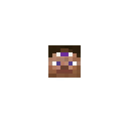

<!-- Generated by tools/build_pack_reference.py. Edit the pack sources and regenerate. -->

# Three-Eye

{ .entry-page-icon }

[Races](index.md) · [Haki Realm](../../reference/content/hakirework.md)

Observation awakens when you enter the Grand Line. Train techniques to reveal and anticipate enemies. The third eye can reveal the Voice of All Things.

| Stat | Value |
| --- | --- |
| Racial damage scaling | 1.00× at 10,000 Doriki → 1.40× at 50,000 Doriki |

[See combat stats](../combat-stats.md).

!!! note "Reading the stats"
    Listed base damage is for the named part of the move. Pack and Doriki multipliers are shown separately. Times assume 20 ticks per second.

<!-- move hakirework:piercing_gaze -->

## Piercing Gaze

{ .entry-move-icon loading=lazy }

The third eye fixed on one foe: they glow, seen through walls, and the user's blows on them hit a quarter harder.

| Stat | Value |
| --- | --- |
| Conditional cooldown | 15 s (300 ticks) |

<!-- move hakirework:third_eye -->

## Third Eye

{ .entry-move-icon loading=lazy }

The user opens their third eye: while it's open they sense everything nearby and sidestep more often. Opens at Observation 40.

| Stat | Value |
| --- | --- |
| Conditional cooldown | 10 s (200 ticks) |

<!-- move hakirework:foresight_step -->

## Foresight Step

{ .entry-move-icon loading=lazy }

The third eye sees the blow before it comes: the user blinks back and nothing touches them for a moment. Opens at Observation 60.

| Stat | Value |
| --- | --- |
| Conditional cooldown | 5 s (100 ticks) |

## Lineage Factors

See the [graft guide](../bloodlines/index.md#grafted-lineage-factors) for factors you can add to this character.

## Quests

See [the quest chapter](../../reference/quests/r_tribes.md) for milestones and rewards.
