<!-- Generated by tools/build_pack_reference.py. Edit the pack sources and regenerate. -->

# Wotan

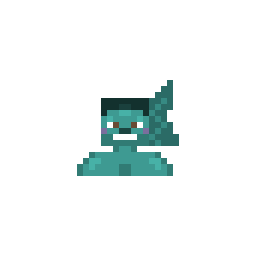{ .entry-page-icon }

[Races](index.md) · [Race Race no Mi](../../reference/content/racenomi.md)

Wotans combine Giant techniques and Fishman Karate. Their fish subtype supplies an additional passive.

**Variants**

- [Saw-shark Wotan](#wotan-sawshark)
- [Ray Wotan](#wotan-ray)
- [Garfish Wotan](#wotan-garfish)
- [Octopus Wotan](#wotan-octopus)
- [Whale Shark Wotan](#wotan-whale-shark)
- [Pufferfish Wotan](#wotan-pufferfish)
- [Hammerhead Wotan](#wotan-hammerhead)

| Stat | Value |
| --- | --- |
| Racial damage scaling | 1.00× at 10,000 Doriki → 1.40× at 50,000 Doriki |

[See combat stats](../combat-stats.md).

!!! note "Reading the stats"
    Listed base damage is for the named part of the move. Pack and Doriki multipliers are shown separately. Times assume 20 ticks per second.

<!-- move mineminenomi:kachiage_haisoku -->

## Kachiage Haisoku

{ .entry-move-icon loading=lazy } *Active*

The user delivers a powerful kick to the opponent's chin, which is stronger inside water

| Stat | Value |
| --- | --- |
| Cooldown | 8 s (160 ticks) |
| Base damage | 20 HP |

<!-- move mineminenomi:karakusagawara_seiken -->

## Karakusagawara Seiken

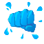{ .entry-move-icon loading=lazy } *Active*

The user punches the air, which sends a shockwave through water vapor in the air

| Stat | Value |
| --- | --- |
| Cooldown | 25 s (500 ticks) |
| Base damage | 20 HP |

<!-- move mineminenomi:mizu_osu -->

## Mizu Osu

{ .entry-move-icon loading=lazy } *Active*

Spits water with enough force to push away any enemy in front of the user.

| Stat | Value |
| --- | --- |
| Cooldown | 8 s (160 ticks) |

<!-- move mineminenomi:mizu_shuryudan -->

## Mizu Shuryudan

{ .entry-move-icon loading=lazy } *Active*

Launches multiple bubbles in the direction the user is looking, these bubbles will linger around until an enemy comes close to them at which point they'll start targeting the enemy and move toward them.

| Stat | Value |
| --- | --- |
| Cooldown | 12 s (240 ticks) |

<!-- move mineminenomi:mizu_taiho -->

## Mizu Taiho

{ .entry-move-icon loading=lazy } *Active*

Launches a giant bubble, dealing massive damage and exploding on contact.

| Stat | Value |
| --- | --- |
| Cooldown | 17 s (340 ticks) |

<!-- move mineminenomi:pack_of_sharks -->

## Pack of Sharks

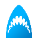{ .entry-move-icon loading=lazy } *Active*

The user fires densely compressed shark-shaped waterbullets at the opponent

| Stat | Value |
| --- | --- |
| Cooldown | 15 s (300 ticks) |

<!-- move mineminenomi:samehada_shotei -->

## Samehada Shotei

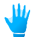{ .entry-move-icon loading=lazy } *Active*

The user concentrates their power to their palms, sending melee damage back to its owner and pushing them a few blocks back

| Stat | Value |
| --- | --- |
| Intrerupt cooldown | 10 s (200 ticks) |
| Min cooldown | 5 s (100 ticks) |
| Max cooldown | 20 s (400 ticks) |
| Base damage | 15 HP |

<!-- move mineminenomi:shark_on_tooth -->

## Shark on Tooth

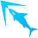{ .entry-move-icon loading=lazy } *Active*

Launches the user forward while spinning, biting the first enemy it comes in contact with.

| Stat | Value |
| --- | --- |
| Cooldown | 15 s (300 ticks) |
| Base damage | 40 HP |

<!-- move mineminenomi:two_fish_engine -->

## Two Fish Engine

{ .entry-move-icon loading=lazy } *Active*

Increases the user's swimming speed

| Stat | Value |
| --- | --- |
| Min cooldown | 5 s (100 ticks) |
| Max cooldown | 15 s (300 ticks) |

<!-- move mineminenomi:uchimizu -->

## Uchimizu

{ .entry-move-icon loading=lazy } *Active*

The user hurls big and fast water droplets at the opponent

| Stat | Value |
| --- | --- |
| Cooldown | 4 s (80 ticks) |

<!-- move mineminenomi:yarinami -->

## Yarinami

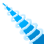{ .entry-move-icon loading=lazy } *Active*

The user fires a densely compressed spear-shaped waterbullet at the opponent

| Stat | Value |
| --- | --- |
| Cooldown | 12 s (240 ticks) |

<!-- move racenomi:fishman_body -->

## Fishman Body

{ .entry-move-icon loading=lazy } *Passive*

The user swims fast and breathes and sees under water

| Stat | Value |
| --- | --- |
| Swim speed | +200% |

<!-- move racenomi:boulder_throw -->

## Boulder Throw

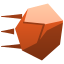{ .entry-move-icon loading=lazy } *Active*

The user tears a boulder out of the ground in front of them and lifts it over their head, used again it is thrown where they look and bursts on what it hits The hole closes after a while

| Stat | Value |
| --- | --- |
| Base damage | 14 HP |
| Cooldown | 12 s (240 ticks) |
| Conditional cooldown | 0.5 s (10 ticks) |

<!-- move racenomi:elbaf_charge -->

## Elbaf Charge

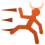{ .entry-move-icon loading=lazy } *Active*

The user charges straight ahead and hits every enemy on the way, the ones half their size or less are thrown aside Blocks are not broken, a wall stops the charge. Only works standing up

| Stat | Value |
| --- | --- |
| Base damage | 8 HP |
| Cooldown | 8.9 s (178 ticks) |

<!-- move racenomi:elbaf_roar -->

## Roar of Elbaf

{ .entry-move-icon loading=lazy } *Active*

The user roars and enemies half their size or less around them are slowed and weakened, the user and their crew or faction hit harder for a while

| Stat | Value |
| --- | --- |
| Cooldown | 22.2 s (444 ticks) |
| Slow and weak seconds | 4 s |
| Strength seconds | 10 s |

<!-- move racenomi:giant_grip -->

## Giant's Grip

{ .entry-move-icon loading=lazy } *Active*

The user grabs a body in their fist and holds it, press again to throw it where they look. Too big a body cannot be held, getting hit makes them let go

| Stat | Value |
| --- | --- |
| Base damage | 10 HP |
| Cooldown | 15 s (300 ticks) |

<!-- move racenomi:giant_stomp -->

## Stomp

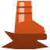{ .entry-move-icon loading=lazy } *Active*

The user brings their foot down and the ground shakes, those at their feet are hurt and thrown up and back. Bigger the bigger they are

| Stat | Value |
| --- | --- |
| Base damage | 10 HP |
| Cooldown | 10 s (200 ticks) |

<!-- move racenomi:hakoku -->

## Hakoku

{ .entry-move-icon loading=lazy } *Active*

The strike of Elbaf's warriors, the user swings a cut that flies straight on and goes through every body on its way. Needs a weapon

| Stat | Value |
| --- | --- |
| Base damage | 20 HP |
| Cooldown | 15 s (300 ticks) |

<!-- move racenomi:shoulder_carry -->

## Shoulder Carry

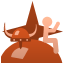{ .entry-move-icon loading=lazy } *Passive*

The user takes a crouching player at least twice smaller on their shoulder with an empty hand, the one carried crouches to get down

## Variants

### Saw-shark Wotan { #wotan-sawshark }

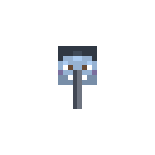{ .entry-move-icon }

A Wotan of the saw-shark, whose bare fists hit harder and leave bleeding wounds.

<!-- move racenomi:sawshark_body -->

#### Saw-shark Body { #wotan-sawshark-sawshark-body }

{ .entry-move-icon loading=lazy } *Passive*

The user hits harder, and a bare-fisted blow now and then leaves a bleeding wound

| Stat | Value |
| --- | --- |
| Added melee damage | 3 HP |
| Bleed chance on an eligible hit | 5% |
| Bleed | 3 s (60 ticks) |
| Bare-handed damage | +3 HP |

### Ray Wotan { #wotan-ray }

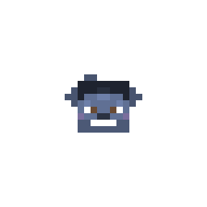{ .entry-move-icon }

A Wotan of the ray, a master of Fishman Karate, sturdy, whose bare hands hit harder and faster.

<!-- move racenomi:ray_body -->

#### Ray Body { #wotan-ray-ray-body }

{ .entry-move-icon loading=lazy } *Passive*

The user is a master of Fishman Karate: sturdier than other fishmen, and their bare-handed blows hit harder and faster

| Stat | Value |
| --- | --- |
| Base damage | 2 HP |
| Armor toughness | +1 |
| Bare-handed damage | +2 HP |
| Bare-handed attack speed | +25% of base |

### Garfish Wotan { #wotan-garfish }

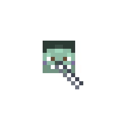{ .entry-move-icon }

A Wotan of the garfish, the swiftest of them in the water.

<!-- move racenomi:garfish_body -->

#### Garfish Body { #wotan-garfish-garfish-body }

{ .entry-move-icon loading=lazy } *Passive*

The user is the swiftest of the fishmen in the water

| Stat | Value |
| --- | --- |
| Swim speed | +100% of base |

### Octopus Wotan { #wotan-octopus }

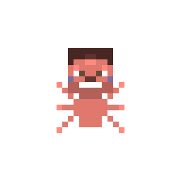{ .entry-move-icon }

A Wotan of the octopus, whose six arms strike faster, armed or not.

<!-- move racenomi:octopus_body -->

#### Octopus Body { #wotan-octopus-octopus-body }

{ .entry-move-icon loading=lazy } *Passive*

The user's six arms strike faster, armed or not

| Stat | Value |
| --- | --- |
| Attack speed (armed or unarmed) | +30% of base |

### Whale Shark Wotan { #wotan-whale-shark }

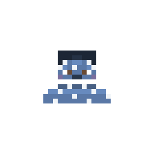{ .entry-move-icon }

A Wotan of the whale shark, broad, sturdy and hard to bring down.

<!-- move racenomi:whale_shark_body -->

#### Whale Shark Body { #wotan-whale-shark-whale-shark-body }

{ .entry-move-icon loading=lazy } *Passive*

The user is the biggest of the fishmen, sturdier and harder to bring down

| Stat | Value |
| --- | --- |
| Armor toughness | +2 |
| Maximum health from passive | +4 HP |

### Pufferfish Wotan { #wotan-pufferfish }

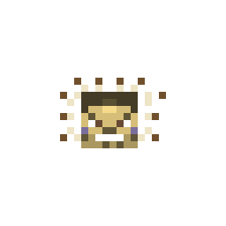{ .entry-move-icon }

A Wotan of the pufferfish, whose spines prick and now and then poison whoever strikes up close.

<!-- move racenomi:pufferfish_body -->

#### Pufferfish Body { #wotan-pufferfish-pufferfish-body }

{ .entry-move-icon loading=lazy } *Passive*

The user's spines prick whoever strikes them up close, and now and then poison them

| Stat | Value |
| --- | --- |
| Spine damage | 2 HP |
| Spine damage on an eligible hit | 2 HP |
| Poison chance | 25% |
| Poison duration | 3 s (60 ticks) |

### Hammerhead Wotan { #wotan-hammerhead }

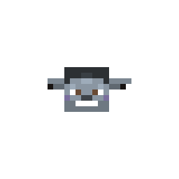{ .entry-move-icon }

A Wotan of the hammerhead, whose blows hit harder and throw further back.

<!-- move racenomi:hammerhead_body -->

#### Hammerhead Body { #wotan-hammerhead-hammerhead-body }

{ .entry-move-icon loading=lazy } *Passive*

The user's blows hit harder and throw the target further back

| Stat | Value |
| --- | --- |
| Base damage | 2 HP |
| Melee damage | +2 HP |
| Knockback strength | 1.5 |

## Lineage Factors

| Graft | Effect | Source |
| --- | --- | --- |
| 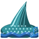{ .entry-move-icon } Wotan Lineage | The Lineage Factor of a Wotan gives the bearer a giant's frame made for the sea and a dorsal fin. | Race Race no Mi |
| 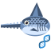{ .entry-move-icon } Saw-shark Lineage | The Lineage Factor of a saw-shark fishman makes the bearer hit harder, and a bare-fisted blow now and then leaves a bleeding wound. | Race Race no Mi |
| 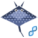{ .entry-move-icon } Ray Lineage | The Lineage Factor of a ray fishman makes the bearer a born karateka: sturdier, and their bare-handed blows hit harder and faster. | Race Race no Mi |
| 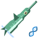{ .entry-move-icon } Garfish Lineage | The Lineage Factor of a garfish fishman makes the bearer swift in the water. | Race Race no Mi |
| 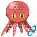{ .entry-move-icon } Octopus Lineage | The Lineage Factor of an octopus fishman grows two more arms on the bearer, and they strike faster, armed or not. | Race Race no Mi |
| 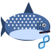{ .entry-move-icon } Whale Shark Lineage | The Lineage Factor of a whale shark fishman makes the bearer broad, sturdier and harder to bring down. | Race Race no Mi |
| 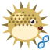{ .entry-move-icon } Pufferfish Lineage | The Lineage Factor of a pufferfish fishman covers the bearer in spines that prick whoever strikes them up close, and now and then poison them. | Race Race no Mi |
| 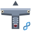{ .entry-move-icon } Hammerhead Lineage | The Lineage Factor of a hammerhead fishman makes the bearer's blows hit harder and throw the target further back. | Race Race no Mi |

See [grafting and capacity](../bloodlines/index.md#grafted-lineage-factors) before choosing a factor.

## Quests

See [the quest chapter](../../reference/quests/r_wotan.md) for milestones and rewards.
