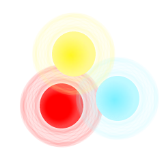

<!-- Generated by tools/build_pack_reference.py. Edit the pack sources and regenerate. -->

# Art of Weather

{ .entry-page-icon }

[All fighting styles](index.md) · [Mine Mine no Mi](../../reference/content/mineminenomi.md)

| Stat | Value |
| --- | --- |
| Style damage at 10,000 Doriki | 1.00× |
| At 50,000 Doriki with a fruit | 1.50× |
| At 50,000 Doriki while fruitless | 2.50× |
| At 50,000 Doriki with an eligible all-fruitless crew | 2.75× |

[See combat stats](../combat-stats.md).

!!! note "Reading the stats"
    Listed base damage is for the named part of the move. Pack and Doriki multipliers are shown separately. Times assume 20 ticks per second.

<!-- move mineminenomi:cool_ball -->

## Cool Ball

{ .entry-move-icon loading=lazy } *Active*

Launch a Cool Ball from your Clima Tact to use for different Tempos SHIFT-USE: Loads the ball into the clima tact

<!-- move mineminenomi:gust_sword -->

## Gust Sword

{ .entry-move-icon loading=lazy } *Active*

Fires a concentrated wind blast forward, knocking back all enemies that it comes in contact with

| Stat | Value |
| --- | --- |
| Cooldown | 0.5 s (10 ticks) |
| Base damage | 2 HP |

<!-- move mineminenomi:heat_ball -->

## Heat Ball

{ .entry-move-icon loading=lazy } *Active*

Launch a Heat Ball from your Clima Tact to use for different Tempos SHIFT-USE: Loads the ball into the clima tact

<!-- move mineminenomi:thunder_ball -->

## Thunder Ball

{ .entry-move-icon loading=lazy } *Active*

Launch a Thunder Ball from your Clima Tact to use for different Tempos SHIFT-USE: Loads the ball into the clima tact

<!-- move mineminenomi:weather_egg -->

## Weather Egg

{ .entry-move-icon loading=lazy } *Active*

Instantly creates a Weather Cloud as if combining a Cool Ball and a Heat Ball

| Stat | Value |
| --- | --- |
| Cooldown | 16 s (320 ticks) |

<!-- move mineminenomi:cyclone_tempo -->

## Cyclone Tempo

*Passive*

Used to create a small cyclone surrounding the user, pushes enemies away from the user while also providing a small protection against physical damage

<!-- move mineminenomi:fog_tempo -->

## Fog Tempo

*Passive*

Creates a thick fog at the user's position, blinding all nearby enemies as well

<!-- move mineminenomi:heat_egg_tempo -->

## Heat Egg Tempo

*Passive*

Used to imbue the Clima Tact with Heat Balls, while active it doubles the physical damage dealt by the clima tact

<!-- move mineminenomi:mirage_tempo -->

## Mirage Tempo

*Passive*

Creates several clones of the user

<!-- move mineminenomi:rain_tempo -->

## Rain Tempo

*Passive*

Creates rain

Calls rain in the area around the weather cloud.

<!-- move mineminenomi:thunder_lance_tempo -->

## Thunder Lance Tempo

*Passive*

Creates a lighting bolt that goes directly to the area the user is pointing at, exploding on impact and hurting entities in its path

| Stat | Value |
| --- | --- |
| Damage with local thunder over caster | 1.25× |

<!-- move mineminenomi:thunderbolt_tempo -->

## Thunderbolt Tempo

*Passive*

Hits a single enemy below the cloud with lightning bolt

| Stat | Value |
| --- | --- |
| Damage with local thunder over caster | 1.25× |

<!-- move mineminenomi:thunderstorm_tempo -->

## Thunderstorm Tempo

*Passive*

Hits multiple enemies below the cloud with multiple lightning bolts

Creates a local thunderstorm at the weather cloud for 60 seconds.

| Stat | Value |
| --- | --- |
| Damage with local thunder over caster | 1.25× |

<!-- move mineminenomi:weather_cloud_tempo -->

## Weather Cloud Tempo

*Passive*

Creates a cloud that can further be used by other Tempos

<!-- move hakirework:swing_arm -->

## Thunder Charge: Swing Arm

{ .entry-move-icon loading=lazy }

Art of Weather. The Clima-Tact charged with electricity and swung through everyone in front: they're struck and paralyzed. Needs a Clima-Tact.

| Stat | Value |
| --- | --- |
| Conditional cooldown | 8 s (160 ticks) |

<!-- move hakirework:zeus_breeze_tempo -->

## Zeus Breeze Tempo

{ .entry-move-icon loading=lazy }

Art of Weather. Storm clouds gather over the Clima-Tact, then one huge thunderbolt falls where the user looks, paralyzing everyone near. Needs a Clima-Tact.

| Stat | Value |
| --- | --- |
| Conditional cooldown | 45 s (900 ticks) |

<!-- move eternalvoyage:tornado_tempo -->

## Tornado Tempo

{ .entry-move-icon loading=lazy } *Active*

Spins up a real tornado a few steps ahead that follows where you point for 30 seconds, catching and battering the enemies it reaches. You and your crew are never caught. It takes in what it meets: fire makes a Firenado, sand a Sandstorm, the sea a Waterspout, lightning bolts down the funnel, frost a Blizzard (fire, sand, lightning, water or ice moves flown into it, Heat, Cool or Thunder Balls, Blizzard Tempo, or the ground under it)

| Stat | Value |
| --- | --- |
| Weather Ball sequence | Cool → Heat → Cool |
| Required technique | Cyclone Tempo |
| Doriki to learn | 3,500 |
| Technology points | 10 |
| Cooldown from cast | 15 s |
| Duration | 30 s |
| Base damage per eligible hit | 8 HP |
| Firenado bonus per eligible hit | +6 HP |
| Sandstorm damage | 4 HP |
| Blizzard damage | 5 HP |
| Lightning strike damage | 24 HP |

<!-- move eternalvoyage:blizzard_tempo -->

## Blizzard Tempo

{ .entry-move-icon loading=lazy } *Active*

Brings a blizzard down where you point for 30 seconds: the enemies inside freeze, slow down and suffer frostbite. Cast on your own tornado, it turns the tornado to a blizzard

| Stat | Value |
| --- | --- |
| Weather Ball sequence | Cool → Cool → Thunder |
| Required technique | Cyclone Tempo |
| Doriki to learn | 4,500 |
| Technology points | 10 |
| Cooldown from cast | 15 s |
| Duration | 30 s |
| Base damage per eligible hit | 6 HP |

<!-- move eternalvoyage:supercell_tempo -->

## Supercell Tempo

{ .entry-move-icon loading=lazy } *Active*

Grows a storm cell over the spot you point at: rain at first, then a thunderstorm whose lightning seeks out the enemies under it, then hail that batters and slows them. It lasts about 48 seconds

| Stat | Value |
| --- | --- |
| Weather Ball sequence | Heat → Cool → Thunder |
| Required technique | Thunderstorm Tempo |
| Doriki to learn | 6,000 |
| Technology points | 15 |
| Cooldown from cast | 30 s |
| Duration | 48 s |
| Thunder begins | 4 s after casting |
| Hail begins | 28 s after casting |
| Base lightning damage | 30 HP |
| Base hail damage | 4 HP |
| Damage with local thunder over caster | 1.25× |

## Quests

See [the quest chapter](../../reference/quests/st_art_of_weather.md) for milestones and rewards.
