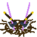
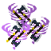

<!-- Generated by tools/build_pack_reference.py. Edit the pack sources and regenerate. -->

# Axe Style

{ .entry-page-icon }

[All fighting styles](index.md) · [Blitz Utility](../../reference/content/blitzutility.md)

| Stat | Value |
| --- | --- |
| Style damage at 10,000 Doriki | 1.00× |
| At 50,000 Doriki with a fruit | 1.50× |
| At 50,000 Doriki while fruitless | 2.50× |
| At 50,000 Doriki with an eligible all-fruitless crew | 2.75× |

[See combat stats](../combat-stats.md).

!!! note "Reading the stats"
    Listed base damage is for the named part of the move. Pack and Doriki multipliers are shown separately. Times assume 20 ticks per second.

<!-- move blitzutility:aka_oni_no_ichigeki -->

## Aka Oni no Ichigeki

{ .entry-move-icon loading=lazy } *Active*

With a single axe held out, the user turns in one massive spin. A tornado pulse rolls outward from them, cutting down and blasting away everyone it reaches. Only needs one axe.

| Stat | Value |
| --- | --- |
| Cooldown | 20 s (400 ticks) |
| Base damage | 30 HP |

<!-- move blitzutility:futenraku -->

## Futenraku

{ .entry-move-icon loading=lazy } *Active*

The user crosses both axes behind their head, then tears them apart in one bisecting slash that sends a colossal blade across the battlefield, dazing everyone it cuts through. Breaks the target's guard. Requires an axe in each hand.

| Stat | Value |
| --- | --- |
| Cooldown | 15 s (300 ticks) |
| Base damage | 25 HP |
| Conditional cooldown | 3.75 s (75 ticks) |

<!-- move blitzutility:kamakiri_buppo_torobai -->

## Kamakiri Buppo: Torobai

{ .entry-move-icon loading=lazy } *Active*

Like a charging mantis, the user barrels forward with both axes spinning, devouring everything around them. Requires an axe in each hand.

| Stat | Value |
| --- | --- |
| Cooldown | 20 s (400 ticks) |
| Base damage | 15 HP |

<!-- move blitzutility:x_calibur -->

## X-Calibur

{ .entry-move-icon loading=lazy } *Active*

The user raises both axes overhead and slams them down, cleaving everything in a cone in front of them and leaving them bleeding. Breaks the target's guard. Free for Axe Style users to learn from the skill tree. Requires an axe in each hand.

| Stat | Value |
| --- | --- |
| Cooldown | 25 s (500 ticks) |
| Base damage | 35 HP |
| Bleed | 3 s (60 ticks) |

<!-- move blitzutility:yachitakeru -->

## Yachitakeru

{ .entry-move-icon loading=lazy } *Active*

Pouring their Conqueror's Haki into both axes, the user unleashes a storm of massive air blades that bursts outward in every direction. Requires an axe in each hand and Haoshoku Infusion to use.

| Stat | Value |
| --- | --- |
| Base damage | 24 HP |
| Cooldown | 40 s (800 ticks) |

<!-- move blitzutility:yasotakeru -->

## Yasotakeru

{ .entry-move-icon loading=lazy } *Active*

The user slashes both axes in a frenzy, firing wave after wave of cutting air blades in front of them. Requires an axe in each hand.

| Stat | Value |
| --- | --- |
| Base damage | 14 HP |
| Cooldown | 25 s (500 ticks) |

## Quests

See [the quest chapter](../../reference/quests/st_weapon_arts.md) for milestones and rewards.
