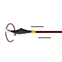
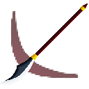
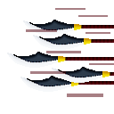

<!-- Generated by tools/build_pack_reference.py. Edit the pack sources and regenerate. -->

# Bisento Style

{ .entry-page-icon }

[All fighting styles](index.md) · [Blitz Utility](../../reference/content/blitzutility.md)

| Stat | Value |
| --- | --- |
| Style damage at 10,000 Doriki | 1.00× |
| At 50,000 Doriki with a fruit | 1.50× |
| At 50,000 Doriki while fruitless | 2.50× |
| At 50,000 Doriki with an eligible all-fruitless crew | 2.75× |

[See combat stats](../combat-stats.md).

!!! note "Reading the stats"
    Listed base damage is for the named part of the move. Pack and Doriki multipliers are shown separately. Times assume 20 ticks per second.

<!-- move blitzutility:gura_weapon_imbue -->

## Gura Weapon Imbue

{ .entry-move-icon loading=lazy } *Active*

The user wraps their pole-arm in a trembling quake bubble. The next Bisento technique doubles its reach and knockback, deals 15 extra damage and pierces all armor. Using any other technique or swinging ends the imbue. Landing a blow with the imbued weapon bursts the bubble on the target like Shingen no Ichigeki. Unlocked by mastering every Bisento technique while having eaten the Gura Gura no Mi. Requires a spear or pole-arm.

| Stat | Value |
| --- | --- |
| Cooldown | 5 s (100 ticks) |
| Bonus damage | 15 HP |
| Strike damage | 10 HP |
| Base damage | 15 HP |

<!-- move blitzutility:koin_ryusui -->

## Koin Ryusui

{ .entry-move-icon loading=lazy } *Active*

The user whirls their pole-arm in a circle behind them, then rushes forward in a single flowing strike that cuts clean through anyone in the way. Ignores armor. Free for Bisento Style users to learn from the skill tree. Requires a spear or pole-arm.

| Stat | Value |
| --- | --- |
| Cooldown | 14 s (280 ticks) |
| Base damage | 25 HP |

<!-- move blitzutility:naginata_defense -->

## Naginata Defense

{ .entry-move-icon loading=lazy } *Active*

The user plants their feet and spins their pole-arm into a whirling wall in front of them, blocking every incoming attack and knocking projectiles out of the air. The user cannot move while guarding. Guard breaking attacks shatter the stance. Requires a spear or pole-arm.

| Stat | Value |
| --- | --- |
| Cooldown | 30 s (600 ticks) |

<!-- move blitzutility:naginata_jihibiki -->

## Naginata Jihibiki

*Active*

The user raises their pole-arm and drives its butt into the ground, sending a tremor through the earth that throws everyone standing nearby off their feet. Requires a spear or pole-arm.

| Stat | Value |
| --- | --- |
| Cooldown | 15 s (300 ticks) |
| Base damage | 25 HP |

<!-- move blitzutility:naginata_muso -->

## Naginata Muso

{ .entry-move-icon loading=lazy } *Active*

The user plants their feet and carves a huge sweep in front of them with their pole-arm, cutting through armor and hurling everyone it catches away. Requires a spear or pole-arm.

| Stat | Value |
| --- | --- |
| Cooldown | 15 s (300 ticks) |
| Base damage | 25 HP |

<!-- move blitzutility:pin_point_barrage -->

## Pin Point Barrage

{ .entry-move-icon loading=lazy } *Active*

The user unleashes a storm of lightning-fast thrusts, each one striking with the full weight of the weapon they hold and driving their foes back. Use again to stop early. Requires a spear or pole-arm.

| Stat | Value |
| --- | --- |
| Cooldown | 10 s (200 ticks) |
| Max thrust damage | 5 HP |

<!-- move blitzutility:vaulting -->

## Vaulting

{ .entry-move-icon loading=lazy } *Active*

The user plants their pole-arm and vaults high into the air, shaking the ground around them as they take off and again when they land. Requires a spear or pole-arm.

| Stat | Value |
| --- | --- |
| Cooldown | 12 s (240 ticks) |
| Base damage | 20 HP |

## Quests

See [the quest chapter](../../reference/quests/st_weapon_arts.md) for milestones and rewards.
