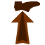
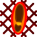
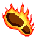
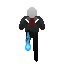

<!-- Generated by tools/build_pack_reference.py. Edit the pack sources and regenerate. -->

# Black Leg

{ .entry-page-icon }

[All fighting styles](index.md) · [Mine Mine no Mi](../../reference/content/mineminenomi.md)

| Stat | Value |
| --- | --- |
| Style damage at 10,000 Doriki | 1.00× |
| At 50,000 Doriki with a fruit | 1.50× |
| At 50,000 Doriki while fruitless | 2.50× |
| At 50,000 Doriki with an eligible all-fruitless crew | 2.75× |

[See combat stats](../combat-stats.md).

!!! note "Reading the stats"
    Listed base damage is for the named part of the move. Pack and Doriki multipliers are shown separately. Times assume 20 ticks per second.

<!-- move mineminenomi:antimanner_kick_course -->

## Anti-Manner Kick Course

{ .entry-move-icon loading=lazy } *Active*

Kicks an enemy and launches them vertically

| Stat | Value |
| --- | --- |
| Cooldown | 12 s (240 ticks) |

<!-- move mineminenomi:bien_cuit_grill_shot -->

## Bien Cuit: Grill Shot

{ .entry-move-icon loading=lazy } *Active*

A strong kick that launches the user forwards and creates a grill-patterened particle to appear, which sets anyone touching it on fire

| Stat | Value |
| --- | --- |
| Cooldown | 20 s (400 ticks) |
| Base damage | 30 HP |

<!-- move mineminenomi:black_leg_passive_bonus -->

## Black Leg Passive Bonuses

*Passive*

<!-- move mineminenomi:concasse -->

## Concasse

{ .entry-move-icon loading=lazy } *Active*

Leaps forward kicking all nearby enemies for moderate damage and knocking them down

| Stat | Value |
| --- | --- |
| Cooldown | 15 s (300 ticks) |
| Base damage | 15 HP |

<!-- move mineminenomi:diable_jambe -->

## Diable Jambe

{ .entry-move-icon loading=lazy } *Active*

The user heats up their leg, dealing additional damage and enhancing other Blackleg abilities

| Stat | Value |
| --- | --- |
| Min cooldown | 4 s (80 ticks) |
| Max cooldown | 34 s (680 ticks) |

<!-- move mineminenomi:extra_hachis -->

## Extra Hachis

{ .entry-move-icon loading=lazy } *Active*

Launches a rapid barrage of kicks

| Stat | Value |
| --- | --- |
| Normal cooldown | 12 s (240 ticks) |
| Poele a frire cooldown | 15 s (300 ticks) |
| Projectile hit | 10 HP |

<!-- move mineminenomi:party_table_kick_course -->

## Party-Table Kick Course

{ .entry-move-icon loading=lazy } *Active*

The user does a hand stand on the ground, legs spread out spinning and dealing damage to all nearby enemies

| Stat | Value |
| --- | --- |
| Cooldown | 12 s (240 ticks) |
| Base damage | 25 HP |

<!-- move mineminenomi:skywalk -->

## Skywalk

{ .entry-move-icon loading=lazy } *Active*

Allows the user to kick the air beneath them and launch themselves into the air

| Stat | Value |
| --- | --- |
| Short cooldown | 0.5 s (10 ticks) |
| Long cooldown | 2.5 s (50 ticks) |

<!-- move hakirework:mouton_shot -->

## Mouton Shot

{ .entry-move-icon loading=lazy }

Black Leg. A straight kick to the body of the one in front that sends them flying; with Diable Jambe it burns.

| Stat | Value |
| --- | --- |
| Conditional cooldown | 6 s (120 ticks) |

<!-- move hakirework:hell_memories -->

## Hell Memories

{ .entry-move-icon loading=lazy }

Black Leg. Sanji's anger set loose through his burning leg: a pillar of fire erupts and a wall of flame rolls out, burning and throwing everyone. Needs Diable Jambe.

| Stat | Value |
| --- | --- |
| Conditional cooldown | 20 s (400 ticks) |

<!-- move blitzutility:ifrit_jambe -->

## Ifrit Jambe

{ .entry-move-icon loading=lazy } *Active*

The user heats up their legs even more than Diable Jambe, coating them in blue flames that deal additional damage and turn the flames of other Blackleg abilities blue. Requires Busoshoku Haki: Internal Destruction to be active.

| Stat | Value |
| --- | --- |
| Min cooldown | 4 s (80 ticks) |
| Frozen cooldown | 8 s (160 ticks) |

<!-- move blitzutility:beouf_burst -->

## Beouf Burst

{ .entry-move-icon loading=lazy } *Active*

The user does a dash into a flying kick towards a target, if successful they kick the target again knocking them away. Requires Busoshoku Haki: Internal Destruction and Ifrit Jambe to be active.

| Stat | Value |
| --- | --- |
| Cooldown | 10 s (200 ticks) |
| Dash damage | 30 HP |
| Kick damage | 25 HP |

## Quests

See [the quest chapter](../../reference/quests/st_black_leg.md) for milestones and rewards.
