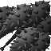
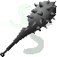
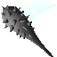
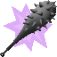
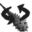

<!-- Generated by tools/build_pack_reference.py. Edit the pack sources and regenerate. -->

# Bludgeon Style

{ .entry-page-icon }

[All fighting styles](index.md) · [Cart Addon](../../reference/content/cartaddon.md)

| Stat | Value |
| --- | --- |
| Style damage at 10,000 Doriki | 1.00× |
| At 50,000 Doriki with a fruit | 1.50× |
| At 50,000 Doriki while fruitless | 2.50× |
| At 50,000 Doriki with an eligible all-fruitless crew | 2.75× |

[See combat stats](../combat-stats.md).

!!! note "Reading the stats"
    Listed base damage is for the named part of the move. Pack and Doriki multipliers are shown separately. Times assume 20 ticks per second.

<!-- move cartaddon:continuous_smashing -->

## Continuous Smashing

{ .entry-move-icon loading=lazy } *Active*

The user slams down their mace continuously

| Stat | Value |
| --- | --- |
| Long cooldown | 15 s (300 ticks) |
| Short cooldown | 0.5 s (10 ticks) |
| Base damage | 15 HP |

<!-- move cartaddon:destroyer_of_death_thunder_bagua -->

## Destroyer of Death Thunder Bagua

{ .entry-move-icon loading=lazy } *Active*

The user rushes towards their target, dealing massive damage. Applies dizzy, and knocks the opponent downwards. (Fruitless)

| Stat | Value |
| --- | --- |
| Cooldown | 45 s (900 ticks) |
| Base damage | 110 HP |

<!-- move cartaddon:home_run -->

## Home Run

{ .entry-move-icon loading=lazy } *Active*

The user slams their blunt weapon into their opponent, sending them flying

| Stat | Value |
| --- | --- |
| Cooldown | 15 s (300 ticks) |
| Base damage | 30 HP |

<!-- move cartaddon:kundali_dragon_swarm -->

## Kundali Dragon Swarm

{ .entry-move-icon loading=lazy } *Active*

The user lets out a barrage of their blunt weapon, dealing damage to all those that oppose them.

| Stat | Value |
| --- | --- |
| Cooldown | 10 s (200 ticks) |

<!-- move cartaddon:shinsoku_hakujaku -->

## Shinsoku Hakujaku

{ .entry-move-icon loading=lazy } *Active*

The user dashes and drags nearby targets. At the end of this ability, the user fires a White Serpent that applies dizzy and knockback. (Fruitless)

| Stat | Value |
| --- | --- |
| Cooldown | 40 s (800 ticks) |
| Base damage | 40 HP |

<!-- move cartaddon:striking_swing -->

## Striking Swing

{ .entry-move-icon loading=lazy } *Active*

The user's next hit is heavier

| Stat | Value |
| --- | --- |
| Cooldown | 8 s (160 ticks) |
| Base damage | 40 HP |

<!-- move cartaddon:thunder_bagua -->

## Thunder Bagua

{ .entry-move-icon loading=lazy } *Active*

The user dashes forward and bashes their target, sending them flying.

| Stat | Value |
| --- | --- |
| Cooldown | 14 s (280 ticks) |
| Base damage | 40 HP |

<!-- move cartaddon:vajra_arrow -->

## Vajra Arrow

{ .entry-move-icon loading=lazy } *Active*

The user fires a long-range projectile-like shockwave at their opponent.

| Stat | Value |
| --- | --- |
| Base damage | 75 HP |
| Cooldown | 25 s (500 ticks) |

<!-- move cartaddon:whirling_mace -->

## Whirling Mace

{ .entry-move-icon loading=lazy } *Active*

The user spins around hitting all nearby enemies with their blunt weapon.

| Stat | Value |
| --- | --- |
| Cooldown | 12 s (240 ticks) |
| Base damage | 10 HP |

## Quests

See [the quest chapter](../../reference/quests/st_weapon_arts.md) for milestones and rewards.
